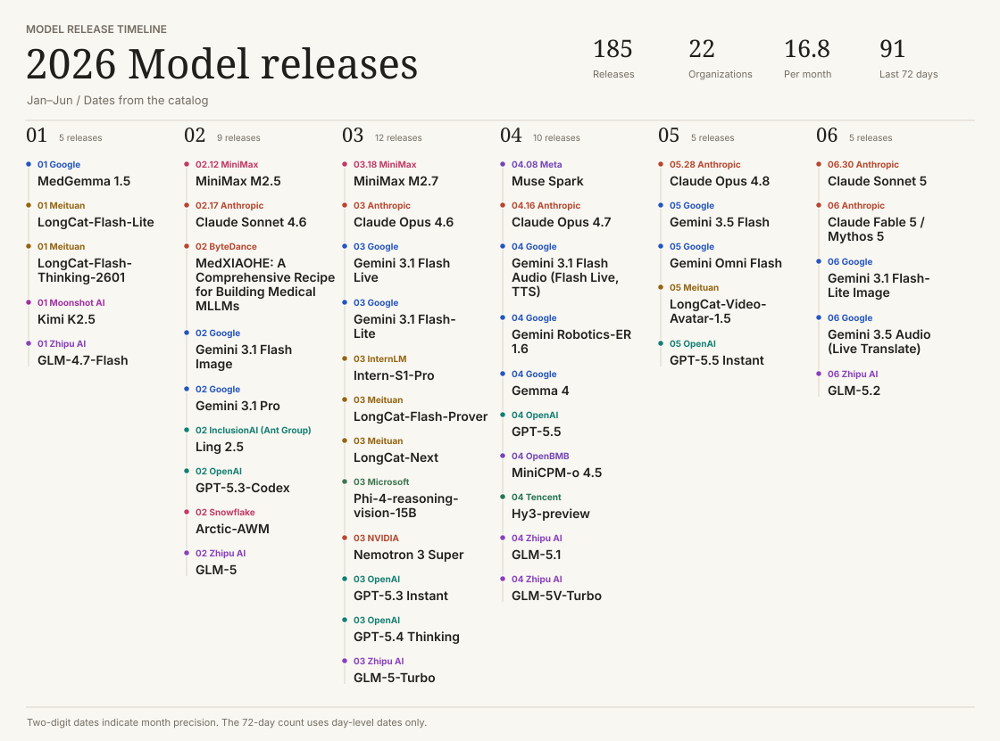
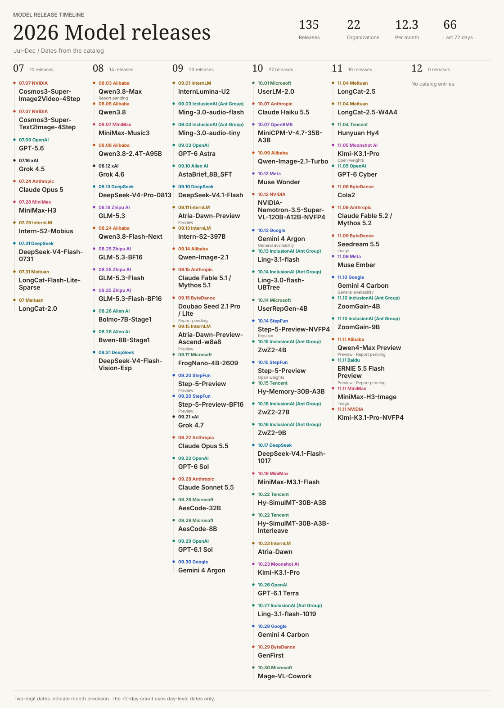
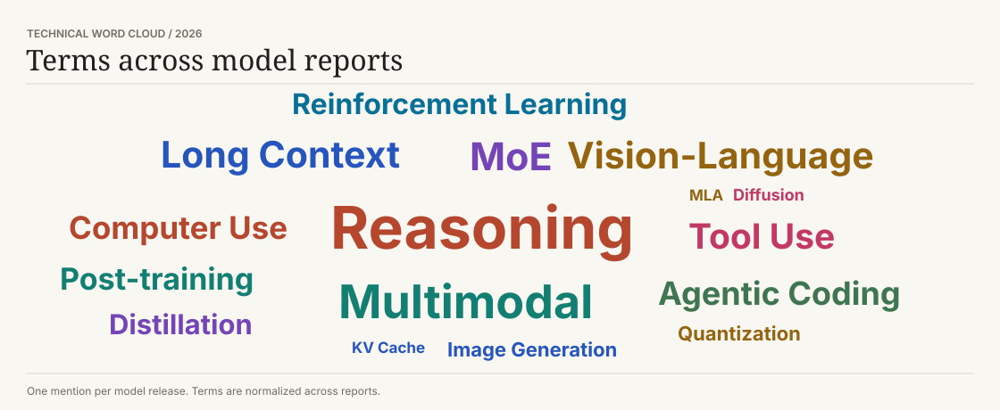

# Awesome LLM Technical Reports (2025-01 ~ 2026-11)

> A curated, structured local archive of frontier LLM / multimodal / medical-vertical model documentation — papers, system cards, model cards, and official blog posts — organized by **year / company**.

<p align="center">
  <a href="https://joe1chief.github.io/awesome-llm-tech-reports/"></a>
</p>

<p align="center">
  
  
  
  
  
</p>

> 🚀 **Interactive Web Experience**: Visit our [LMSYS-style Interactive Web Portal](https://joe1chief.github.io/awesome-llm-tech-reports/) for instant multi-category filtering, alternating evolution timeline, Head-to-Head model technical diff arena, full-text search, and one-click BibTeX citations!

---

## Table of Contents

- [Project Scope](#project-scope)
- [Release Timeline](#release-timeline)
- [Technical Word Cloud](#technical-word-cloud)
- [Company Quick Links](#company-quick-links)
- [Model Index (Folded by Year)](#model-index-folded-by-year)
- [Star History](#star-history)

## Project Scope

- Archives model reports from **2025-01** through **2026-11** across LLM, multimodal and medical domains.
- Links official technical reports, system cards and model cards. Local PDFs are available for mirrored reports.
- Provides a searchable Markdown index and a [scheduled refresh workflow](REPORT_AUTOMATION.md).

## Release Timeline

[Browse the full timeline and release sources](https://joe1chief.github.io/awesome-llm-tech-reports/timeline.html)





## Technical Word Cloud



[Word frequencies](docs/data/word-cloud.json)

## Company Quick Links

`2026`: [`Meituan`](#company-meituan) · [`Google`](#company-google) · [`Zhipu AI`](#company-zhipu) · [`Anthropic`](#company-anthropic) · [`OpenAI`](#company-openai) · [`OpenBMB`](#company-openbmb) · [`Tencent`](#company-tencent) · [`MiniMax`](#company-minimax) · [`NVIDIA`](#company-nvidia) · [`Microsoft`](#company-microsoft) · [`InternLM`](#company-internlm) · [`InclusionAI (Ant Group)`](#company-inclusionai) · [`Snowflake`](#company-snowflake) · [`ByteDance`](#company-bytedance) · [`Moonshot AI`](#company-moonshot)

`2025`: [`StepFun`](#company-stepfun) · [`Zhipu AI`](#company-zhipu) · [`MiniMax`](#company-minimax) · [`Meituan`](#company-meituan) · [`Allen AI`](#company-allenai) · [`Alibaba`](#company-alibaba_qwen) · [`Google`](#company-google) · [`NVIDIA`](#company-nvidia) · [`xAI`](#company-xai) · [`OpenAI`](#company-openai) · [`Anthropic`](#company-anthropic) · [`Tencent`](#company-tencent) · [`InternLM`](#company-internlm) · [`Hugging Face`](#company-huggingface) · [`Quark`](#company-quark) · [`Moonshot AI`](#company-moonshot) · [`ByteDance`](#company-bytedance) · [`Meta`](#company-meta) · [`DeepSeek`](#company-deepseek)

### Company Directory Index

<a id="company-alibaba_qwen"></a>
- **Alibaba / Qwen**: `2025/alibaba_qwen/`
<a id="company-allenai"></a>
- **Allen AI**: `2025/allenai/`
<a id="company-anthropic"></a>
- **Anthropic**: `2025/anthropic/`, `2026/anthropic/`
<a id="company-bytedance"></a>
- **ByteDance**: `2025/bytedance/`, `2026/bytedance/`
<a id="company-deepseek"></a>
- **DeepSeek**: `2025/deepseek/`
<a id="company-google"></a>
- **Google**: `2025/google/`, `2026/google/`
<a id="company-huggingface"></a>
- **Hugging Face**: `2025/huggingface/`
<a id="company-inclusionai"></a>
- **InclusionAI (Ant Group)**: `2026/inclusionai/`
<a id="company-internlm"></a>
- **InternLM**: `2025/internlm/`, `2026/internlm/`
<a id="company-meituan"></a>
- **Meituan**: `2025/meituan/`, `2026/meituan/`
<a id="company-meta"></a>
- **Meta**: `2025/meta/`
<a id="company-microsoft"></a>
- **Microsoft**: `2026/microsoft/`
<a id="company-minimax"></a>
- **MiniMax**: `2025/minimax/`, `2026/minimax/`
<a id="company-moonshot"></a>
- **Moonshot AI**: `2025/moonshot/`, `2026/moonshot/`
<a id="company-nvidia"></a>
- **NVIDIA**: `2025/nvidia/`, `2026/nvidia/`
<a id="company-openai"></a>
- **OpenAI**: `2025/openai/`, `2026/openai/`
<a id="company-openbmb"></a>
- **OpenBMB**: `2026/openbmb/`
<a id="company-quark"></a>
- **Quark (Alibaba)**: `2025/quark/`
<a id="company-snowflake"></a>
- **Snowflake**: `2026/snowflake/`
<a id="company-stepfun"></a>
- **StepFun**: `2025/stepfun/`
<a id="company-tencent"></a>
- **Tencent**: `2025/tencent/`, `2026/tencent/`
<a id="company-zhipu"></a>
- **Zhipu AI**: `2025/zhipu/`, `2026/zhipu/`
<a id="company-xai"></a>
- **xAI**: `2025/xai/`

## Model Index (Folded by Year)

<details open>
<summary><b>2026 (169 models)</b></summary>

| Release Date | Organization | Model | Core Highlights (from PDF) | Official Link | Local File |
| --- | --- | --- | --- | --- | --- |
| 2026-11-11 | NVIDIA | Kimi-K3.1-Pro-NVFP4 | ## Description: The NVIDIA Kimi-K3.1-Pro NVFP4 model is the quantized version of Moonshot AI's Kimi-K3.1-Pro model, which is an auto-regressive language model that uses an optimized transformer architecture. Kimi-K3.1-Pro is a natively multimodal Mixture-of-Experts model post-trained from Kimi K3, with 2.8T total parameters, 104B activated parameters, and a 1,048,576-token context window. For more information, please check \[here\](https://huggingface.co/moonshotai/Kimi-K3.1-Pro). The NVIDIA Kimi-K3.1-Pro NVFP4 model is quantized with \[Model Optimizer\](htt | https://huggingface.co/nvidia/Kimi-K3.1-Pro-NVFP4/blob/3af0462972c9cc07e5ba6e0867b44f961ce95e9b/README.md | Official source |
| 2026-11-10 | InclusionAI (Ant Group) | ZoomGain-9B | !\[Table 3 showing RL training results for Qwen3.5-4B and Qwen3.5-9B on ZoomGain and ZwZ data\](docs/figures/zoomgain-rl-training-results.png) | https://huggingface.co/inclusionAI/ZoomGain-9B/blob/b4550ef2e5a30b33c5133278036a682197489145/README.md | Official source |
| 2026-11-10 | InclusionAI (Ant Group) | ZoomGain-4B | !\[Table 3 showing RL training results for Qwen3.5-4B and Qwen3.5-9B on ZoomGain and ZwZ data\](docs/figures/zoomgain-rl-training-results.png) | https://huggingface.co/inclusionAI/ZoomGain-4B/blob/2ac9e28f1de993b4d7b6ebeda1368ff2e6982a71/README.md | Official source |
| 2026-11-09 | Anthropic | Claude Fable 5.2 / Mythos 5.2 | The paired release documents agentic coding, software engineering and multi-step work evaluations, alongside the safety testing performed before deployment. | https://www.anthropic.com/document/claude-fable-5-2-mythos-5-2-system-card | Official source |
| 2026-11-08 | MiniMax | MiniMax-H3-Image-PE | ```bash sglang serve \\ --model-path MiniMaxAI/MiniMax-H3-Image-PE \\ --served-model-name MiniMax-H3-Image-PE \\ --model-type llm \\ --reasoning-parser qwen3 \\ --grammar-backend xgrammar \\ --constrained-json-disable-any-whitespace \\ --host 0.0.0.0 \\ --port 30000 ``` | https://huggingface.co/MiniMaxAI/MiniMax-H3-Image-PE/blob/35603d4b63949afa12cb098227fffefedf081afa/README.md | Official source |
| 2026-11-07 | Tencent | Qwen3.8-27B-DSpine-b16 | --- license: apache-2.0 base_model: - Qwen/Qwen3.8-27B pipeline_tag: text-generation inference: false tags: - dspine - speculative-decoding - draft-model - sglang --- | https://huggingface.co/tencent/Qwen3.8-27B-DSpine-b16/blob/5f54174d301dbca65d9aa4448dc47e56732d9a12/README.md | Official source |
| 2026-11-06 | ByteDance | Cola2 | Hierarchical language generation separates continuous semantic modeling from discrete text realization, but its effectiveness depends on what the latent space compresses and how the discrete generator uses it. We propose Cola2, a framework that jointly studies continuous semantic compression, the balance between reconstruction and generation, and continuous-discrete co-adaptation. Cola2 dynamically segments text into semantic spans, controls the compression rate through auxiliary-loss-free negative feedback, and combines reconstruction and generation sup | https://arxiv.org/abs/2610.31305v1 | Official source |
| 2026-11-06 | InternLM | Sage-SciPerception | Projectors are organized by modality, task, and language-model version. Start with the available checkpoints below, or use the \[inference guide\](#inference) to connect projected scientific inputs to a serving workflow. Each checkpoint records its matching language model and input representation in `config.json`. | https://huggingface.co/internlm/Sage-SciPerception/blob/7c228fc03394027fed19bda1ff26388394b0031a/README.md | Official source |
| 2026-11-05 | Allen AI | maniflow-tb | ManiFlow-tb is the low-level action model for \[ToyBlocks\](https://allenai.org/blog/toyblocks), a robot block-stacking project. It is trained on simulated Franka arm data for manipulating blocks on a table (pick-and-place and in-place rotation of three blocks). It is trained with the ManiFlow training code at \[allenai/maniflow-tb\](https://github.com/allenai/maniflow-tb) and evaluated through ToyBlocks' policy server. | https://huggingface.co/allenai/maniflow-tb/blob/1e8385fdb1a28096989309d8c36f51f247ddf0d3/README.md | Official source |
| 2026-11-05 | Allen AI | Molmo2-4B-tb | * **Model type:** vision-language model with about 4.5B parameters, running at about 6 Hz. * **Input:** one 640x360 front-camera image and a text goal. * **Output:** a short plan, then the action and its target as a Molmo2 point. * **Actions:** pick, place (on a block or the table), flip (left, right, forward, backward), rotate (cw, ccw) and done. * **Training:** 6,000 steps at batch size 256 on simulated ToyBlocks three-block stacking episodes. We mix in 25% image-pointing data (PixMo-Points, PixMo-Count, CoSyn-Point) to retain Molmo's general pointing | https://huggingface.co/allenai/Molmo2-4B-tb/blob/e5c3ef6018c5f6b011a2b3d0b774fddb5aa1f842/README.md | Official source |
| 2026-11-05 | ByteDance | Cross-Layer-TopK-CLT | A cross-layer transcoder (CLT) for \[Qwen3-8B-Base\](https://huggingface.co/Qwen/Qwen3-8B-Base): 36 layers × 32,768 latents. Each layer's latents read the residual stream right before that layer's MLP (`resid_mid`) and write to the MLP outputs (`mlp_out`) of that layer and every later layer. 94.2B parameters, fp32, 377 GB in total. | https://huggingface.co/ByteDance-Seed/Cross-Layer-TopK-CLT/blob/0b2f254a3f44c7e97984ca3d2d826d3f6df5879e/README.md | Official source |
| 2026-11-05 | ByteDance | Qwen3-30B-A3B-MoE-SAE | Each SAE was trained independently on MoE block outputs collected from the Olmo 3 training corpus: 5/8 Dolma 3 pretraining data, 1/4 Dolci-Think-SFT (reasoning chains of thought) and 1/8 Dolci-Instruct-SFT (instruction following). Training used a TopK activation with k decaying from 1000 to 100 over the first 10,000 steps, an auxiliary loss, AdamW and about 3.2B tokens per SAE; the full recipe is given in the appendix "SAE training details" of the paper. | https://huggingface.co/ByteDance-Seed/Qwen3-30B-A3B-MoE-SAE/blob/ae59df340950f82641114eacd9db3ae360d11794/README.md | Official source |
| 2026-11-04 | Meituan | LongCat-2.5-W4A4 | LongCat-2.5 is a native multimodal MoE model for long-horizon agentic tasks, with **1.6 trillion total parameters** and approximately **48 billion activated per token**. Building on LongCat-2.0, it combines visual understanding with agentic coding for complex codebase development, full-project builds, creative design, and 3D tasks. Long-sequence training, large-scale RL, multi-teacher learning, and infrastructure optimizations on domestic AI accelerators underpin these capabilities. | https://huggingface.co/meituan-longcat/LongCat-2.5-W4A4/blob/bafc909a5f7308d0663c23f4b05fd32dc2200de8/README.md | Official source |
| 2026-11-04 | Meituan | LongCat-2.5 | LongCat-2.5 is a native multimodal MoE model for long-horizon agentic tasks, with **1.6 trillion total parameters** and approximately **48 billion activated per token**. Building on LongCat-2.0, it combines visual understanding with agentic coding for complex codebase development, full-project builds, creative design, and 3D tasks. Long-sequence training, large-scale RL, multi-teacher learning, and infrastructure optimizations on domestic AI accelerators underpin these capabilities. | https://huggingface.co/meituan-longcat/LongCat-2.5/blob/60032d966e6369b822f0e61d2eff01368d38b111/README.md | Official source |
| 2026-11-03 | MiniMax | MiniMax-H3-Image | It generates images of about 16 megapixels at every aspect ratio, from 4096x4096 (1:1) to 6272x2688 (21:9), directly and without an upscaler (see \[Sizes\](#sizes)). The checkpoint is distilled to 6 sampling steps (6 NFEs) with no classifier-free guidance. Its diffusion transformer (DiT) has the H3 architecture without the audio layers, and it uses the MiniMax-H3 text encoder unchanged. | https://huggingface.co/MiniMaxAI/MiniMax-H3-Image/blob/5f90473023975e6271b0ed1dd84c4e88e4bbc6d3/README.md | Official source |
| 2026-11-02 | Moonshot AI | Kimi-K3.1-Pro | Architecture Mixture-of-Experts (MoE) Total Parameters 2.8T Activated Parameters 104B Number of Layers 93 Number of Dense Layers 1 Attention-Layer Composition 69 KDA + 24 Gated DSA * Attention Hidden Dimension 7168 Number of Attention Heads 96 DSA Index Head Dimension 128 DSA Index Number of Heads 32 DSA Index Top-K 2048 Latent MoE Dimension 3584 MoE Hidden Dimension (per Expert) 3072 Number of Experts 896 Selected Experts per Token 16 Number of Shared Experts 2 Vocabulary Size 160K Context Length 1048576 Attention Mechanism KDA &amp;amp; Gated DSA Activatio | https://huggingface.co/moonshotai/Kimi-K3.1-Pro/blob/d9e99b0792a5e93b78ea9bea62a68167e36ddd9e/README.md | Official source |
| 2026-10-30 | Microsoft | Mage-VL-Cowork | **Mage-VL-Cowork** bridges this gap. Trained end-to-end from an intermediate **4B \[`Mage-VL`\](https://huggingface.co/microsoft/Mage-VL)** checkpoint through a progressive **five-stage specialize-then-unify curriculum**, it combines screenshot-grounded GUI interaction (`computer_use`) and persistent code/terminal execution (`bash`) inside a **single vision-language policy** — with no external orchestrator. Upstream of training, we **evolve the teacher harness** (pruning redundant action routes and equipping domain libraries) and build **Mage-CUA-Forge**, | https://huggingface.co/microsoft/Mage-VL-Cowork/blob/6fbe7f91da477c1c73790dbb1f08d001b8626be1/README.md | Official source |
| 2026-10-29 | ByteDance | GenFirst | Latent generative models typically follow a two-stage pipeline, training a variational autoencoder for reconstruction and then a generative model on the frozen latent space. Since reconstruction-optimized latents are not necessarily generation-friendly, jointly training both models is an appealing alternative. However, direct end-to-end training remains challenging, as it is prone to latent collapse and faces a generation-reconstruction conflict. We revisit this problem by analyzing how different objectives shape the latent space and identify two key ins | https://arxiv.org/abs/2608.29335v1 | Official source |
| 2026-10-27 | InclusionAI (Ant Group) | Ling-3.1-flash-1019 | ## Introduction We introduce **Ling-3.1-flash-1019**, an upgraded version of \[Ling-3.1-flash\](https://huggingface.co/inclusionAI/Ling-3.1-flash), with **560B** total parameters, **25B** active parameters per token, and a **1M-token context window**. With further post-training optimizations, **Ling-3.1-flash-1019** demonstrates significant improvements in scientific and real-world agentic capabilities. Its **AA-Briefcase** score rises from 1397 to **1524**, while performance on **AutomationBench-AA** increases from 62% to **68%**. The model also makes gai | https://huggingface.co/inclusionAI/Ling-3.1-flash-1019/blob/2109a6863fb14361eecc346ef98b3db88b8cdaee/README.md | Official source |
| 2026-10-26 | OpenBMB | MiniCPM-OCR-1.0-DSpark | \| Property \| Value \| \| :--- \| :--- \| \| Target model \| MiniCPM-OCR 1.0 (1.3B) \| \| Draft parameters \| 296,837,889 \| \| Draft layers \| 5 \| \| Draft tokens per forward pass \| 15 \| \| Target hidden-state layers \| `\[3, 7, 11, 15, 19\]` \| \| Checkpoint precision \| BF16 \| \| Input vocabulary \| 248,100 \| \| Draft output vocabulary \| 114,688 \| | https://huggingface.co/openbmb/MiniCPM-OCR-1.0-DSpark/blob/cb24ab4f593389832024a688216e05bf3803950e/README.md | Official source |
| 2026-10-24 | Tencent | Hy-Nomas-Diffusers | - **Free-form interaction:** Guide successive segments with instructions about subjects, actions, appearance, style, and environment. - **Camera control:** Supply camera trajectories alongside text to control viewpoint and movement. - **Continuous generation:** Reuse earlier context through a KV cache when extending the same world. - **Distilled inference:** Generate each segment with 4 DiT denoising steps in the example below and decode its latents with a fine-tuned PixelUMM decoder. - **Diffusers integration:** Load the bundled transformer, text encode | https://huggingface.co/tencent/Hy-Nomas-Diffusers/blob/a1ae04d11ae4ea176d1f76de634c115944f9882d/README.md | Official source |
| 2026-10-23 | Allen AI | OlmoEarth-v1_2-FT-LFMC-Base | This model is fine-tuned from \[OlmoEarth-v1_2-Base\](https://huggingface.co/allenai/OlmoEarth-v1_2-Base) to map live fuel moisture content (LFMC) values for woody vegetation. It follows the same training setup as \[OlmoEarth-v1-FT-LFMC-Base\](https://huggingface.co/allenai/OlmoEarth-v1-FT-LFMC-Base). | https://huggingface.co/allenai/OlmoEarth-v1_2-FT-LFMC-Base/blob/a3747521ea3e965381c3f43d9f16fb41609375a9/README.md | Official source |
| 2026-10-23 | InternLM | Atria-Dawn | As AI agents become participants in the development of their successors, they reshape both the production of intelligence and the role of human researchers. We introduce Atria Dawn Preview, a foundation agentic language model designed for scientific research and engineering workflows, with the goal of expanding the frontier of agent productivity in the real world. This model is trained via a Verifiable Experience Pipeline that connects tool-mediated interactions to executable environments and externally verified outcomes. Across 16 benchmarks spanning re | https://arxiv.org/abs/2609.15818v2 | Official source |
| 2026-10-23 | OpenBMB | MiniCPM-OCR-Jev | - 🛡️ **A small model that beats larger ones**: at only 2B parameters, decision AUROC (×100) on \[JevOCRBench\](https://huggingface.co/datasets/openbmb/JevOCRBench) is **93.6**, above JEV-35B-A3B (90.1) and close to Qwen3.5-397B-A17B (93.8). - 🧩 **Stable generalization**: on parses from MiniCPM-OCR 1.0, GLM-OCR, PaddleOCR-VL-1.6, and Xiaomi-OCR-0, AUROC (×100) stays in **91.9–93.4**. | https://huggingface.co/openbmb/MiniCPM-OCR-Jev/blob/a0ed278eb6aa1f333a711665ab610055a4a816ab/README.md | Official source |
| 2026-10-22 | Tencent | WeVisOne-VL-2B | The attached `mask_decoder.pt` (9,609,764 parameters) is a required core component that combines: - A **Visual Feature Adapter** over multi-level Qwen3-VL pre-merging ViT features; - A **Box-Guided Query Decoder** with 6 deformable cross-attention blocks initialized from the ` ` hidden state and Fourier-encoded box prior; - An **Instance-Conditioned Dense Prediction Head** with `FullCanvasAlphaCascadeHead` (refining predictions across S/4, S/2, and S/1 to output full-resolution continuous alpha mattes at stride 1). | https://huggingface.co/tencent/WeVisOne-VL-2B/blob/fcf8c8ca7fa481b514005ef591c8b72bed39618a/README.md | Official source |
| 2026-10-22 | Tencent | Hy-SimulMT-30B-A3B-Interleave | In our **RealSI long-form audio evaluation**, Hy-SimulMT achieved a **StreamLAAL of approximately 3 seconds**, the lowest among the systems shown in the comparison. Its GEMBA score exceeded those of the compared open-source models and four of the five commercial APIs. | https://huggingface.co/tencent/Hy-SimulMT-30B-A3B-Interleave/blob/e988e52e19ec4002e2763ec46fdff997c68fe859/README.md | Official source |
| 2026-10-22 | Tencent | Hy-SimulMT-30B-A3B | In our **RealSI long-form audio evaluation**, Hy-SimulMT achieved a **StreamLAAL of approximately 3 seconds**, the lowest among the systems shown in the comparison. Its GEMBA score exceeded those of the compared open-source models and four of the five commercial APIs. | https://huggingface.co/tencent/Hy-SimulMT-30B-A3B/blob/56c233df75bf09e386aa6282b01730b461afc83f/README.md | Official source |
| 2026-10-22 | Tencent | WeVisOne-VL-4B | The attached `mask_decoder.pt` (9,609,764 parameters) is a required core component that combines: - A **Visual Feature Adapter** over multi-level Qwen3-VL pre-merging ViT features; - A **Box-Guided Query Decoder** with 6 deformable cross-attention blocks initialized from the ` ` hidden state and Fourier-encoded box prior; - An **Instance-Conditioned Dense Prediction Head** with `FullCanvasAlphaCascadeHead` (refining predictions across S/4, S/2, and S/1 to output full-resolution continuous alpha mattes at stride 1). | https://huggingface.co/tencent/WeVisOne-VL-4B/blob/6b44a45873b4bbc7dca383922504430dc60eca23/README.md | Official source |
| 2026-10-21 | OpenBMB | MiniCPM-OCR-1.0 | - 🏆 **SOTA document parsing**: **93.68 on Real5-OmniDocBench**, a benchmark for real-world document parsing, with leading results on OmniDocBench v1.6, Wild-OmniDocBench, and olmOCR-Bench. Handles Chinese and English documents and PDFs, including scans, curved pages, photographs, skewed pages, and recaptured documents. - ⚡ **Efficient inference.** With DSpark decoding acceleration (\[BF16\](https://huggingface.co/openbmb/MiniCPM-OCR-1.0-DSpark), \[GGUF\](https://huggingface.co/openbmb/MiniCPM-OCR-1.0-DSpark-gguf)) end-to-end processing efficiency improves by | https://huggingface.co/openbmb/MiniCPM-OCR-1.0/blob/883ca368d17335b9ce5aa6fef4d000ef0684fcaa/README.md | Official source |
| 2026-10-21 | Tencent | Hy-Nomas | Interactive world generation requires models to follow successive commands while preserving relevant history and action consequences. We present Hy-Nomas, a video world model with an 8B diffusion backbone that supports free-form text instructions and continuous camera control across multiple interaction turns. It generates variable-length segments conditioned on current inputs and cached history. Our central design aligns structured video captions with action-aware causal attention: descriptive context remains accessible across segments, while action ins | https://arxiv.org/abs/2610.36729v1 | Official source |
| 2026-10-17 | DeepSeek | DeepSeek-V4.1-Flash-1017 | **DeepSeek-V4.1-Flash-1017** is a minor update to \[**DeepSeek-V4.1-Flash**\](https://huggingface.co/deepseek-ai/DeepSeek-V4.1-Flash), delivering substantial improvements across reasoning, coding, agentic tasks, and visual benchmarks. Alongside these gains, the model reduces task execution time and output length, enabling users to complete tasks faster and at lower cost and advancing the performance–cost Pareto frontier across multiple agent harnesses. | https://huggingface.co/deepseek-ai/DeepSeek-V4.1-Flash-1017/blob/08c8657f02291e11b6f6b63e0e16014f8e748518/README.md | Official source |
| 2026-10-17 | Microsoft | Sentiment-Analysis-7B | **Sentiment-Analysis-7B** is a 7B-parameter autoregressive language model fine-tuned for sentiment classification of user messages directed at a service, product, or agent (the "Target"). It is built on top of \[*mistralai/Mistral-7B-Instruct-v0.2*\](https://huggingface.co/mistralai/Mistral-7B-Instruct-v0.2) and was fine-tuned with reinforcement learning, using an LLM as a judge, on a small internal training set of ~300 examples. No pre-defined labels were used for training. | https://huggingface.co/microsoft/Sentiment-Analysis-7B/blob/ac3324057c2bfeeb2ab56c7a7c786316538552b1/README.md | Official source |
| 2026-10-17 | MiniMax | MiniMax-M3.1-Flash | Building on MiniMax-M3, M3.1-Flash improves task performance and inference efficiency with sparse attention throughout the model, quantization-aware training, and DSpark speculative decoding. | https://huggingface.co/MiniMaxAI/MiniMax-M3.1-Flash/blob/ce7f4df87d2e05262f5775f373dac4772f134041/README.md | Official source |
| 2026-10-16 | InclusionAI (Ant Group) | ZwZ2-27B | --- library_name: transformers pipeline_tag: image-text-to-text datasets: - inclusionAI/ZwZ2-RL-VQA base_model: Qwen/Qwen3.6-27B language: - en tags: - zwz2 - vision-language - visual-reasoning - reinforcement-learning - grpo --- | https://huggingface.co/inclusionAI/ZwZ2-27B/blob/6decedf05c953da84fe272922e192499794244e9/README.md | Official source |
| 2026-10-16 | InclusionAI (Ant Group) | ZwZ2-9B | --- library_name: transformers pipeline_tag: image-text-to-text datasets: - inclusionAI/ZwZ2-RL-VQA base_model: Qwen/Qwen3.5-9B language: - en tags: - zwz2 - vision-language - visual-reasoning - reinforcement-learning - grpo --- | https://huggingface.co/inclusionAI/ZwZ2-9B/blob/de52e7291860cf8f4e09c829c5f6d1337674926d/README.md | Official source |
| 2026-10-16 | Microsoft | scFM-dataselection | --- license: mit tags: - single-cell - biology - geneformer - scvi - self-supervised-learning - scimilarity - pca - safetensors inference: false --- | https://huggingface.co/microsoft/scFM-dataselection/blob/e697bd27466463882a185028e911e2b7ae729a34/README.md | Official source |
| 2026-10-15 | InclusionAI (Ant Group) | ZwZ2-4B | --- library_name: transformers pipeline_tag: image-text-to-text datasets: - inclusionAI/ZwZ2-RL-VQA base_model: Qwen/Qwen3.5-4B language: - en tags: - zwz2 - vision-language - visual-reasoning - reinforcement-learning - grpo --- | https://huggingface.co/inclusionAI/ZwZ2-4B/blob/f4cf5f31fb5578622312017a5a74d6b0cd1d64b8/README.md | Official source |
| 2026-10-15 | Tencent | Hy-Memory-30B-A3B | External-memory systems extend language-model applications beyond a context window, but their quality depends critically on the model executing the write path: deciding what to retain, how precisely to represent it, and how new evidence should update persistent state. Existing frameworks typically place a general-purpose large language model behind framework-specific prompts. This raises serving cost, and a writer specialized for one protocol does not transfer directly to another; a unified model that can operate across established memory frameworks rema | https://arxiv.org/abs/2610.22196v1 | Official source |
| 2026-10-14 | InclusionAI (Ant Group) | Ling-3.0-flash-UBTree | The paper also introduces tree-native training with renormalized KL supervision on high-temperature target traces, encouraging plausible alternative branches. See the \[paper\](https://arxiv.org/abs/2609.39972) for the method and experiments. | https://huggingface.co/inclusionAI/Ling-3.0-flash-UBTree/blob/8e4f4b110839cb73e0b670b2f3fcae388475b114/README.md | Official source |
| 2026-10-14 | Microsoft | UserRepGen-4B | The model was trained with online supervised fine-tuning through hindsight distillation, using feedback obtained by comparing simulated and original user behavior. At inference time, it generates a representation directly from the source conversation without requiring simulation rollouts or hindsight feedback. | https://huggingface.co/microsoft/UserRepGen-4B/blob/bfc905b249365cab00e94ba308f2cea5b23bbc6e/README.md | Official source |
| 2026-10-14 | StepFun | Step-5-Preview-NVFP4 | Step 5 Preview is a sparse Mixture-of-Experts (MoE) model with 600B total parameters and 27B active parameters. It supports up to 1 million tokens of context and accepts text, images, and video, enabling sustained reasoning and tool use across complex tasks. | https://huggingface.co/stepfun-ai/Step-5-Preview-NVFP4/blob/bc246cc2848e17b37f377eda8fd825c5b3018d1f/README.md | Official source |
| 2026-10-13 | InclusionAI (Ant Group) | Ling-3.1-flash | ## Introduction We're introducing **Ling-3.1-flash**, an upgraded native hybrid reasoning model designed for complex, real-world tasks. With **560B** total parameters, **25B** active parameters per token, and a **1M-token context window**, Ling-3.1-flash builds upon Ling-3.0-flash with improvements in architecture and performance on real-world tasks. | https://huggingface.co/inclusionAI/Ling-3.1-flash/blob/dde57b1c6a365aa0e0a33e15cecce0f2be96f5a3/README.md | Official source |
| 2026-10-12 | Allen AI | HiRO-ACEv2 | 3. Update paths in the ACE inference config file `ace2s_inference_config_global.yaml`. Specifically, update `experiment_dir`, `checkpoint_path`, `initial_condition.path` and `forcing_loader.dataset.path`. | https://huggingface.co/allenai/HiRO-ACEv2/blob/16bd51b8da79d85c138cc166c93196501616c3bf/README.md | Official source |
| 2026-10-12 | NVIDIA | NVIDIA-Nemotron-3.5-Super-VL-120B-A12B-NVFP4 | 2026-10-27 Nemotron 3.5 Super and Lightning: Open, Efficient Mixture-of-Experts Hybrid Mamba-Transformer Models for Agentic AI NVIDIA Abstract. We introduce Nemotron 3.5 Super and Nemotron 3.5 Lightning, open and efficient Mixture-of-Experts Hybrid Mamba-Transformer models designed for reasoning, long-context understanding, and agentic workloads. Super is a 120B-parameter, 12B-active multimodal model, while Lightning is a smaller 30B-parameter, 3B-active text model; both designed for efficient deployment. Both models combine large-scale distillation, lon | https://research.nvidia.com/labs/nemotron/files/NVIDIA-Nemotron-3.5-Super-and-Lightning-Technical-Report.pdf | Official source |
| 2026-10-12 | OpenBMB | Trident-Qwen3VL-2B | Each input is a dict with an optional `text` string and an `images` list of local image paths. Use `text` only, `images` only, or both for fused inputs. Queries and documents use different default instructions, which are part of the training format. | https://huggingface.co/openbmb/Trident-Qwen3VL-2B/blob/ed4ff93bd1ed814a8479681b2d8edb1d5eaf3e0c/README.md | Official source |
| 2026-10-09 | Alibaba | Qwen-Image-2.1-Turbo | **Qwen-Image-2.1-Turbo** is an accelerated checkpoint of \[Qwen-Image-2.1\](https://huggingface.co/Qwen/Qwen-Image-2.1) for text-to-image generation and image editing with **8 denoising steps**. It uses the same 7B visual generation architecture and loads directly with `QwenImage21Pipeline` in Diffusers. | https://huggingface.co/Qwen/Qwen-Image-2.1-Turbo/blob/fc13ba1986fcb905854dc8de2f52eee395f49b5b/README.md | Official source |
| 2026-10-09 | Tencent | Youtu-Parsing-Omni | We present Youtu-Parsing-Omni, an omni-modal parser that converts documents, images, audio, and video into structured records grounded in space and time, providing a perception layer for agents that read, locate, and cite evidence across modalities. Its design rests on one encoder for every modality and one schema for every task. Youtu-Omni-Encoder, initialized from a pre-trained language model to strengthen text reading, encodes all modalities with shared weights in a unified space-time coordinate system, and a few fusion layers let video frames attend | https://arxiv.org/abs/2610.39301v1 | Official source |
| 2026-10-07 | OpenBMB | MiniCPM-V-4.7-35B-A3B | \[GitHub\](https://github.com/openbmb/MiniCPM-V) · \[On-device results\](#on-device-capability-and-efficiency) · \[Evaluation\](#evaluation) · \[Examples\](#examples) · \[Usage\](#usages) · \[Model weights\](#model-weights) · \[DSpark\](https://huggingface.co/openbmb/MiniCPM-V-4.7-35B-A3B-DSpark) | https://huggingface.co/openbmb/MiniCPM-V-4.7-35B-A3B/blob/98e79ba972b586ac6146d3505771ce1467e199ba/README.md | Official source |
| 2026-10-05 | InclusionAI (Ant Group) | LemonDecider | \| Property \| Value \| \|---\|---\| \| Architecture \| Qwen3.5-4B hybrid backbone with a 255-option decision readout \| \| Loader \| `modeling_lemondecider.LemonDeciderForDecisionClassification`, `trust_remote_code=True` \| \| Model type / protocol \| `lemondecider_decision` / `lemondecider-v1` \| \| Attention \| Noncausal periodic full-attention layers; hybrid recurrent layers; SDPA \| \| Readout \| Native inline joint-question readout (`joint_readout.predict_joint`) \| \| Temperature \| 1.0026751894886363, inherited from the parent checkpoint; not refit \| \| Capacity \| 8192 | https://huggingface.co/inclusionAI/LemonDecider/blob/05ec18fa0994b7369cb25ac76c19ed0865c776fd/README.md | Official source |
| 2026-10-02 | NVIDIA | Flora-Rewarder | Flora-rewarder-27B produces outcome rewards (an episode-level success score), used for monitoring real-world deployments, and process rewards (dense action-quality scores over short time steps), used during reinforcement learning-based post-training. Flora was developed by NVIDIA as the data engine used for training GR00T-2, and is released to help researchers scale up custom robot datasets. | https://huggingface.co/nvidia/Flora-Rewarder/blob/a58b675874982043ba3e6c2e9d006bc74a7efce4/README.md | Official source |
| 2026-10-01 | Microsoft | UserLM-2.0 | The model is intended to support research on realistic user simulation and the development and evaluation of more robust assistant models. | https://huggingface.co/microsoft/UserLM-2.0/blob/dcb646115d9c3be6d335c2289c05b94a6f52ed97/README.md | Official source |
| 2026-10-01 | NVIDIA | Flora-TempSeg | Flora-segmenter-9B localizes operations in robot and human manipulation videos. For each input window, it predicts local interval coordinates and flags indicating whether an operation continues beyond the visible window. The Flora data engine projects these fragments onto the source clock and stitches them into episode-level events; the separate Flora captioner generates their action instructions. Flora was developed by NVIDIA as the data engine used for training GR00T-2, and is released to help researchers scale up custom robot datasets. | https://huggingface.co/nvidia/Flora-TempSeg/blob/b6fa34c285da54b9c3e6550d93796a705e6faaf2/README.md | Official source |
| 2026-10-01 | NVIDIA | Flora-Captioner | Flora-captioner-27B generates one action instruction for a supplied target interval in a robot or human manipulation video. It uses neighboring video context to disambiguate the intended local operation. In the Flora data engine, target intervals come from temporal segmentation and stitching; the captioner supplies the text used for balancing the pretraining data distribution. Flora was developed by NVIDIA as the data engine used for training GR00T-2, and is released to help researchers scale up custom robot datasets. | https://huggingface.co/nvidia/Flora-Captioner/blob/669b3f4924b29212da609b292babddfef690f579/README.md | Official source |
| 2026-09-29 | InternLM | AdvancedMathBench-AutoVerifier | - Architecture: `Qwen3_5MoeForConditionalGeneration`. - Tokenizer: bundled `InternS1Tokenizer`; requires `sentencepiece` and `trust_remote_code=True` after reviewing the tokenizer code. - Weights: 40 safetensors shards, approximately 68 GiB. | https://huggingface.co/internlm/AdvancedMathBench-AutoVerifier/blob/7fc819b608f1ba6abf26c9e4d3831e744e3dc7cd/README.md | Official source |
| 2026-09-29 | Microsoft | AesCode-32B | AesCode-32B starts from **Qwen3-VL-32B-Instruct** and is trained with cold-start SFT followed by GDPO across seven reward channels. It is the larger released checkpoint and leads the aggregate benchmark results. | https://huggingface.co/microsoft/AesCode-32B/blob/3f9157f331c574b470149ddd88e67d5bd13481f8/README.md | Official source |
| 2026-09-29 | Microsoft | AesCode-8B | **The reference image is optional.** Reference-conditioned training internalizes visual planning into the policy. Measured on AesCode-8B, withholding the reference at inference costs only **1.00 Visual point**, against 19.55 for the Qwen3-VL-8B-Instruct backbone and 10.04 for GPT-5.5. Quality is still highest when a reference is supplied. | https://huggingface.co/microsoft/AesCode-8B/blob/cfe1f698e09b8e7a009901ca700c765e25240af6/README.md | Official source |
| 2026-09-28 | Anthropic | Claude Sonnet 5.5 | Anthropic evaluates agentic coding and computer use across effort settings, including how lower inference effort affects task quality and cost. The system card covers evaluation methodology and safety. | https://www.anthropic.com/claude-sonnet-5-5-system-card | Official source |
| 2026-09-26 | InternLM | Intern-Decision-4B | This API performs structured candidate scoring. It does not call `generate()` or sample free-form text. A request can contain multiple fields; no gold answers are inserted into the prompt. The inference compiler uses only `state`, `questions`, and optional `images`. | https://huggingface.co/internlm/Intern-Decision-4B/blob/38c9dafbbef52dd04bae943c0c6ac918419adfd5/README.md | Official source |
| 2026-09-26 | InternLM | Intern-Decision-2B | This API performs structured candidate scoring. It does not call `generate()` or sample free-form text. A request can contain multiple fields; no gold answers are inserted into the prompt. The inference compiler uses only `state`, `questions`, and optional `images`. | https://huggingface.co/internlm/Intern-Decision-2B/blob/85c5657708a09884ff9fd8d7f57789b410a97b33/README.md | Official source |
| 2026-09-26 | InternLM | Intern-Decision-0.8B | This API performs structured candidate scoring. It does not call `generate()` or sample free-form text. A request can contain multiple fields; no gold answers are inserted into the prompt. The inference compiler uses only `state`, `questions`, and optional `images`. | https://huggingface.co/internlm/Intern-Decision-0.8B/blob/42457fafd13d10d0b0d9be46cb30a23caa409994/README.md | Official source |
| 2026-09-21 | xAI | Grok 4.7 | Grok 4.7 was built with an entirely new safeguard stack. It is the strongest model we’ve tested on refusals and jailbreak resistance. In dual-use domains like cybersecurity and biological work, it leads on both utility for benign tasks and safe refusal on dangerous ones, topping LatchBio’s biosafety benchmark at 62.4%. | https://x.ai/news/grok-4-7 | Official source |
| 2026-09-20 | Alibaba | Qwen-Image-2.1-PE-I2I | We are excited to open-source **Qwen-Image-2.1**, a unified text-to-image generation and image editing model in the Qwen family. With just **7B parameters in its visual generation component** (32 Single-Stream DiT layers), Qwen-Image-2.1 balances generation quality, inference efficiency, and versatility. | https://huggingface.co/Qwen/Qwen-Image-2.1-PE-I2I/blob/72927bc08afc99b7888ceb7d7d51a12db3700bbd/README.md | Official source |
| 2026-09-20 | Alibaba | Qwen-Image-2.1-PE-T2I | We are excited to open-source **Qwen-Image-2.1**, a unified text-to-image generation and image editing model in the Qwen family. With just **7B parameters in its visual generation component** (32 Single-Stream DiT layers), Qwen-Image-2.1 balances generation quality, inference efficiency, and versatility. | https://huggingface.co/Qwen/Qwen-Image-2.1-PE-T2I/blob/f3ed7985c788ad75b3ab7223e0c4c51e2a43545b/README.md | Official source |
| 2026-09-20 | StepFun | Step-5-Preview-BF16 | Step 5 Preview is a sparse Mixture-of-Experts (MoE) model with 600B total parameters and 27B active parameters. It supports up to 1 million tokens of context and accepts text, images, and video, enabling sustained reasoning and tool use across complex tasks. | https://huggingface.co/stepfun-ai/Step-5-Preview-BF16/blob/7734b7ffac118d70d8398bfa3eb0fab007eb45b1/README.md | Official source |
| 2026-09-20 | StepFun | Step-5-Preview | Step 5 Preview is a sparse Mixture-of-Experts (MoE) model with 600B total parameters and 27B active parameters. It supports up to 1 million tokens of context and accepts text, images, and video, enabling sustained reasoning and tool use across complex tasks. | https://huggingface.co/stepfun-ai/Step-5-Preview/blob/364b3b03fed2477aa0953fe855a2c4c8c48ee3cc/README.md | Official source |
| 2026-09-17 | Microsoft | FrogNano-4B-2609 | \|Field \| Value \| --- \| --- \| \| Developer \| Microsoft Corporation \| \| Description \| FrogNano is a compact repository-level coding agent derived from Qwen/Qwen3.5-4B. It is post-trained exclusively with reinforcement learning on approximately 1,500 synthetic software-engineering tasks generated, validated, and calibrated against the evolving policy using TaskPilot. FrogNano operates through the lightweight five-tool Leaf harness. Its agent-specific post-training uses no stronger-model solution trajectories, actions, reasoning traces, or patch targets. \| \| | https://huggingface.co/microsoft/FrogNano-4B-2609/blob/b90468c11a913c1916b4542b4b7a530ec42024a4/README.md | Official source |
| 2026-09-15 | InternLM | Atria-Dawn-Preview-Ascend-w8a8 | We conducted a comprehensive evaluation of Atria Dawn Preview across search, coding, tool use, productivity, and security benchmarks. | https://huggingface.co/internlm/Atria-Dawn-Preview-Ascend-w8a8/blob/849ab55ca65c3d36d87c1fc2e8ebf679276f8682/README.md | Official source |
| 2026-09-14 | Alibaba | Qwen-Image-2.1 | We are excited to open-source Qwen-Image-2.1, a unified text-to-image generation and image editing model in the Qwen family. With just 7B parameters in its visual generation component (32 Single-Stream DiT layers), Qwen-Image-2.1 balances generation quality, inference efficiency, and versatility. | https://github.com/QwenLM/Qwen-Image-2.1 | Official source |
| 2026-09-14 | Google | embeddinggemma-2 | We present EmbeddingGemma 2, an open multimodal embedding model which natively represents text, images, audio, video, and combinations thereof in a unified space. Our approach introduces improvements such as simplified per-layer embeddings and a multi-stage curriculum with modality and objective progression which ensure strong quality across unimodal, cross-modal, and mixed-modal evaluations. Notably, in comprehensive embedding benchmarks across all modalities, EmbeddingGemma 2 establishes a new Pareto frontier, outperforming both specialist models and m | https://arxiv.org/abs/2610.37364v2 | Official source |
| 2026-09-13 | InternLM | Intern-S2-397B | We introduce **Intern-S2-397B**, our most capable multimodal foundation model for scientific intelligence and long-horizon agents. Intern-S2-397B scales along three critical dimensions: pre-training, reinforcement-learning task coverage, and interactive agent environments. By combining a new vision-language pre-training paradigm with large-scale multi-task reinforcement learning and long-horizon agent reinforcement learning, Intern-S2-397B delivers a step change in general reasoning, scientific problem solving, and agentic capabilities. | https://huggingface.co/internlm/Intern-S2-397B/blob/85c1f58844e68836ec02245183cfa671de20977a/README.md | Official source |
| 2026-09-11 | InternLM | Atria-Dawn-Preview | We conducted a comprehensive evaluation of Atria Dawn Preview across search, coding, tool use, productivity, and security benchmarks. | https://huggingface.co/internlm/Atria-Dawn-Preview/blob/311a9b8c6c0e8dd4b00b2d7baff7a926c3415e78/README.md | Official source |
| 2026-09-10 | DeepSeek | DeepSeek-V4.1-Flash | A smaller model family introduces native visual understanding and reduces KV cache demand. DeepSeek attributes capability improvements to changes in pretraining and larger-scale reinforcement learning during post-training. | https://huggingface.co/deepseek-ai/DeepSeek-V4.1-Flash/blob/main/DeepSeek_V41_Tech_Report.pdf | Official source |
| 2026-09-10 | Allen AI | AstaBrief_8B_SFT | ## Inference and Usage &gt;\[!NOTE\] &gt;**Recommended prompt**: This checkpoint was fine-tuned using this \[SFT prompt\](https://huggingface.co/datasets/allenai/AstaBrief_prompts/blob/main/sft_prompt.txt). For best results, we recommend using the same prompt format at inference time with your input query and section references. Using a different prompt or interaction format may lead to degraded or inconsistent behavior. | https://huggingface.co/allenai/AstaBrief_8B_SFT/blob/d2d57580d2255422a4c1e4ca4efb6b169a134351/README.md | Official source |
| 2026-09-09 | Tencent | WeVisCut | Producing long-form videos from narration requires interdependent decisions that remain coherent across shots. Existing agentic editors often use multi-stage workflows driven by general models, leaving the quality-cost trade-off of compact, task-adapted policies unclear. We address this gap with WeVisCut, a long-form script-to-video system that connects tool execution with policy learning. Its agent harness maintains shared production state so that tool feedback informs subsequent decisions and repairs. Because finished videos do not expose these decisio | https://arxiv.org/abs/2610.38352v1 | Official source |
| 2026-09-06 | OpenBMB | MiniCPM5-2B | We are releasing **MiniCPM5-2B**, the second model in the **MiniCPM5** series, following \[MiniCPM5-1B\](https://huggingface.co/openbmb/MiniCPM5-1B). It is a dense 2B Transformer that scales up the same training recipe, built for on-device, local deployment, and resource-constrained scenarios, reaching 2B-class open-source SOTA. | https://huggingface.co/openbmb/MiniCPM5-2B/blob/42433e90dad95123ab87729fd7011e7110629556/README.md | Official source |
| 2026-09-06 | OpenBMB | MiniCPM5-2B-DSpark | \| Property \| Value \| \|---\|---\| \| Target model \| \[MiniCPM5-2B\](https://huggingface.co/openbmb/MiniCPM5-2B) \| \| Draft layers \| 5 \| \| Draft parameters \| 323,776,001 \| \| Draft tokens per forward pass \| 7 \| \| Target hidden-state layers \| `\[1, 10, 20, 30, 39\]` \| \| Checkpoint precision \| BF16 \| | https://huggingface.co/openbmb/MiniCPM5-2B-DSpark/blob/a63eb96b9bba7e999639d3fe3b6d70a0ea38eabd/README.md | Official source |
| 2026-09-06 | OpenBMB | UltraData-Code-L2-Classifier | &gt; **Abstract:** Code generation has become a core capability of large language models (LLMs), and code data is central to the pre-training process that develops it. As obtaining public code of sufficient quality becomes more difficult, further progress cannot rely on corpus expansion alone. Tiered data management instead applies increasingly targeted processing to smaller data pools, producing data states suited to different training objectives. Following this perspective, we present **UltraData-Code** as four connected data states spanning repository ar | https://huggingface.co/openbmb/UltraData-Code-L2-Classifier/blob/f7b94ab98a647eac3136bf6e654c34b2aaa76f3a/README.md | Official source |
| 2026-09-04 | Allen AI | OlmoEarth-v1_3-Base | OlmoEarth-v1_3-Base is a ViT-Base (128M parameters) foundation model for remote sensing tasks over Sentinel-1, Sentinel-2, and Landsat images or image time series. It also includes a Perceiver (14.3M parameters) and a linear student which projects the 768 dimensional tokens down to 128 dimensions (0.1M parameters). This model (including the student) is used to generate OlmoEarth's global, annualized embeddings. | https://huggingface.co/allenai/OlmoEarth-v1_3-Base/blob/9e9e918a369701c105dde7ef56789b0ff1d47f50/README.md | Official source |
| 2026-09-04 | Tencent | EVIE-8B | &gt; 📢 **Release Announcement**: All model weights, inference pipelines, and evaluation suites have been fully open-sourced. The technical report is available on arXiv: \[EVIE: Evidence-Vector-Informed Embeddings for Visual Document Retrieval\](https://arxiv.org/abs/2610.11553). Training code and distillation recipes are available in the \[Tencent/EVIE\](https://github.com/Tencent/EVIE) repository. | https://huggingface.co/tencent/EVIE-8B/blob/cdc8f60e56d168591354cf919bb5a50a5d1f617b/README.md | Official source |
| 2026-09-03 | InclusionAI (Ant Group) | Ming-3.0-audio-tiny | --- language: - en - zh license: mit library_name: transformers pipeline_tag: audio-to-audio tags: - audio - speech - automatic-speech-recognition - audio-understanding - audio-reasoning - speech-to-text - text-to-speech - conversational - mixture-of-experts - custom_code model_name: Ming-3.0-audio-tiny --- | https://huggingface.co/inclusionAI/Ming-3.0-audio-tiny/blob/401b1abc63de0862dfbc9cd2a40895019d742d09/README.md | Official source |
| 2026-09-03 | InclusionAI (Ant Group) | Ming-3.0-audio-flash | A native audio model built for real-world speech recognition, audio understanding, reasoning, and end-to-end spoken interaction. | https://github.com/inclusionAI/Ming-3.0-audio-flash | Official source |
| 2026-09-01 | Google | gnm-v3 | # Zero parameters produce the neutral template face mesh identity = np.zeros(gnm.identity_dim) expression = np.zeros(gnm.expression_dim) rotations = np.zeros((gnm.num_joints, 3)) # Axis-angle rotations (neck, eyes) translation = np.zeros((3,)) | https://huggingface.co/google/gnm-v3/blob/c01e90d298d82301f9fd18f54806be751775cb7c/README.md | Official source |
| 2026-09-01 | InternLM | InternLumina-U2 | Intern Lumina U2 is a unified multimodal model that brings language, image, video and 3D into a single framework, covering text QA, text-to-image generation, image understanding, image editing, video understanding and 3D understanding with one model. It is a 16B-parameter MoE with 1B active parameters (16B-A1B), pairing an efficient sparse backbone with an 8-codebook fully-discrete visual representation built on \[AToken\](https://github.com/apple/ml-atoken). | https://huggingface.co/internlm/InternLumina-U2/blob/8e3d57f3cb190323334752952a622bb5b97086c1/README.md | Official source |
| 2026-09-01 | NVIDIA | Nemotron-3-Diarization | Streaming Sortformer introduced an arrival-order speaker cache to maintain speaker identities across chunks in end-to-end streaming speaker diarization, with a single model supporting configurable latency profiles spanning offline operation to ultra-low-latency streaming. Nemotron 3 Diarization addresses the original model's four-speaker limitation by extending support to eight speakers while improving both accuracy and computational efficiency. The previous FastConformer-Transformer stack is streamlined into a pure Transformer encoder. A learned upsampl | https://arxiv.org/abs/2611.12246v1 | Official source |
| 2026-09-01 | OpenBMB | MiniCPM5-2B-Midtrain | We are releasing **MiniCPM5-2B**, the second model in the **MiniCPM5** series, following \[MiniCPM5-1B\](https://huggingface.co/openbmb/MiniCPM5-1B). It is a dense 2B Transformer that scales up the same training recipe, built for on-device, local deployment, and resource-constrained scenarios, reaching 2B-class open-source SOTA. | https://huggingface.co/openbmb/MiniCPM5-2B-Midtrain/blob/cceb0a157ba55ad5feb380dab1ce1909a76abf68/README.md | Official source |
| 2026-08-31 | DeepSeek | DeepSeek-V4-Flash-Vision-Exp | We are excited to introduce **DeepSeek-V4-Flash-Vision-Exp**, our first experimental multimodal model in the DeepSeek-V4 family. It builds on the DeepSeek-V4-Flash architecture by incorporating visual modules and undergoing continued training to unlock visual understanding capabilities. | https://huggingface.co/deepseek-ai/DeepSeek-V4-Flash-Vision-Exp/blob/6821d6ad3681a4b137b066b76094fa82ebd0a380/README.md | Official source |
| 2026-08-31 | NVIDIA | Cosmos3-Nano-Transfer-Auto | Interactive World Simulation with Cosmos for Physical AI Contents 1 Introduction 4 2 Model Architecture 5 2.1 Cosmos 3 Backbone . . . . . . . . . . . . . . . . . . . . . . . . . . . . . . . . . . . . . . . . . . 5 2.2 Multimodal Token Arrangement . . . . . . . . . . . . . . . . . . . . . . . . . . . . . . . . . . . 6 2.3 Temporal-causal Attention . . . . . . . . . . . . . . . . . . . . . . . . . . . . . . . . . . . . . . 9 3 Post-training Recipe 10 3.1 Bidirectional Adaptation . . . . . . . . . . . . . . . . . . . . . . . . . . . . . . . . . . . . . . . | https://research.nvidia.com/labs/cosmos-lab/cosmos-simulation/technical-report.pdf | Official source |
| 2026-08-31 | NVIDIA | Cosmos3-Nano-Sim-Transfer | Interactive World Simulation with Cosmos for Physical AI Contents 1 Introduction 4 2 Model Architecture 5 2.1 Cosmos 3 Backbone . . . . . . . . . . . . . . . . . . . . . . . . . . . . . . . . . . . . . . . . . . 5 2.2 Multimodal Token Arrangement . . . . . . . . . . . . . . . . . . . . . . . . . . . . . . . . . . . 6 2.3 Temporal-causal Attention . . . . . . . . . . . . . . . . . . . . . . . . . . . . . . . . . . . . . . 9 3 Post-training Recipe 10 3.1 Bidirectional Adaptation . . . . . . . . . . . . . . . . . . . . . . . . . . . . . . . . . . . . . . . | https://research.nvidia.com/labs/cosmos-lab/cosmos-simulation/technical-report.pdf | Official source |
| 2026-08-27 | Alibaba | Qwen-Drive-1.0 | We present Qwen-Drive-1.0, an initial step towards a vision-language foundation model for autonomous driving. Qwen-Drive-1.0 retains the architecture of the pretrained vision-language model (VLM) and integrates 3D perception, visual question answering, and motion planning within a unified framework. An external bird's-eye-view (BEV) perception head jointly performs 3D object detection, semantic occupancy prediction, and BEV map segmentation. It serves as a probe of the 3D information accessible from the shared representations and provides an explicit, in | https://arxiv.org/abs/2609.00111v1 | Official source |
| 2026-08-27 | Microsoft | bioemu2 | \| **Field** \| **Value** \| \|----\|----\| \| Developer \| Microsoft Research \| \| Model architecture \| Diffusion-based all-atom score model. \| \| Parameters \| Approximately 500M parameters \| \| Inputs \| Biomolecular sequence(s) plus an optional multiple sequence alignment (MSA), contact conditioning, and method conditioning. \| \| Outputs \| A generative ensemble of all-atom 3D biomolecular structures in Cartesian coordinates, sampled by reverse diffusion. \| \| Training dates \| August–September 2026 \| \| Release date \| October 2026 \| \| License \| MIT \| \| Related assets | https://huggingface.co/microsoft/bioemu2/blob/dd4b0c1b69984b68edcb6200a544213be4d75242/README.md | Official source |
| 2026-08-27 | OpenBMB | MiniCPM5-2B-SFT | We are releasing **MiniCPM5-2B**, the second model in the **MiniCPM5** series, following \[MiniCPM5-1B\](https://huggingface.co/openbmb/MiniCPM5-1B). It is a dense 2B Transformer that scales up the same training recipe, built for on-device, local deployment, and resource-constrained scenarios, reaching 2B-class open-source SOTA. | https://huggingface.co/openbmb/MiniCPM5-2B-SFT/blob/9db063584f59cda95a5bef6bb7a4b4eda1ebd33e/README.md | Official source |
| 2026-08-27 | OpenBMB | MiniCPM5-2B-Base | We are releasing **MiniCPM5-2B**, the second model in the **MiniCPM5** series, following \[MiniCPM5-1B\](https://huggingface.co/openbmb/MiniCPM5-1B). It is a dense 2B Transformer that scales up the same training recipe, built for on-device, local deployment, and resource-constrained scenarios, reaching 2B-class open-source SOTA. | https://huggingface.co/openbmb/MiniCPM5-2B-Base/blob/e09861095569642c3cf632d80e3200ee1d30b547/README.md | Official source |
| 2026-08-26 | Allen AI | Bwen-8B-Stage1 | Qwen3 8B Base retrofitted to operate over bytes instead of tokens via *byteification* through a short additional training procedure. **This checkpoint contains Stage 1 training only - inner model parameters are unchanged.** | https://huggingface.co/allenai/Bwen-8B-Stage1/blob/854da622962867062be79bc750172cd0a3f6c2a8/README.md | Official source |
| 2026-08-26 | Allen AI | Bolmo-7B-Stage1 | Olmo 3 7B retrofitted to operate over bytes instead of tokens via *byteification* through a short additional training procedure. **This checkpoint contains Stage 1 training only - inner model parameters are unchanged.** | https://huggingface.co/allenai/Bolmo-7B-Stage1/blob/36da45293c742c597728e2d0f3498ac10667188b/README.md | Official source |
| 2026-08-26 | Allen AI | Bolmo-1B-Stage1 | OLMo 2 1B retrofitted to operate over bytes instead of tokens via *byteification* through a short additional training procedure. **This checkpoint contains Stage 1 training only - inner model parameters are unchanged.** | https://huggingface.co/allenai/Bolmo-1B-Stage1/blob/c5ac3c1b61f925518a1e5dbb4ea4ee67f38f1050/README.md | Official source |
| 2026-08-25 | Zhipu AI | GLM-5.3-Flash-BF16 | We introduce GLM-5.3-Flash, the first natively multimodal model in the GLM-5 series. With 320B total parameters and just 18B active parameters, it outperforms GLM-5.2 across benchmarks and real-world workloads at one-tenth the price, while approaching Claude Opus 4.8 on coding and agentic benchmarks. | https://huggingface.co/zai-org/GLM-5.3-Flash-BF16/blob/f9fed3bbc82291073373d67452e9f25317ef7577/README.md | Official source |
| 2026-08-25 | Zhipu AI | GLM-5.3-BF16 | GLM-5.3 uses the same base model as GLM-5.2 — every gain comes from post-training. Compared with GLM-5.2, it is much better at complex coding and long-horizon tasks: | https://huggingface.co/zai-org/GLM-5.3-BF16/blob/abf42e6c0e53bc29a875511301e7b7fcd220315b/README.md | Official source |
| 2026-08-25 | Zhipu AI | GLM-5.3-Flash | We introduce GLM-5.3-Flash, the first natively multimodal model in the GLM-5 series. With 320B total parameters and just 18B active parameters, it outperforms GLM-5.2 across benchmarks and real-world workloads at one-tenth the price, while approaching Claude Opus 4.8 on coding and agentic benchmarks. | https://huggingface.co/zai-org/GLM-5.3-Flash/blob/46a050bec13002ad29ee795c16e61cf4fa3c4a9c/README.md | Official source |
| 2026-08-25 | Zhipu AI | GLM-5.3 | GLM-5.3 uses the same base model as GLM-5.2 — every gain comes from post-training. Compared with GLM-5.2, it is much better at complex coding and long-horizon tasks: | https://huggingface.co/zai-org/GLM-5.3/blob/ba32f8c19c8738e2c57c71798c601d477a7bf844/README.md | Official source |
| 2026-08-24 | Alibaba | Qwen3.8-Flash-Next | &gt; \[!Tip\] &gt; For users seeking managed, scalable inference without infrastructure maintenance, the official Qwen API service is provided by \[Qwen Cloud\](https://www.qwencloud.com). &gt; &gt; In particular, **Qwen3.8-Flash** is the official version based on Qwen3.8-Flash-Next with more production features, e.g., 1M context length by default, official built-in tools. For more information, please refer to the \[Qwen3.8-Flash Overview\](https://www.qwencloud.com/models/qwen3.8-flash). | https://huggingface.co/Qwen/Qwen3.8-Flash-Next/blob/812d96e10a0dd82b69d749e68693698cf6c36daa/README.md | Official source |
| 2026-08-24 | Google | timesfm-3.0-pytorch | ## Model Details - **Architecture**: Stacked Mixing Transformer with Variate Attention and CPM Iterative RevIN. - **Context Patch Length**: 32 - **Forecast Horizon Patch Length**: 64 - **Layers**: 20 transformer layers (model dim: 1280, heads: 16) - **Quantiles**: (median at index 4) | https://huggingface.co/google/timesfm-3.0-pytorch/blob/43046b85ec22d584a13f8098c2ed39c889e129c2/README.md | Official source |
| 2026-08-19 | Google | tipsv1-g14 | TIPS (Text-Image Pre-training with Spatial awareness, ICLR 2025) is a family of contrastive vision-language models that produce spatially rich image features aligned with text embeddings. This is the original (v1) g/14 release with 1.1B vision params and 389M text params, converted from the \[official checkpoints\](https://github.com/google-deepmind/tips). | https://huggingface.co/google/tipsv1-g14/blob/79a0b1548c1d6da931ba4c9ef5fd9251744ca4b9/README.md | Official source |
| 2026-08-19 | Google | tipsv1-g14-lowres | TIPS (Text-Image Pre-training with Spatial awareness, ICLR 2025) is a family of contrastive vision-language models that produce spatially rich image features aligned with text embeddings. This is the original (v1) g/14 low-res release with 1.1B vision params and 389M text params, converted from the \[official checkpoints\](https://github.com/google-deepmind/tips). | https://huggingface.co/google/tipsv1-g14-lowres/blob/a8c59ff3ac1b229c7178e8d7f626036d812358a4/README.md | Official source |
| 2026-08-19 | Google | tipsv1-l14 | TIPS (Text-Image Pre-training with Spatial awareness, ICLR 2025) is a family of contrastive vision-language models that produce spatially rich image features aligned with text embeddings. This is the original (v1) L/14 release with 304M vision params and 184M text params, converted from the \[official checkpoints\](https://github.com/google-deepmind/tips). | https://huggingface.co/google/tipsv1-l14/blob/05c1dd400ade562d318d00d63c5474f21dfe2a72/README.md | Official source |
| 2026-08-19 | Google | tipsv1-so400m14 | TIPS (Text-Image Pre-training with Spatial awareness, ICLR 2025) is a family of contrastive vision-language models that produce spatially rich image features aligned with text embeddings. This is the original (v1) So400m/14 release with 413M vision params and 448M text params, converted from the \[official checkpoints\](https://github.com/google-deepmind/tips). | https://huggingface.co/google/tipsv1-so400m14/blob/9bf0d1426d430e0ce9b19fc84692d9b3d74b3355/README.md | Official source |
| 2026-08-19 | Google | tipsv1-s14 | TIPS (Text-Image Pre-training with Spatial awareness, ICLR 2025) is a family of contrastive vision-language models that produce spatially rich image features aligned with text embeddings. This is the original (v1) S/14 release with 22M vision params and 34M text params, converted from the \[official checkpoints\](https://github.com/google-deepmind/tips). | https://huggingface.co/google/tipsv1-s14/blob/109d6693a2a0263be13309c193eb7427ce13a386/README.md | Official source |
| 2026-08-19 | Google | tipsv1-b14 | TIPS (Text-Image Pre-training with Spatial awareness, ICLR 2025) is a family of contrastive vision-language models that produce spatially rich image features aligned with text embeddings. This is the original (v1) B/14 release with 86M vision params and 110M text params, converted from the \[official checkpoints\](https://github.com/google-deepmind/tips). | https://huggingface.co/google/tipsv1-b14/blob/424f5e0ee56557079d99419c729a655e2cbcc7b1/README.md | Official source |
| 2026-08-13 | DeepSeek | DeepSeek-V4-Pro-0813 | \| Benchmark \| DeepSeek-V4-Pro-0813 \| DeepSeek-V4-Flash-0731 \| DeepSeek-V4-Pro (Preview) \| DeepSeek-V4-Flash (Preview) \| GLM-5.2 \| Kimi K3 \| Opus-4.8 \| Fable-5 (w/ fallback) \| \| :--- \| :---: \| :---: \| :---: \| :---: \| :---: \| :---: \| :---: \| :---: \| \| HLE (wo / w tools) \| 42.7 / 60.0 \| 37.8 / 51.5 \| 37.7 / 48.2 \| 34.8 / 45.1 \| 40.5 / 54.7 \| 43.5 / 56.0 \| 49.8 / 57.9 \| 53.3 / 63.0 \| \| Terminal Bench 2.1 \| 87.9 \| 82.7 \| 72.1 \| 61.8 \| 81.0 \| 88.3 \| 85.0 \| 88.0 \| \| NL2Repo \| 61.5 \| 54.2 \| 38.5 \| 39.4 \| 48.9 \| - \| 69.7 \| - \| \| Cybergym \| 83.3 \| 76.7 \| 52.7 \| 38 | https://huggingface.co/deepseek-ai/DeepSeek-V4-Pro-0813/blob/72e1d3230f6c080a530b0a1d46f8eb4602340597/README.md | Official source |
| 2026-08-12 | NVIDIA | Alpamayo2-Edge | NVIDIA Alpamayo 2 Edge is a 2B-parameter reasoning vision-language-action model that uses adaptive reasoning to generate driving trajectories and causal explanations. Built on the Nemotron-based backbone of NVIDIA Cosmos 3 Edge, it supports fine-tuning and efficient in-vehicle deployment on NVIDIA DRIVE AGX Thor. | https://huggingface.co/nvidia/Alpamayo2-Edge/blob/b92b6aa326bd3e2235db28f248ad5a30b5890e64/README.md | Official source |
| 2026-08-12 | xAI | Grok 4.6 | Competitor figures are drawn from the respective developers’ published system cards or benchmark leaderboards | https://x.ai/news/grok-4-6#training-grok-46 | Official source |
| 2026-08-08 | Alibaba | Qwen3.8-2.4T-A95B | &gt; \[!Tip\] &gt; For users seeking managed, scalable inference without infrastructure maintenance, the official Qwen API service is provided by \[Qwen Cloud\](https://www.qwencloud.com). &gt; &gt; In particular, **Qwen3.8-Max** is the official version based on Qwen3.8-2.4T-A95B with more features, such as vision input &amp; non-thinking support, 1M context length by default, official built-in tools, etc. &gt; For more information, please refer to the \[Qwen3.8-Max Overview\](https://www.qwencloud.com/models/qwen3.8-max). | https://huggingface.co/Qwen/Qwen3.8-2.4T-A95B/blob/4f885e51d6bbfee5866446d56d3f96f336c39723/README.md | Official source |
| 2026-08-07 | MiniMax | MiniMax-Music3 | MiniMax Music 3 uses a hierarchical autoregressive architecture that separates global musical modeling from local acoustic modeling. | https://huggingface.co/MiniMaxAI/MiniMax-Music3/blob/1b525ccb685ae809f33027c51c351eeb5833cf72/README.md | Official source |
| 2026-08-05 | Alibaba | Qwen3.8 | &gt; \[!Tip\] &gt; For users seeking managed, scalable inference without infrastructure maintenance, the official Qwen API service is provided by \[Qwen Cloud\](https://www.qwencloud.com). &gt; In particular, **Qwen3.8-27B** will be available as a hosted version with more production features, e.g., 1M context length by default, official built-in tools. For more information, please refer to the \[Qwen3.8-27B Overview\](https://www.qwencloud.com/models/qwen3.8-27b). The service is coming soon. Stay tuned for updates. | https://huggingface.co/Qwen/Qwen3.8-27B/blob/37561816e66b5b9153b1b64c10968c18c1e6f4a0/README.md | Official source |
| 2026-07-31 | DeepSeek | DeepSeek-V4-Flash-0731 | \| Benchmark \| DeepSeek-V4-Flash-0731 \| DeepSeek-V4-Flash (Preview) \| DeepSeek-V4-Pro (Preview) \| GLM-5.2 \| Opus-4.8 \| \| :--- \| :---: \| :---: \| :---: \| :---: \| :---: \| \| Terminal Bench 2.1 \| 82.7 \| 61.8 \| 72.1 \| 81.0 \| 85.0 \| \| NL2Repo \| 54.2 \| 39.4 \| 38.5 \| 48.9 \| 69.7 \| \| Cybergym \| 76.7 \| 38.7 \| 52.7 \| - \| 83.1 \| \| DeepSWE \| 54.4 \| 7.3 \| 12.8 \| 46.2 \| 58.0 \| \| Toolathlon-Verified \| 70.3 \| 49.7 \| 55.9 \| 59.9 \| 76.2 \| \| Agents' Last Exam \| 25.2 \| 15.8 \| 16.5 \| 23.8 \| 25.7 \| \| AutomationBench Public \| 25.1 \| 10.8 \| 12.8 \| 12.9 \| 27.2 \| \| DSBench-FullStack | https://huggingface.co/deepseek-ai/DeepSeek-V4-Flash-0731/blob/7872f01b1d1fe23eabc4c98b48bffcef5a386062/README.md | Official source |
| 2026-07-31 | Google | tabfm-1.1.0-pytorch | TabFM is a zero-shot tabular foundation model from Google Research. It supports classification and regression on structured/tabular data with mixed numerical and categorical columns, requiring no fine-tuning or hyperparameter search - training examples are passed as context and predictions are made in a single forward pass. | https://huggingface.co/google/tabfm-1.1.0-pytorch/blob/d7cfd3b8d184d7c8fed4210aeba9e1c967d45f2a/README.md | Official source |
| 2026-07-31 | Meituan | LongCat-Flash-Lite-Sparse | LongCat-Flash-Lite-Sparse is a non-thinking Mixture-of-Experts (MoE) model with 69B total parameters and approximately 3B activated parameters per token. Built on \[LongCat-Flash-Lite\](https://huggingface.co/meituan-longcat/LongCat-Flash-Lite), it replaces dense MLA with **LongCat Sparse Attention (LSA)** and natively supports context lengths of up to 1M tokens. Compared with its dense predecessor, LongCat-Flash-Lite-Sparse improves long-context inference efficiency and agentic capabilities while preserving strong reasoning and general-knowledge performan | https://huggingface.co/meituan-longcat/LongCat-Flash-Lite-Sparse/blob/35de83a18b5838ec1657edb3f885a59bbdd7888f/README.md | Official source |
| 2026-07-29 | InternLM | Intern-S2-Mobius | We introduce **Intern-S2-Mobius**, a 35B foundation model built on the Mobius-v0 architecture realized by Xtuner and LMDeploy. Instead of binding knowledge storage and reasoning computation layer by layer as in conventional Transformer models, Mobius organizes knowledge into a globally shared **Memory** and lets multiple **Reasoners** iteratively query and refine hidden states against this shared repository. | https://huggingface.co/internlm/Intern-S2-Mobius/blob/1b23c974ac860b182c61732299ae4fc432a8cf54/README.md | Official source |
| 2026-07-28 | MiniMax | MiniMax-H3 | ## System Overview MiniMax H3 is a general-purpose, omni-modal generative system. It supports unified understanding of multimodal contexts composed of text, images, video, and audio, and can generate video with native stereo audio at resolutions up to 2K and durations of up to 15 seconds. Thanks to its task-generalization-oriented system design, H3 already possesses broad multimodal context understanding and generation capabilities at the pre-training stage, enabling outstanding performance in following complex multimodal instructions. | https://huggingface.co/MiniMaxAI/MiniMax-H3/blob/0919fb684102ef115126612f3fbb84d1027e7317/README.md | Official source |
| 2026-07-16 | xAI | Grok 4.5 | Grok 4.5 was trained on datasets spanning knowledge in coding, science, engineering, and math. With both intelligent and efficient reasoning, Grok 4.5 excels at real engineering tasks and exceeds comparable leading models at these tasks. | https://x.ai/news/grok-4-5#training-grok-45 | Official source |
| 2026-07-09 | NVIDIA | Cosmos3-Edge-Policy-DROID | 2026-6-22 Cosmos 3: Omnimodal World Models for Physical AI NVIDIA1 Abstract WeintroduceCosmos3,afamilyofomnimodalworldmodelsdesignedtojointlyprocessandgeneratelan- guage, image, video, audio, and action sequences within a unified mixture-of-transformers architecture. By supporting highly flexible input-output configurations, Cosmos 3 seamlessly unifies critical modalities for Physical AI—effectively subsuming vision-language models, video generators, world simulators, and world-action models into a single framework. Our evaluation demonstrates that Cosmo | https://research.nvidia.com/labs/cosmos-lab/cosmos3/technical-report.pdf | Official source |
| 2026-07-07 | NVIDIA | Cosmos3-Super-Image2Video-4Step | 2026-6-22 Cosmos 3: Omnimodal World Models for Physical AI NVIDIA1 Abstract WeintroduceCosmos3,afamilyofomnimodalworldmodelsdesignedtojointlyprocessandgeneratelan- guage, image, video, audio, and action sequences within a unified mixture-of-transformers architecture. By supporting highly flexible input-output configurations, Cosmos 3 seamlessly unifies critical modalities for Physical AI—effectively subsuming vision-language models, video generators, world simulators, and world-action models into a single framework. Our evaluation demonstrates that Cosmo | https://research.nvidia.com/labs/cosmos-lab/cosmos3/technical-report.pdf | Official source |
| 2026-07-07 | NVIDIA | Cosmos3-Super-Text2Image-4Step | 2026-6-22 Cosmos 3: Omnimodal World Models for Physical AI NVIDIA1 Abstract WeintroduceCosmos3,afamilyofomnimodalworldmodelsdesignedtojointlyprocessandgeneratelan- guage, image, video, audio, and action sequences within a unified mixture-of-transformers architecture. By supporting highly flexible input-output configurations, Cosmos 3 seamlessly unifies critical modalities for Physical AI—effectively subsuming vision-language models, video generators, world simulators, and world-action models into a single framework. Our evaluation demonstrates that Cosmo | https://research.nvidia.com/labs/cosmos-lab/cosmos3/technical-report.pdf | Official source |
| 2026-07-03 | ByteDance | PAR | \| Checkpoint \| Description \| \|------------\|-------------\| \| `3scale_400M` \| 3-scale 400M PAR model used in the main benchmark table. \| \| `3scale_400M_pdb` \| 3-scale 400M PAR model fine-tuned on the PDB dataset. \| \| `3scale_by_ratio_60M` \| 3-scale 60M PAR model used for zero-shot motif scaffolding. \| | https://huggingface.co/ByteDance-Seed/PAR/blob/7fb609346f5d9a2baa76add1f387aee1bdb8874b/README.md | Official source |
| 2026-07 | Meituan | LongCat-2.0 | To strengthen the model on long-horizon tasks, we introduce LongCat Sparse Attention and train LongCat-2.0 on hundreds of billions of tokens of 1M-context data Together with dedicated post-training, this gives LongCat-2.0 strong performance on coding and agentic tasks | https://huggingface.co/meituan-longcat/LongCat-2.0 | 2026/meituan/2026-07_longcat-2.0.pdf |
| 2026-06 | Google | Gemini 3.5 Audio (Live Translate) | Model Data Training Dataset: Gemini 3.5 Live Translate is based on Gemini 3 Pro Gemini 3.5 Live Translate is designed to filter out background noise, but not all background audio may be ignored | https://storage.googleapis.com/deepmind-media/Model-Cards/Gemini-3-5-Audio-Model-Card.pdf | 2026/google/2026-06_gemini-3.5-audio-live-translate.pdf |
| 2026-06 | Google | Gemini 3.1 Flash-Lite Image | Gemini 3.1 Flash-Lite Image can comprehend input from different information sources, including text, images, audio and video 1 Model Data Training Dataset: Gemini 3.1 Flash-Lite Image is based on Gemini 3.1 Flash-Lite | https://storage.googleapis.com/deepmind-media/Model-Cards/Gemini-3-1-Flash-Lite-Image-Model-Card.pdf | 2026/google/2026-06_gemini-3.1-flash-lite-image.pdf |
| 2026-06 | Zhipu AI | GLM-5.2 | GLM-5.2 delivers a Solid 1M lossless context and has undergone months of specialized training for long-horizon Coding Agent scenarios, covering high-value tasks such as large-scale implementation, automated research, and performance optimization 2 Coding Capabilities Validated by Both Benchmarks and Developers On standard coding benchmarks, GLM-5.2 is the strongest open-source model, improving on GLM-5.1 by a wide margin: 81.0 vs | https://docs.z.ai/guides/llm/glm-5.2 | 2026/zhipu/2026-06_glm-5.2.pdf |
| 2026-06 | Anthropic | Claude Sonnet 5 | Across a broad suite of internal and third-party benchmarks, Sonnet 5 shows clear gains over Claude Sonnet 4.6 in coding, agentic search, multimodal reasoning, and professional-task performance Sonnet 5 is not a model optimized for cyber capabilities; any cyber-relevant skill it demonstrates likely emerges from its general capabilities, rather than targeted training | https://www-cdn.anthropic.com/9e6a1044980d8c4ed85669faf9c2a8342e2e9f1e/Claude%20Sonnet%205%20System%20Card.pdf | 2026/anthropic/2026-06_claude-sonnet-5.pdf |
| 2026-06 | Anthropic | Claude Fable 5 / Mythos 5 | System card covering Claude Fable 5 and Mythos 5 release-specific capability, safety, and deployment evaluations. | https://www-cdn.anthropic.com/2f9323abbcc4abe219577539efe19a623c9ca2bd/Claude%20Fable%205%20%26%20Claude%20Mythos%205%20System%20Card.pdf | 2026/anthropic/2026-06_claude-fable-5-mythos-5.pdf |
| 2026-05 | OpenAI | GPT-5.5 Instant | 19 2 1 Introduction GPT-5.5 Instant is our latest Instant model, and explained in our blog Note that there is not a model named GPT-5.4 Instant, and the main model to baseline against is GPT-5.3 Instant | https://deploymentsafety.openai.com/gpt-5-5-instant/gpt-5-5-instant.pdf | 2026/openai/2026-05_gpt-5.5-instant.pdf |
| 2026-05 | Meituan | LongCat-Video-Avatar-1.5 | By upgrading the audio encoder to Whisper Large and meticulously scaling our training recipes, v1.5 achieves accurate lip-synchronization, full-body temporal stability, and robust long-video generation with strict identity consistency Despite advances in audio-driven video generation, achieving commercial-grade stability remains challenging | https://arxiv.org/pdf/2605.26486 | 2026/meituan/2026-05_longcat-video-avatar-1.5.pdf |
| 2026-05 | Google | Gemini Omni Flash | Architecture: Gemini Omni Flash is a transformer-based model (Vaswani et al., 2017) with native multimodal support for text, vision, video and audio inputs Model Data Training Dataset: Gemini Omni Flash was trained on audio, video, image, and text data | https://storage.googleapis.com/deepmind-media/Model-Cards/Gemini-Omni-Flash-Model-Card.pdf | 2026/google/2026-05_gemini-omni-flash.pdf |
| 2026-05 | Google | Gemini 3.5 Flash | 3 Evaluation Approach : Gemini 3.5 Flash was evaluated across a range of benchmarks, including reasoning, coding, agentic tool use, multimodal capabilities, multi-lingual performance, and long-context Gemini 3.5 Flash is based on the Gemini 3 Flash reasoning foundation with thinking levels to control the mix of quality, cost and latency | https://storage.googleapis.com/deepmind-media/Model-Cards/Gemini-3-5-Flash-Model-Card.pdf | 2026/google/2026-05_gemini-3.5-flash.pdf |
| 2026-05 | Anthropic | Claude Opus 4.8 | System card for Claude Opus 4.8 with capability, agentic coding, and safety evaluations for the Opus 4 series update. | https://www-cdn.anthropic.com/0f0c97ad20d8005706296bd92aa1c27c6b2f4f61/Claude%20Opus%204.8%20System%20Card.pdf | 2026/anthropic/2026-05_claude-opus-4.8.pdf |
| 2026-04 | Zhipu AI | GLM-5V-Turbo | multimodal coding and agentic tasks, as well as pure-text coding, GLM-5V-Turbo delivers strong performance with a smaller model size 30+ Task Joint Reinforcement Learning : During RL, the model is jointly optimized across 30+ task types, spanning STEM, grounding, video, GUI agents, and coding agents, resulting in more robust gains in perception, reasoning, and agentic execution | https://docs.z.ai/guides/vlm/glm-5v-turbo | 2026/zhipu/2026-04_glm-5v-turbo.pdf |
| 2026-04 | Google | Gemma 4 | Featuring both Dense and Mixture-of-Experts (MoE) architectures, Gemma 4 is well-suited for tasks like text generation, coding, and reasoning They are well-suited for reasoning, agentic workflows, coding, and multimodal understanding | https://ai.google.dev/gemma/docs/core/model_card_4?utm_source=deepmind.google&utm_medium=referral&utm_campaign=gdm&utm_content | 2026/google/2026-04_gemma-4.pdf |
| 2026-04 | OpenBMB | MiniCPM-o 4.5 | To fully exploit the rich omni-modal knowledge during training, Mini CPM-o 4.5 is built on an end-to-end multimodal architecture featuring token-level continuous connections (2) Extensive evaluations show that Mini CPM-o 4.5 approaches Gemini 2.5 Flash in vision-language capabilities and achieves state-of-the-art open-source performance at its scale | https://arxiv.org/pdf/2604.27393 | 2026/openbmb/2026-04_minicpm-o-4.5.pdf |
| 2026-04 | OpenAI | GPT-5.5 | 4 2 Model Data and Training 4 3 Safety 5 3.1 Disallowed Content We generally treat GPT-5.5’s safety results as strong proxies for GPT-5.5 Pro, which is the same underlying model using a setting that makes use of parallel test time compute | https://deploymentsafety.openai.com/gpt-5-5/gpt-5-5.pdf | 2026/openai/2026-04_gpt-5.5.pdf |
| 2026-04 | Google | Gemini Robotics-ER 1.6 | Published: April 2026 Model Information Description : Gemini Robotics-ER (Embodied Reasoning) 1.6 is a Vision-Language-Model that enhances Gemini’s spatial and physical reasoning capabilities The model card below covers Gemini Robotics-ER 1.6 | https://storage.googleapis.com/deepmind-media/Model-Cards/Gemini-Robotics-ER-1-6-Model-Card.pdf | 2026/google/2026-04_gemini-robotics-er-1.6.pdf |
| 2026-04 | Google | Gemini 3.1 Flash Audio (Flash Live, TTS) | Information specific to these modalities is specified in-line and referred to as Gemini 3.1 Flash Live or Gemini 3.1 Flash TTS (Text-to-Speech), referred to collectively as Gemini 3.1 Flash Audio 1 Model Data Training Dataset: Gemini 3.1 Flash Audio is based on Gemini 3 Pro | https://storage.googleapis.com/deepmind-media/Model-Cards/Gemini-3-1-Flash-Audio-Model-Card.pdf | 2026/google/2026-04_gemini-3.1-flash-audio-flash-live-tts.pdf |
| 2026-04 | Zhipu AI | GLM-5.1 | In both general capability and coding performance, GLM-5.1 is overall aligned with Claude Opus 4.6 At the same time, across 12 representative benchmarks covering reasoning, coding, agents, tool use, and browsing, GLM-5.1 demonstrates a broad and well-balanced capability profile | https://docs.z.ai/guides/llm/glm-5.1 | 2026/zhipu/2026-04_glm-5.1.pdf |
| 2026-04 | Tencent | Hy3-preview | Hy3 preview is the first model trained on our rebuilt infrastructure, and the strongest we've shipped so far Hy3 preview scores well on Claw Eval and Wild Claw Bench — a sign that its agent capabilities are becoming practical | https://github.com/Tencent-Hunyuan/Hy3-preview | 2026/tencent/2026-04_hy3-preview.pdf |
| 2026-04 | Anthropic | Claude Opus 4.7 | System card for Claude Opus 4.7 covering coding, tool-use, alignment, and safety evaluations for the model update. | https://www-cdn.anthropic.com/037f06850df7fbe871e206dad004c3db5fd50340/Claude%20Opus%204.7%20System%20Card.pdf | 2026/anthropic/2026-04_claude-opus-4.7.pdf |
| 2026-03 | OpenAI | GPT-5.4 Thinking | Frontier reasoning model that unifies recent gains in coding, agentic workflows, and deep web research, while adding high-capability cybersecurity mitigations and stronger chain-of-thought monitoring. | https://deploymentsafety.openai.com/gpt-5-4-thinking/gpt-5-4-thinking.pdf | 2026/openai/2026-03_gpt-5.4-thinking.pdf |
| 2026-03 | OpenAI | GPT-5.3 Instant | General-purpose GPT-5 update tuned for richer web-grounded answers, smoother follow-up behavior, fewer dead ends and caveats, and improved everyday conversational usefulness. | https://deploymentsafety.openai.com/gpt-5-3-instant/gpt-5-3-instant.pdf | 2026/openai/2026-03_gpt-5.3-instant.pdf |
| 2026-03 | Google | Gemini 3.1 Flash-Lite | Evaluation Approach : Gemini 3.1 Flash-Lite was evaluated across a range of benchmarks, including speed, reasoning, multimodal capabilities, factuality, agentic tool use, multi-lingual performance, coding, and long-context Model dependencies: Gemini 3.1 Flash-Lite is based on Gemini 3 Pro | https://storage.googleapis.com/deepmind-media/Model-Cards/Gemini-3-1-Flash-Lite-Model-Card.pdf | 2026/google/2026-03_gemini-3.1-flash-lite.pdf |
| 2026-03 | Google | Gemini 3.1 Flash Live | Real-time multimodal model with native audio input/output, 128K context, and evaluation emphasis on low-latency voice and video interactions, conversational audio understanding, and multi-step function use. | https://storage.googleapis.com/deepmind-media/Model-Cards/Gemini-3-1-Flash-Live-Model-Card.pdf | 2026/google/2026-03_gemini-3.1-flash-live.pdf |
| 2026-03 | MiniMax | MiniMax M2.7 | M2.7 is our first model deeply participating in its own evolution M2.7 is capable of building complex agent harnesses and completing highly elaborate productivity tasks, leveraging capabilities such as Agent Teams, complex Skills, and dynamic tool search | https://www.minimax.io/news/minimax-m27-en | 2026/minimax/2026-03_minimax-m2.7.pdf |
| 2026-03 | Meituan | LongCat-Next | Building on this foundation, we develop LongCat-Next, a native multimodal model that processes text, vision, and audio under a single autoregressive objective with minimal modality-specific design To transcend this limitation, we introduce Discrete Native Autoregressive (DiNA), a unified framework that represents multimodal information within a shared discrete space, enabling a consistent and principled autoregressive modeling across modalities | https://arxiv.org/pdf/2603.27538 | 2026/meituan/2026-03_longcat-next.pdf |
| 2026-03 | Meituan | LongCat-Flash-Prover | We introduce LongCat-Flash-Prover, a flagship 560-billion-parameter open-source Mixture-of-Experts (MoE) model that advances Native Formal Reasoning in Lean4 through agentic tool-integrated reasoning (TIR) The overview of the training process is shown in Figure 3, it begins with an initial checkpoint derived from the LongCat Mid-train Base model, an early-stage version of our previous LongCat-Flash-Thinking-2601 | https://arxiv.org/pdf/2603.21065 | 2026/meituan/2026-03_longcat-flash-prover.pdf |
| 2026-03 | NVIDIA | Nemotron 3 Super | We describe the pre-training, post-training, and quantization of Nemotron 3 Super, a 120 billion (active 12 billion) parameter hybrid Mamba-Attention Mixture-of-Experts model Nemotron 3 Super : Open, Efficient Mixture-of-Experts Hybrid Mamba-Transformer Model for Agentic Reasoning IFBench (Inst | https://research.nvidia.com/labs/nemotron/files/NVIDIA-Nemotron-3-Super-Technical-Report.pdf | 2026/nvidia/2026-03_nemotron-3-super.pdf |
| 2026-03 | Microsoft | Phi-4-reasoning-vision-15B | Phi-4-reasoning-vision-15B is a compact open-weight multimodal reasoning model that balances reasoning power, efficiency, and training data needs It is a broadly capable model that allows for natural interaction for a wide array of vision-language tasks and excels at math and science reasoning and understanding user interfaces, as shown in Figure 1 | https://arxiv.org/pdf/2603.03975 | 2026/microsoft/2026-03_phi-4-reasoning-vision-15b.pdf |
| 2026-03 | InternLM | Intern-S1-Pro | Intern- S1 is a multimodal Mixture-of-Experts (MoE) model with 28 billion activated parameters and 241 billion total parameters, continually pre-trained on 5T to- kens, including over 2.5T tokens from scientific domains 2 Intern-S1 Technical Report In the pre-training stage, the key challenge is to prepare large-scale pre-training data for those low-resource but high-value science domains | https://arxiv.org/pdf/2508.15763 | 2026/internlm/2026-03_intern-s1-pro.pdf |
| 2026-03 | Anthropic | Claude Opus 4.6 | Nico Christie Co-founder &amp; CTO , Shortcut.ai 01 / 20 Evaluating Claude Opus 4.6 Across agentic coding, computer use, tool use, search, and finance , Opus 4.6 is an industry-leading model, often by a wide margin Claude Opus 4.6 is available today on claude.ai , our API, and all major cloud platforms | https://www.anthropic.com/news/claude-opus-4-6 | 2026/anthropic/2026-03_claude-opus-4.6.pdf |
| 2026-03 | Zhipu AI | GLM-5-Turbo | Meanwhile, the usage of Skills has increased rapidly—from 26% to 45% in a short period of time —highlighting a clear shift toward a more modular and skill-driven agent ecosystem Based on extensive analysis of real Open Claw use cases, we introduce ZClaw Bench , an end-to-end benchmark designed specifically for agent tasks in the Open Claw ecosystem | https://docs.z.ai/guides/llm/glm-5-turbo | 2026/zhipu/2026-03_glm-5-turbo.pdf |
| 2026-02 | Zhipu AI | GLM-5 | Next-generation foundation model designed for agentic engineering; adopts DSA (DeepSeek Sparse Attention) on top of MoE 744B/40B with async RL to strengthen reasoning, coding, and agent capabilities. | https://docs.z.ai/guides/llm/glm-5 | 2026/zhipu/2026-02_glm-5.pdf |
| 2026-02 | OpenAI | GPT-5.3-Codex | 29 2 1 Introduction GPT-5.3-Codex is the most capable agentic coding model to date, combining the frontier coding performance of GPT-5.2-Codex with the reasoning and professional knowledge capabilities of GPT-5.2 As explained in the GPT-5.1-Codex-Max system card, the model is not intended for conversational use | https://deploymentsafety.openai.com/gpt-5-3-codex/gpt-5-3-codex.pdf | 2026/openai/2026-02_gpt-5.3-codex.pdf |
| 2026-02 | MiniMax | MiniMax M2.5 | Extensively RL-trained frontier model; SOTA in coding (80.2% SWE-Bench Verified), agentic tool use, and search; 37% faster than M2.1 at 100 tok/s with costs as low as $1/hour continuous operation. | https://www.minimax.io/news/minimax-m25 | 2026/minimax/2026-02_minimax-m2.5.pdf |
| 2026-02 | InclusionAI (Ant Group) | Ling 2.5 | 1T total / 63B active parameters with hybrid linear attention; supports up to 1M context via YaRN, features composite reward RL for efficiency-performance balance, and is compatible with mainstream agent platforms. | https://github.com/inclusionAI/Ling-V2.5 | 2026/inclusionai/2026-02_ling-2.5.pdf |
| 2026-02 | Google | Gemini 3.1 Pro | Advanced sparse-MoE multimodal reasoning model with 1M context, stronger agentic coding and long-context performance than Gemini 3 Pro, and published safety assessments under Google DeepMind's Frontier Safety Framework. | https://storage.googleapis.com/deepmind-media/Model-Cards/Gemini-3-1-Pro-Model-Card.pdf | 2026/google/2026-02_gemini-3.1-pro.pdf |
| 2026-02 | Google | Gemini 3.1 Flash Image | Gemini 3.1 Flash Image can comprehend input from different information sources, including text, images, audio and video 1 Model Data Training Dataset: Gemini 3.1 Flash Image is based on Gemini 3 Flash | https://storage.googleapis.com/deepmind-media/Model-Cards/Gemini-3-1-Flash-Image-Model-Card.pdf | 2026/google/2026-02_gemini-3.1-flash-image.pdf |
| 2026-02 | Snowflake | Arctic-AWM | Recent advances in large language model (LLM) have empowered autonomous agents to perform complex tasks that require multi-turn interactions with tools and environments However, scaling such agent training is limited by the lack of di- verse and reliable environments | https://arxiv.org/pdf/2602.10090 | 2026/snowflake/2026-02_arctic-awm.pdf |
| 2026-02 | ByteDance | MedXIAOHE: A Comprehensive Recipe for Building Medical MLLMs | Med XIAOHE achieves state-of-the-art performance across diverse medical benchmarks and surpasses leading closed-source multimodal systems on multiple capabilities We present Med XIAOHE, a medical vision-language foundation model designed to advance general- purpose medical understanding and reasoning in real-world clinical applications | https://arxiv.org/pdf/2602.12705 | 2026/bytedance/2026-02_medxiaohe-a-comprehensive-recipe-for-building-medical-mllms.pdf |
| 2026-02 | Anthropic | Claude Sonnet 4.6 | Claude Sonnet 4.6 is the latest large language model from Anthropic We evaluate the model for its coding, agentic, reasoning, multimodal, computer use, mathematical, and many other abilities, and assess its skills in specific areas such as finance, cybersecurity, and life sciences | https://www-cdn.anthropic.com/bbd8ef16d70b7a1665f14f306ee88b53f686aa75/Claude%20Sonnet%204.6%20System%20Card.pdf | 2026/anthropic/2026-02_claude-sonnet-4.6.pdf |
| 2026-01 | Zhipu AI | GLM-4.7-Flash | Production-Ready Performance: Built for enterprise workloads with the reliability your applications demand Key Features 🎯 All-in-One API: A single API for text generation, image generation, document embeddings, NER, summarization, image classification, and more | https://huggingface.co/zai-org/GLM-4.7-Flash | 2026/zhipu/2026-01_glm-4.7-flash.pdf |
| 2026-01 | Google | MedGemma 1.5 | To our knowledge, MedGemma 1.5 is the first public release of an open multimodal large language model that can interpret high-dimensional medical data while also retaining the ability to interpret general 2D data and text MedGemma 1.5 4B improves at text-based tasks over MedGemma 1 4B, including on medical reasoning (Med QA) and electronic health record information retrieval (EHRQA) | https://research.google/blog/next-generation-medical-image-interpretation-with-medgemma-15-and-medical-speech-to-text-with-medasr/ | 2026/google/2026-01_medgemma-1.5.pdf |
| 2026-01 | Meituan | LongCat-Flash-Thinking-2601 | We introduce LongCat-Flash-Thinking-2601, a 560-billion-parameter open-source Mixture-of-Experts (MoE) reasoning model with superior agentic reasoning capability In this work, we introduce LongCat-Flash-Thinking-2601, a powerful and efficient Mixture-of-Experts (MoE) reasoning model with 560B total parameters and 27B activated parameters on average per token, featuring strong agentic reasoning capability | https://arxiv.org/pdf/2601.16725 | 2026/meituan/2026-01_longcat-flash-thinking-2601.pdf |
| 2026-01 | Moonshot AI | Kimi K2.5 | Kimi K2.5 is an open-source, native multimodal agentic model built through continual pretraining on approximately 15 trillion mixed visual and text tokens atop Kimi-K2-Base Key Features Native Multimodality : Pre-trained on vision–language tokens, K2.5 excels in visual knowledge, cross-modal reasoning, and agentic tool use grounded in visual inputs | https://github.com/MoonshotAI/Kimi-K2.5 | 2026/moonshot/2026-01_kimi-k2.5.pdf |
| 2026-01 | Meituan | LongCat-Flash-Lite | Based on these findings, we introduce and open-source LongCat-Flash-Lite, a model trained from scratch with 68.5B total parameters and 2.9B ∼4.5B activated parameters depending on the context Guided by these insights, we introduce LongCat-Flash-Lite, a 68.5B parameter model with ∼3B activated trained from scratch | https://arxiv.org/pdf/2601.21204 | 2026/meituan/2026-01_longcat-flash-lite.pdf |

</details>

---

<details>
<summary><b>2025 (66 models)</b></summary>

| Release Date | Organization | Model | Core Highlights (from PDF) | Official Link | Local File |
| --- | --- | --- | --- | --- | --- |
| 2025-12 | StepFun | Step-DeepResearch | To address this, we introduce Step-Deep Research, a cost-effective, end-to-end Deep Research agent model Kimi-Researcher \[3\] supports long-horizon multi-turn search reasoning through end-to-end agentic RL training, employing context management mechanisms and asynchronous rollout systems | https://arxiv.org/pdf/2512.20491 | 2025/stepfun/2025-12_step-deepresearch.pdf |
| 2025-12 | Zhipu AI | GLM-4.7 | This reduces the time developers spend on style “fine-tuning.” GLM-4.7 delivers significant upgrades in layout and aesthetics for office creation Multimodal Interaction and Real-Time Application Development In scenarios requiring cameras, real-time input, and interactive controls, GLM-4.7 demonstrates superior system-level comprehension | https://docs.z.ai/guides/llm/glm-4.7 | 2025/zhipu/2025-12_glm-4.7.pdf |
| 2025-12 | MiniMax | MiniMax M2.1 | 2025.12.23 MiniMax M2.1: Significantly Enhanced Multi-Language Programming, Built for Real-World Complex Tasks Access API Coding Plan Try Agent Now MiniMax has been continuously transforming itself in a more AI-native way Today we are releasing updates to the model component, namely MiniMax M2.1, hoping to help more enterprises and individuals find more AI- native ways of working (and living) sooner | https://www.minimax.io/news/minimax-m21 | 2025/minimax/2025-12_minimax-m2.1.pdf |
| 2025-12 | Meituan | LongCat-Image | We are releasing not only multiple model versions for text-to-image and image editing, including checkpoints after mid-training and post-training stages, but also the entire toolchain of training procedure Beyond generation, LongCat-Image also excels in image editing, achieving SOTA results on standard benchmarks with superior editing consistency compared to other open-source works | https://arxiv.org/pdf/2512.07584 | 2025/meituan/2025-12_longcat-image.pdf |
| 2025-12 | Allen AI | OLMo 3 | Our flagship model,Olmo 3.1 Think32B, is the strongest fully-open thinking model released to-date 2.2 Post-training We post-train Olmo 3 Baseinto three model variants: • Olmo 3 Think(Section §4) is trained to perform extended reasoning by generating a structured thinking trace before a final answer | https://arxiv.org/pdf/2512.13961 | 2025/allenai/2025-12_olmo-3.pdf |
| 2025-12 | Alibaba | Qwen-Image | Based on this insight, we introduce Qwen-Image- Layered, an end-to-end diffusion model that directly de- composes a single RGB image into multiple semantically disentangled RGBA layers • 2) Unlike prior methods that decompose images into fore- ground and background \[18, 45\], we propose a VLD- MMDi T (Variable Layers Decomposition MMDi T), which supports decomposition into a variable number of layers and is compatible with multi-task training | https://arxiv.org/pdf/2512.15603 | 2025/alibaba_qwen/2025-12_qwen-image.pdf |
| 2025-12 | Google | Gemini 3 Flash | Gemini 3 Flash is built off of the Gemini 3 Pro reasoning foundation with thinking levels to control the mix of quality, cost and latency Model dependencies: Gemini 3 Flash is based on Gemini 3 Pro | https://storage.googleapis.com/deepmind-media/Model-Cards/Gemini-3-Flash-Model-Card.pdf | 2025/google/2025-12_gemini-3-flash.pdf |
| 2025-12 | Zhipu AI | GLM-4.6V | GLM-4.6V is equipped with native multimodal tool calling capability: Multimodal Input: Images, screenshots, and document pages can be passed directly as tool parameters without being converted to text descriptions first, minimizing signal loss GLM-4.6V GLM-4.6V-Flash X GLM-4.6V-Flash Positioning High Performance Input Modality Video / Image / Text / File Output Modality Text Context Length 128K Resources API Documentation: Learn how to call the API | https://docs.z.ai/guides/vlm/glm-4.6v | 2025/zhipu/2025-12_glm-4.6v.pdf |
| 2025-11 | Alibaba | Qwen3-VL | Most capable vision-language model in the Qwen series; natively supports interleaved contexts up to 256K tokens, seamlessly integrating text, images, and video for multimodal reasoning. | https://arxiv.org/pdf/2511.21631 | 2025/alibaba_qwen/2025-11_qwen3-vl.pdf |
| 2025-11 | NVIDIA | Nemotron 3 Nano 4B | The accuracy shown is the average across all benchmarks: MATH-500, AIME-2024, AIME-2025, GPQA, Live Code Bench v5, and MMLU-Pro.Right: Scaling analysis comparing Nemotron Elastic and Minitron-SSM as model family size grows We validate our approach by training elastic vari- ants of Nemotron Nano V2 12B reasoning model \[14\], producing both homogeneous and heterogeneous 9B configurations plus a 6B variant, all from a single training run | https://arxiv.org/pdf/2511.16664 | 2025/nvidia/2025-11_nemotron-3-nano-4b.pdf |
| 2025-11 | xAI | Grok 4.1 Fast | November 2025 Copy for LLM View as Markdown Nov 19 Grok 4.1 Fast is available in Enterprise API You can now use Grok 4.1 Fast in the x AI Enterprise API October 2025 Copy for LLM View as Markdown Oct 15 Tools are now generally available New agentic server-side tools including web_search , x_search and code_execution are available | https://docs.x.ai/docs/release-notes | 2025/xai/2025-11_grok-4.1-fast.pdf |
| 2025-11 | OpenAI | GPT-5.1-Codex-Max | 26 2 1 Introduction GPT-5.1-Codex-Max is our new frontier agentic coding model 3 2 Baseline model safety evaluations 3 2.1 Disallowed content evaluations | https://cdn.openai.com/pdf/2a7d98b1-57e5-4147-8d0e-683894d782ae/5p1_codex_max_card_03.pdf | 2025/openai/2025-11_gpt-5.1-codex-max.pdf |
| 2025-11 | Anthropic | Claude Haiku 4.5 | Guy Gur-Ari Co-Founder Claude Haiku 4.5 is a leap forward for agentic coding , particularly for sub-agent orchestration and computer use tasks Claude Haiku 4.5 is available everywhere today | https://www.anthropic.com/news/claude-haiku-4-5 | 2025/anthropic/2025-11_claude-haiku-4.5.pdf |
| 2025-11 | Anthropic | Claude Sonnet 4.5 | Claude Sonnet 4.5 is the best coding model in the world The model also shows improved capabilities on a broad range of evaluations including reasoning and math: Claude Sonnet 4.5 is our most powerful model to date | https://www.anthropic.com/news/claude-sonnet-4-5 | 2025/anthropic/2025-11_claude-sonnet-4.5.pdf |
| 2025-11 | Google | Gemini 3 Pro Image | Gemini 3 Pro Image is now Google’s most advanced model for image generation and can comprehend vast datasets, challenging problems from different information sources, including text and images Model dependencies: Gemini 3 Pro Image is based on Gemini 3 Pro | https://storage.googleapis.com/deepmind-media/Model-Cards/Gemini-3-Pro-Image-Model-Card.pdf | 2025/google/2025-11_gemini-3-pro-image.pdf |
| 2025-11 | Google | Gemini 3 Pro | Gemini 3 Pro is now Google’s most advanced model for complex tasks, and can comprehend vast datasets and challenging problems from different information sources, including text, audio, images, video, and entire code repositories Gemini 3 Pro is trained using reinforcement learning techniques that can leverage multi-step reasoning, problem-solving and theorem-proving data | https://storage.googleapis.com/deepmind-media/Model-Cards/Gemini-3-Pro-Model-Card.pdf | 2025/google/2025-11_gemini-3-pro.pdf |
| 2025-11 | Tencent | HunyuanVideo 1.5 | We present Hunyuan Video 1.5, a lightweight yet powerful open-source video generation model that achieves state-of-the-art visual quality and motion coher- ence with only 8.3 billion parameters, enabling efficient inference on consumer- grade GPUs To address these challenges, we introduce Hunyuan Video 1.5, an open-source 8.3B video generation model designed to achieve state-of-the-art visual quality while maintaining high inference efficiency | https://arxiv.org/pdf/2511.18870 | 2025/tencent/2025-11_hunyuanvideo-1.5.pdf |
| 2025-10 | Meituan | LongCat-Flash-Omni | Open-source omni-modal 560B model (27B activated) optimized for low-latency real-time audio-visual interaction; uses curriculum-inspired progressive multimodal training with modality-decoupled parallelism sustaining over 90% of text-only training throughput. | https://arxiv.org/pdf/2511.00279 | 2025/meituan/2025-10_longcat-flash-omni.pdf |
| 2025-10 | MiniMax | MiniMax M2 | 2025.10.27 MiniMax M2 &amp; Agent: Ingenious in Sim plicity Access API Coding Plan Try Agent Now From Day 1 of our founding, we have been committed to the vision of " | https://www.minimax.io/news/minimax-m2 | 2025/minimax/2025-10_minimax-m2.pdf |
| 2025-10 | Meituan | LongCat-Video | Toward this end, we introduce LongCat-Video, a foundational video generation model with 13.6B parameters, delivering strong performance across multiple video generation tasks In this report, we introduce LongCat-Video, a foundational video generation model with 13.6B parameters that delivers strong performance across general video generation tasks, particularly excelling in efficient, high-quality long video generation | https://arxiv.org/pdf/2510.22200 | 2025/meituan/2025-10_longcat-video.pdf |
| 2025-10 | InternLM | Intern-S1 | Intern- S1 is a multimodal Mixture-of-Experts (MoE) model with 28 billion activated parameters and 241 billion total parameters, continually pre-trained on 5T to- kens, including over 2.5T tokens from scientific domains 2 Intern-S1 Technical Report In the pre-training stage, the key challenge is to prepare large-scale pre-training data for those low-resource but high-value science domains | https://arxiv.org/pdf/2508.15763 | 2025/internlm/2025-10_intern-s1.pdf |
| 2025-10 | Google | Gemini 2.5 Computer Use | Ethics and Safety Evaluation Approach: As the Gemini 2.5 Computer Use Model is based off of Gemini 2.5 Pro, we rely on Ethics &amp; Safety evaluations reported for Gemini 2.5 Pro Frontier Safety Assessment: Because model usage is restricted to the Gemini 2.5 Computer Use tool, the scope of capabilities is limited to browser and mobile user interface controls; it is therefore not in scope for a Frontier Safety Framework assessment | https://storage.googleapis.com/deepmind-media/Model-Cards/Gemini-2-5-Computer-Use-Model-Card.pdf | 2025/google/2025-10_gemini-2.5-computer-use.pdf |
| 2025-10 | Hugging Face | SmolLM3 | It supports dual mode reasoning, 6 languages and long context The model is a decoder-only transformer using GQA and No PE (with 3:1 ratio), it was pretrained on 11.2T tokens with a staged curriculum of web, code, math and reasoning data | https://huggingface.co/HuggingFaceTB/SmolLM3-3B | 2025/huggingface/2025-10_smollm3.pdf |
| 2025-09 | Meituan | LongCat-Flash | 560B MoE language model designed for computational efficiency and agentic capabilities; introduces Zero-computation Experts and novel routing for scalable inference. | https://arxiv.org/pdf/2509.01322 | 2025/meituan/2025-09_longcat-flash.pdf |
| 2025-09 | Meituan | LongCat-Flash-Thinking | Efficient 560B MoE reasoning model built on LongCat-Flash; cultivated through long CoT data cold-start and curriculum RL for formal and agentic reasoning. | https://arxiv.org/pdf/2509.18883 | 2025/meituan/2025-09_longcat-flash-thinking.pdf |
| 2025-09 | Alibaba | Qwen3-Omni | We present Qwen3-Omni, a single multimodal model that for the first time maintains state-of-the-art performance across text, image, audio, and video without any degra- dation relative to single-modal counterparts Based on these features, Qwen3-Omni supports a wide range of tasks, including but not limited to voice dialogue, video dialogue, and video reasoning | https://arxiv.org/pdf/2509.17765 | 2025/alibaba_qwen/2025-09_qwen3-omni.pdf |
| 2025-09 | Google | Gemini 2.5 Flash-Lite | Gemini 2.5 Flash-Lite is an addition to our hybrid reasoning model family, giving developers the ability to turn a model's thinking on or off This model offers improved performance compared to 2.0 Flash-Lite, with strong results in coding, math, science, and reasoning benchmarks | https://storage.googleapis.com/deepmind-media/Model-Cards/Gemini-2-5-Flash-Lite-Model-Card.pdf | 2025/google/2025-09_gemini-2.5-flash-lite.pdf |
| 2025-09 | Google | Gemini 2.5 Flash and Gemini 2.5 Flash Image | image and audio) as additional outputs of Gemini 2.5 Flash; information specific to these modalities is specified in line (i.e Gemini 2.5 Flash is Google’s first fully hybrid reasoning model, giving developers the ability to turn a model’s thinking on or off | https://storage.googleapis.com/deepmind-media/Model-Cards/Gemini-2-5-Flash-Model-Card.pdf | 2025/google/2025-09_gemini-2.5-flash-and-gemini-2.5-flash-image.pdf |
| 2025-09 | Alibaba | Qwen3.5 | Under the 32k/256k context length, the decoding throughput of Qwen3.5-397B-A17B is 8.6x/19.0x that of Qwen3-Max, and the performance is comparable The decoding throughput of Qwen3.5-397B-A17B is 3.5x/7.2 times that of Qwen3-235B-A22B | https://qwen.ai/blog?id=qwen3.5 | 2025/alibaba_qwen/2025-09_qwen3.5.pdf |
| 2025-09 | Alibaba | Qwen3-Next | Post-training Instruct Model Performance Qwen3-Next-80B-A3B-Instruct significantly outperforms Qwen3-30B-A3B-Instruct-2507 and Qwen3- 32B-Non-thinking, and achieves results nearly matching our flagship Qwen3-235B-A22B- Instruct-2507 This base model achieves performance comparable to (or even slightly better than) the dense Qwen3-32B model, while using less than 10% of its training cost (GPU hours) | https://qwen.ai/blog?id=qwen3-next | 2025/alibaba_qwen/2025-09_qwen3-next.pdf |
| 2025-09 | Alibaba | Qwen3-Max | Meanwhile, Qwen3-Max-Thinking — still under active training — is already demonstrating remarkable potential Moreover, on Tau2-Bench — a rigorous evaluation of agent tool-calling proficiency — Qwen3-Max-Instruct delivers a breakthrough score of 74.8, surpassing both Claude Opus 4 and Deep Seek V3.1 | https://qwen.ai/blog?id=qwen3-max | 2025/alibaba_qwen/2025-09_qwen3-max.pdf |
| 2025-09 | Google | Gemini Robotics 1.5 | Gemini Robotics 1.5 features a novel architecture and a Motion Transfer (MT) mechanism, which enables it to learn from heterogeneous, multi-embodiment robot data and makes the VLA more general In Gemini Robotics 1.5, we also introduce a new model architecture and training recipe for the VLA | https://storage.googleapis.com/deepmind-media/gemini-robotics/Gemini-Robotics-1-5-Tech-Report.pdf#page=30 | 2025/google/2025-09_gemini-robotics-1.5.pdf |
| 2025-09 | Tencent | HunyuanImage 3.0 | We present Hunyuan Image 3.0, a native multimodal model that unifies multimodal understanding and generation within an autoregressive framework, with its image generation module publicly available 2.3 Reasoning Dataset Construction Our model is a powerful, natively multi-modal architecture endowed with robust reasoning and semantic understanding capabilities | https://arxiv.org/pdf/2509.23951 | 2025/tencent/2025-09_hunyuanimage-3.0.pdf |
| 2025-09 | Zhipu AI | GLM-4.6 | Advanced reasoning : GLM-4.6 shows a clear improvement in reasoning performance and supports tool use during inference, leading to stronger overall capability | https://docs.z.ai/guides/llm/glm-4.6 | 2025/zhipu/2025-09_glm-4.6.pdf |
| 2025-08 | OpenAI | GPT-5 | Unified system card covering multi-model routing architecture and comprehensive safety evaluations across the GPT-5 model family including reasoning and tool-use capabilities. | https://cdn.openai.com/gpt-5-system-card.pdf | 2025/openai/2025-08_gpt-5.pdf |
| 2025-08 | OpenAI | gpt-oss-120b/20b | Apache 2.0 open-weight MoE models (120B and 20B); model card covers architecture, quantization, and post-training for reasoning and tool use. | https://deploymentsafety.openai.com/gpt-oss | 2025/openai/2025-08_gpt-oss-120b-20b.pdf |
| 2025-08 | Google | Gemma 3 270M | Gemma 3 270M is its low power consumption For example, check out this Bedtime Story Generator web app : Link to Youtube Video (visible only when JS is disabled) Gemma 3 270M used to power a Bedtime Story Generator web app using Transformers.js | https://developers.googleblog.com/en/introducing-gemma-3-270m/ | 2025/google/2025-08_gemma-3-270m.pdf |
| 2025-08 | InternLM | Intern-S1-mini | We introduce Intern-S1-mini, a lightweight open-source multimodal reasoning model based on the same techniques as Intern-S1 Built upon an 8B dense language model (Qwen3) and a 0.3B Vision encoder (Intern Vi T), Intern-S1-mini has been further pretrained on 5 trillion tokens of multimodal data, including over 2.5 trillion scientific-domain tokens | https://huggingface.co/internlm/Intern-S1-mini | 2025/internlm/2025-08_intern-s1-mini.pdf |
| 2025-08 | Anthropic | Claude Opus 4.5 | For instance, the open-source model Search-R1, when paired with the BM25 retriever, achieves 3.86% accuracy, whereas the GPT-5 achieves 55.9% Integrating the GPT-5 with the Qwen3-Embedding-8B retriever further enhances its accuracy to 70.1% with fewer search calls | https://arxiv.org/pdf/2508.06600 | 2025/anthropic/2025-08_claude-opus-4.5.pdf |
| 2025-08 | Quark (Alibaba) | QuarkMed Medical Foundation Model | This report introduces Quark Med, a medical foundation model designed to meet these demands Unlike general-domain text, medical language is characterized by a highly specialized vocabulary, complex clinical concepts, and a nuanced syntax that is often ambiguous and context-dependent | https://arxiv.org/pdf/2508.11894 | 2025/quark/2025-08_quarkmed-medical-foundation-model.pdf |
| 2025-08 | Google | Gemma 3 | Gemma 3 has a large, 128K context window, multilingual support in over 140 languages, and is available in more sizes than previous versions | https://ai.google.dev/gemma/docs/core/model_card_3 | 2025/google/2025-08_gemma-3.pdf |
| 2025-08 | Google | Gemini 2.5 Deep Think | Gemini 2.5 Deep Think is an enhanced reasoning model that is part of our Gemini 2.5 family that uses parallel thinking and reinforcement learning to test multiple hypotheses at once Gemini 2.5 Deep Think IMO 2025 results are computed as pass@1 while all the other results coming from matharena.ai are best of 32 | https://storage.googleapis.com/deepmind-media/Model-Cards/Gemini-2-5-Deep-Think-Model-Card.pdf | 2025/google/2025-08_gemini-2.5-deep-think.pdf |
| 2025-08 | Anthropic | Claude Opus 4.1 | This page is displayed while the website verifies you are not a bot Check your network settings: 1 | https://www.anthropic.com/news/claude-opus-4-1 | 2025/anthropic/2025-08_claude-opus-4.1.pdf |
| 2025-08 | Zhipu AI | GLM-4.5V | 2 Support Thinking and Non-Thinking GLM-4.5V introduces a new “Thinking Mode” switch, allowing users to freely switch between quick response and deep reasoning, flexibly balancing processing speed and output quality according to task requirements With a total of 106B parameters and 12B activation parameters, it achieves SOTA performance among open-source VLMs of the same level in various benchmark tests, covering common tasks such as image, video, document understanding, and GUI tasks | https://docs.z.ai/guides/vlm/glm-4.5v | 2025/zhipu/2025-08_glm-4.5v.pdf |
| 2025-07 | xAI | Grok 4 | December 2025 Copy for LLM View as Markdown Dec 16 Grok Voice Agent API is released Grok Voice Agent API is generally available November 2025 Copy for LLM View as Markdown Nov 19 Grok 4.1 Fast is available in Enterprise API You can now use Grok 4.1 Fast in the x AI Enterprise API | https://docs.x.ai/docs/release-notes | 2025/xai/2025-07_grok-4.pdf |
| 2025-07 | Moonshot AI | Kimi K2: Open Agentic Intelligence | Post-training must transform those priors into actionable behaviors, yet agentic capabilities such as multi-step reasoning, long-term planning, and tool use are rare in natural data and costly to scale We introduce Kimi K2, a Mixture-of-Experts (MoE) large language model with 32 billion activated parameters and 1 trillion total parameters | https://arxiv.org/pdf/2507.20534 | 2025/moonshot/2025-07_kimi-k2-open-agentic-intelligence.pdf |
| 2025-07 | Alibaba | Qwen3-Coder | Qwen3-Coder is the code version of Qwen3, the large language model series developed by Qwen team Table of Contents Introduction Key Features Basic Information Quick Start 👉🏻 Chat with Qwen3-Coder Fill in the middle with Qwen3-Coder Use Cases Example: Releasing a Website Example: Desktop Tidy Example: Zombies vs | https://github.com/QwenLM/Qwen3-Coder | 2025/alibaba_qwen/2025-07_qwen3-coder.pdf |
| 2025-07 | Zhipu AI | GLM-4.5 | GLM-4.5 and GLM-4.5-Air are optimized for tool invocation, web browsing, software engineering, and front-end development On charts such as SWE-Bench Verified, the GLM-4.5 series lies on the Pareto frontier for performance-to-parameter ratio, demonstrating that at the same scale, the GLM-4.5 series delivers optimal performance | https://docs.z.ai/guides/llm/glm-4.5 | 2025/zhipu/2025-07_glm-4.5.pdf |
| 2025-07 | Google | Gemini Robotics On-Device | It is designed for general-purpose robotic manipulation, operating efficiently on local devices We actively work on safety features and evaluation metrics, building on recent work on semantic safety and automated red-teaming, to improve overall safety and performance of Gemini Robotics | https://storage.googleapis.com/deepmind-media/Model-Cards/Gemini-Robotics-On-Device-Model-Card.pdf | 2025/google/2025-07_gemini-robotics-on-device.pdf |
| 2025-06 | Google | Gemma 3N | They are capable of multimodal input, handling text, image, video, and audio input, and generating text outputs, with open weights for pre-trained and instruction-tuned variants For more information on Gemma 3n's efficient parameter management technology, see the Gemma 3n page | https://ai.google.dev/gemma/docs/gemma-3n/model_card | 2025/google/2025-06_gemma-3n.pdf |
| 2025-06 | Google | Gemini 2.5 Pro | As Google’s most advanced model for complex tasks, Gemini 2.5 Pro can comprehend vast datasets and challenging problems from different information sources, including text, audio, images, video, and even entire code repositories 1 We’ve updated the naming convention throughout this model card to reflect that Gemini 2.5 Pro is generally available and to clearly differentiate between different Gemini 2.5 Pro versions | https://storage.googleapis.com/deepmind-media/Model-Cards/Gemini-2-5-Pro-Model-Card.pdf | 2025/google/2025-06_gemini-2.5-pro.pdf |
| 2025-05 | ByteDance | Seed1.5-VL | Vision-language foundation model (MoE 20B active / 532M vision encoder) designed for general-purpose multimodal understanding and reasoning with enhanced visual capabilities. | https://arxiv.org/pdf/2505.07062 | 2025/bytedance/2025-05_seed1.5-vl.pdf |
| 2025-05 | Tencent | Hunyuan-TurboS: Advancing Large Language Models through Mamba-Transformer Synergy and Adaptive Chain-of-Thought | Hunyuan-Turbo S features an adaptive long-short chain-of-thought (Co T) mechanism, dynamically switching between rapid responses for simple queries and deep ”thinking” modes for complex problems, optimizing com- putational resources Aiming to further push these boundaries, we introduce Hunyuan-Turbo S, a large hybrid Transformer-Mamba Mixture of Experts (MoE) model | https://arxiv.org/pdf/2505.15431 | 2025/tencent/2025-05_hunyuan-turbos-advancing-large-language-models-through-mamba-transformer-synergy-and-adaptive-chain-of-thought.pdf |
| 2025-04 | OpenAI | o3 / o4-mini | Reasoning models combining state-of-the-art reasoning with full tool capabilities — web browsing, Python, image analysis, image generation, canvas, automations, file search, and memory. | https://cdn.openai.com/pdf/2221c875-02dc-4789-800b-e7758f3722c1/o3-and-o4-mini-system-card.pdf | 2025/openai/2025-04_o3-o4-mini.pdf |
| 2025-04 | Meta | Llama 4 Scout/Maverick | First natively multimodal models in the Llama 4 herd; Scout features 10M token context with MoE architecture, Maverick optimized for quality and speed, both distilled from Llama 4 Behemoth. | https://ai.meta.com/blog/llama-4-multimodal-intelligence/ | 2025/meta/2025-04_llama-4-scout-maverick.pdf |
| 2025-04 | Google | Gemini 2.0 Flash-Lite | Gemini 2.0 Flash-Lite is Google’s most cost-e fficient model, striking a balance between efficiency and quality targeting low-cost workflows Each model within the 2.0 family, including Gemini 2.0 Flash-Lite, is carefully designed and calibrated to achieve an optimal balance between quality and performance for their speci fic downstream applications | https://storage.googleapis.com/deepmind-media/Model-Cards/Gemini-2-0-Flash-Lite-Model-Card.pdf | 2025/google/2025-04_gemini-2.0-flash-lite.pdf |
| 2025-04 | Google | Gemini 2.0 Flash | 1% 3 Intended Usage and Limitations Benefit and Intended Usage: Gemini 2.0 Flash offers enhanced multimodal understanding, enabling reasoning across images, video, audio, and text Gemini 2.0 Flash improves upon the Gemini 1.5 Flash model and o ffers enhanced quality at similar speeds | https://storage.googleapis.com/deepmind-media/Model-Cards/Gemini-2-0-Flash-Model-Card.pdf | 2025/google/2025-04_gemini-2.0-flash.pdf |
| 2025-04 | Alibaba | Qwen3 | A key innovation in Qwen3 is the integration of thinking mode (for complex, multi-step reasoning) and non-thinking mode (for rapid, context-driven responses) into a unified framework Meanwhile, due to the advantage of the model architecture, the inference costs and training costs on each trillion tokens of Qwen3-235B-A22B-Base are much cheaper than those of Qwen2.5-72B-Base | https://raw.githubusercontent.com/QwenLM/Qwen3/main/Qwen3_Technical_Report.pdf | 2025/alibaba_qwen/2025-04_qwen3.pdf |
| 2025-03 | Alibaba | Qwen2.5-Omni | In this report, we present Qwen2.5-Omni, an end-to-end multimodal model designed to perceive diverse modalities, including text, images, audio, and video, while simultane- ously generating text and natural speech responses in a streaming manner Figure 1: Qwen2.5-Omni is a unified end-to-end model capable of processing multiple modalities, such as text, audio, image and video, and generating real-time text or speech response | https://github.com/QwenLM/Qwen2.5-Omni/raw/main/assets/Qwen2.5_Omni.pdf | 2025/alibaba_qwen/2025-03_qwen2.5-omni.pdf |
| 2025-02 | Google | Gemma 2 | The MoE Architecture (26B A4B): The 26B is a Mixture of Experts model This is why its baseline memory requirement is much closer to a dense 26B model than a 4B model | https://storage.googleapis.com/deepmind-media/gemma/gemma-2-report.pdf | 2025/google/2025-02_gemma-2.pdf |
| 2025-02 | Google | Gemma 1 | Enhanced Coding &amp; Agentic Capabilities: Achieves notable improvements in coding benchmarks alongside built-in function-calling support, powering highly capable autonomous agents Native System Prompt Support: Gemma 4 introduces built-in support for the system role, enabling more structured and controllable conversations | https://ai.google.dev/gemma/docs/model_card | 2025/google/2025-02_gemma-1.pdf |
| 2025-01 | Alibaba | Qwen2.5-1M | Compared to the previous 128K version, the Qwen2.5-1M series have significantly enhanced long-context capabilities through long-context pre- training and post-training Specifically, the Qwen2.5-14B-Instruct-1M model significantly outperforms GPT-4o-mini in long-context tasks and supports contexts eight times longer | https://qianwen-res.oss-cn-beijing.aliyuncs.com/Qwen2.5-1M/Qwen2_5_1M_Technical_Report.pdf | 2025/alibaba_qwen/2025-01_qwen2.5-1m.pdf |
| 2025-01 | Alibaba | Qwen2.5-Max | Qwen2.5-Max is available in Qwen Chat, and you can directly chat with the model, or play with artifacts, search, etc The API of Qwen2.5-Max (whose model name is qwen-max-2025-01-25) is available | https://qwen.ai/blog?id=qwen2.5-max | 2025/alibaba_qwen/2025-01_qwen2.5-max.pdf |
| 2025-01 | Alibaba | Qwen2.5-VL | Being agentic: Qwen2.5-VL directly plays as a visual agent that can reason and dynamically direct tools, which is capable of computer use and phone use Qwen2.5-VL is not only proficient in recognizing common objects such as flowers, birds, fish, and insects, but it is highly capable of analyzing texts, charts, icons, graphics, and layouts within images | https://qwen.ai/blog?id=qwen2.5-vl | 2025/alibaba_qwen/2025-01_qwen2.5-vl.pdf |
| 2025-01 | InternLM | InternLM3 | Remarkably, Intern LM3 is trained on only 4 trillion high-quality tokens, saving more than 75% of the training cost compared to other LLMs of similar scale Model Zoo Performance Evaluation Intern LM3 # Intern LM3-8B-Instruct # Introduction # Intern LM3 has open-sourced an 8-billion parameter instruction model, Intern LM3-8B-Instruct, designed for general-purpose usage and advanced reasoning | https://internlm.readthedocs.io/en/latest/model_card/InternLM3.html | 2025/internlm/2025-01_internlm3.pdf |
| 2025-01 | DeepSeek | DeepSeek-R1 | Deep Seek-R1-Zero, a model trained via large-scale reinforcement learning (RL) without super- vised fine-tuning (SFT) as a preliminary step, demonstrates remarkable reasoning capabilities To address these issues and further enhance reasoning performance, we introduce Deep Seek-R1, which incorporates multi-stage training and cold-start data before RL | https://github.com/deepseek-ai/DeepSeek-R1/raw/main/DeepSeek_R1.pdf | 2025/deepseek/2025-01_deepseek-r1.pdf |

</details>

---

## Star History

<a href="https://star-history.com/#joe1chief/awesome-llm-tech-reports&Date">
 <picture>
   <source media="(prefers-color-scheme: dark)" srcset="https://api.star-history.com/svg?repos=joe1chief/awesome-llm-tech-reports&type=Date&theme=dark" />
   <source media="(prefers-color-scheme: light)" srcset="https://api.star-history.com/svg?repos=joe1chief/awesome-llm-tech-reports&type=Date" />
   
 </picture>
</a>
