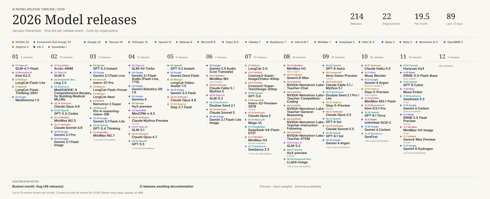

# Awesome LLM Technical Reports (2025-01 ~ 2026-11)

> A curated, structured local archive of frontier LLM / multimodal / medical-vertical model documentation — papers, system cards, model cards, and official blog posts — organized by **year / company**.

  

  
  
  
  
  

> 🚀 **Interactive Web Experience**: Visit our [LMSYS-style Interactive Web Portal](https://joe1chief.github.io/awesome-llm-tech-reports/) for instant multi-category filtering, alternating evolution timeline, Head-to-Head model technical diff arena, full-text search, and one-click BibTeX citations!

---

## Table of Contents

- [Project Scope](#project-scope)
- [Release Timeline](#release-timeline)
- [Technical Word Cloud](#technical-word-cloud)
- [Company Quick Links](#company-quick-links)
- [Model Index (Folded by Year)](#model-index-folded-by-year)
- [Star History](#star-history)

## Project Scope

- Archives model reports from **2025-01** through **2026-11** across LLM, multimodal and medical domains.
- Links official technical reports, system cards and model cards. Local PDFs are available for mirrored reports.
- Provides a searchable Markdown index and a [scheduled refresh workflow](REPORT_AUTOMATION.md).

## Release Timeline

[Browse the full timeline and release sources](https://joe1chief.github.io/awesome-llm-tech-reports/timeline.html)

## Technical Word Cloud

[Word frequencies](docs/data/word-cloud.json)

## Company Quick Links

`2026`: [`Meituan`](#company-meituan) · [`Google`](#company-google) · [`Zhipu AI`](#company-zhipu) · [`Anthropic`](#company-anthropic) · [`OpenAI`](#company-openai) · [`OpenBMB`](#company-openbmb) · [`Tencent`](#company-tencent) · [`MiniMax`](#company-minimax) · [`NVIDIA`](#company-nvidia) · [`Microsoft`](#company-microsoft) · [`InternLM`](#company-internlm) · [`InclusionAI (Ant Group)`](#company-inclusionai) · [`Snowflake`](#company-snowflake) · [`ByteDance`](#company-bytedance) · [`Moonshot AI`](#company-moonshot)

`2025`: [`StepFun`](#company-stepfun) · [`Zhipu AI`](#company-zhipu) · [`MiniMax`](#company-minimax) · [`Meituan`](#company-meituan) · [`Allen AI`](#company-allenai) · [`Alibaba`](#company-alibaba_qwen) · [`Google`](#company-google) · [`NVIDIA`](#company-nvidia) · [`xAI`](#company-xai) · [`OpenAI`](#company-openai) · [`Anthropic`](#company-anthropic) · [`Tencent`](#company-tencent) · [`InternLM`](#company-internlm) · [`Hugging Face`](#company-huggingface) · [`Quark`](#company-quark) · [`Moonshot AI`](#company-moonshot) · [`ByteDance`](#company-bytedance) · [`Meta`](#company-meta) · [`DeepSeek`](#company-deepseek)

### Company Directory Index

- **Alibaba / Qwen**: `2025/alibaba_qwen/`

- **Allen AI**: `2025/allenai/`

- **Anthropic**: `2025/anthropic/`, `2026/anthropic/`

- **ByteDance**: `2025/bytedance/`, `2026/bytedance/`

- **DeepSeek**: `2025/deepseek/`

- **Google**: `2025/google/`, `2026/google/`

- **Hugging Face**: `2025/huggingface/`

- **InclusionAI (Ant Group)**: `2026/inclusionai/`

- **InternLM**: `2025/internlm/`, `2026/internlm/`

- **Meituan**: `2025/meituan/`, `2026/meituan/`

- **Meta**: `2025/meta/`

- **Microsoft**: `2026/microsoft/`

- **MiniMax**: `2025/minimax/`, `2026/minimax/`

- **Moonshot AI**: `2025/moonshot/`, `2026/moonshot/`

- **NVIDIA**: `2025/nvidia/`, `2026/nvidia/`

- **OpenAI**: `2025/openai/`, `2026/openai/`

- **OpenBMB**: `2026/openbmb/`

- **Quark (Alibaba)**: `2025/quark/`

- **Snowflake**: `2026/snowflake/`

- **StepFun**: `2025/stepfun/`

- **Tencent**: `2025/tencent/`, `2026/tencent/`

- **Zhipu AI**: `2025/zhipu/`, `2026/zhipu/`

- **xAI**: `2025/xai/`

## Model Index (Folded by Year)

<b>2026 (192 models)</b>

| Release Date | Organization | Model | Core Highlights | Official Link | Local File |
| --- | --- | --- | --- | --- | --- |
| 2026-11-12 | Google | Gemini 4 Hydrogen |  | https://deepmind.google/models/model-cards/gemini-4-hydrogen/ | Model card |
| 2026-11-11 | MiniMax | MiniMax-H3-Image | Building on H3's pre-training capabilities, we've made improvements across the entire post-training pipeline, from data and reinforcement learning to sampling-step reduction, PE, and deployment optimization. | https://www.minimax.io/blog/minimax-h3-image | Official technical page |
| 2026-11-11 | Alibaba | Qwen4-Max Preview | qwen4-max-preview,Alibaba Cloud Model Studio:Explore Qwen4-Max-Preview's multimodal understanding, deep reasoning, tool calling, and Token Plan access | https://www.alibabacloud.com/help/en/model-studio/qwen4-max-preview | Official technical page |
| 2026-11-11 | Baidu | ERNIE 5.5 Flash Preview | The post-trained preview has 280B total and 14B active parameters, with a 1M-token context. Baidu provides benchmark results and examples across coding, design and content creation. | https://ernie.baidu.com/release/ernie-5-5-flash-preview/ | Official technical page |
| 2026-11-10 | InclusionAI (Ant Group) | ZoomGain-9B | !\[Table 3 showing RL training results for Qwen3.5-4B and Qwen3.5-9B on ZoomGain and ZwZ data\](docs/figures/zoomgain-rl-training-results.png) | https://huggingface.co/inclusionAI/ZoomGain-9B/blob/b4550ef2e5a30b33c5133278036a682197489145/README.md | Model card |
| 2026-11-10 | InclusionAI (Ant Group) | ZoomGain-4B | !\[Table 3 showing RL training results for Qwen3.5-4B and Qwen3.5-9B on ZoomGain and ZwZ data\](docs/figures/zoomgain-rl-training-results.png) | https://huggingface.co/inclusionAI/ZoomGain-4B/blob/2ac9e28f1de993b4d7b6ebeda1368ff2e6982a71/README.md | Model card |
| 2026-11-09 | Anthropic | Claude Fable 5.2 / Mythos 5.2 | The paired release documents agentic coding, software engineering and multi-step work evaluations, alongside the safety testing performed before deployment. | https://www.anthropic.com/document/claude-fable-5-2-mythos-5-2-system-card | System card |
| 2026-11-09 | ByteDance | Seedream 5.5 |  | https://seed.bytedance.com/en/blog/more-realistic-images-more-stable-editing-across-100-rounds-introducing-seedream-5-5/ | Official technical page |
| 2026-11-09 | Meta | Muse Ember | Muse Ember is our smallest and most efficient model, designed for complex reasoning execution and the work agents repeat all day. | https://research.meta.ai/blog/muse-ember | Official technical page |
| 2026-11-06 | ByteDance | Cola2 | Hierarchical language generation separates continuous semantic modeling from discrete text realization, but its effectiveness depends on what the latent space compresses and how the discrete generator uses it. We propose Cola2, a framework that jointly studies continuous semantic compression, the balance between reconstruction and generation, and continuous-discrete co-adaptation. Cola2 dynamically segments text into semantic spans, controls the compression rate through auxiliary-loss-free negative feedback, and combines reconstruction and generation sup | https://arxiv.org/abs/2610.31305v1 | Technical report |
| 2026-11-05 | OpenAI | GPT-6 Cyber | GPT-6 Cyber is a cyber-specialized variant of GPT-6 Astra designed for authorized security work, including tasks such as vulnerability discovery, exploit development, and web pentesting. The model has specialized post-training that aims to improve cybersecurity capabilities and reduce cyber refusals. The goal is to expand the security work the model can perform while keeping it within the user’s authorized scope and preserving refusals outside cybersecurity. In our evaluations, GPT-6 Cyber shows substantially stronger cybersecurity capabilities and impro | https://deploymentsafety.openai.com/gpt-6-cyber | System card |
| 2026-11-05 | Baidu | ERNIE-5.5-Flash-Base | \*\*ERNIE 5.5 Flash\*\* is an efficient sparse Mixture-of-Experts (MoE) language model with \*\*280B total parameters and 14B activated per token\*\*, pre-trained from scratch on \*\*33.5T tokens\*\* with a training context of up to \*\*128K\*\*; fine-tuning and inference support a \*\*1M-token\*\* context. Different domains, reasoning tasks and agentic applications call for different data, training objectives and behavioral policies; by releasing the weights at the end of pre-training, we let developers build on the model's general capabilities and choose for themselves wh | https://huggingface.co/baidu/ERNIE-5.5-Flash-Base/blob/028544b2ffceea189b2d8768ed2b9d09b06f2343/README.md | Model card |
| 2026-11-04 | Meituan | LongCat-2.5 | LongCat-2.5 is a native multimodal MoE model for long-horizon agentic tasks, with \*\*1.6 trillion total parameters\*\* and approximately \*\*48 billion activated per token\*\*. Building on LongCat-2.0, it combines visual understanding with agentic coding for complex codebase development, full-project builds, creative design, and 3D tasks. Long-sequence training, large-scale RL, multi-teacher learning, and infrastructure optimizations on domestic AI accelerators underpin these capabilities. | https://huggingface.co/meituan-longcat/LongCat-2.5/blob/60032d966e6369b822f0e61d2eff01368d38b111/README.md | Model card |
| 2026-11-04 | Tencent | Hunyuan Hy4 |  | https://adp.tencent.com/zh/blog/tencent-cloud-adp-hunyuan-hy4-release | Official technical page |
| 2026-10-30 | Microsoft | Mage-VL-Cowork | \*\*Mage-VL-Cowork\*\* bridges this gap. Trained end-to-end from an intermediate \*\*4B \[`Mage-VL`\](https://huggingface.co/microsoft/Mage-VL)\*\* checkpoint through a progressive \*\*five-stage specialize-then-unify curriculum\*\*, it combines screenshot-grounded GUI interaction (`computer\_use`) and persistent code/terminal execution (`bash`) inside a \*\*single vision-language policy\*\* — with no external orchestrator. Upstream of training, we \*\*evolve the teacher harness\*\* (pruning redundant action routes and equipping domain libraries) and build \*\*Mage-CUA-Forge\*\*, | https://huggingface.co/microsoft/Mage-VL-Cowork/blob/6fbe7f91da477c1c73790dbb1f08d001b8626be1/README.md | Model card |
| 2026-10-29 | ByteDance | GenFirst | Latent generative models typically follow a two-stage pipeline, training a variational autoencoder for reconstruction and then a generative model on the frozen latent space. Since reconstruction-optimized latents are not necessarily generation-friendly, jointly training both models is an appealing alternative. However, direct end-to-end training remains challenging, as it is prone to latent collapse and faces a generation-reconstruction conflict. We revisit this problem by analyzing how different objectives shape the latent space and identify two key ins | https://arxiv.org/abs/2608.29335v1 | Technical report |
| 2026-10-29 | OpenAI | GPT-6 Luna | GPT-6 Luna (October 29) uses the same types of data and training as GPT-6 Luna (October 7), described in the GPT-6 Luna (October 7) card. | https://deploymentsafety.openai.com/gpt-6-luna-october-28-2026-addendum | System card |
| 2026-10-28 | Google | Gemini 4 Carbon |  | https://deepmind.google/models/model-cards/gemini-4-carbon/ | Model card |
| 2026-10-27 | InclusionAI (Ant Group) | Ling-3.1-flash-1019 | ## Introduction We introduce \*\*Ling-3.1-flash-1019\*\*, an upgraded version of \[Ling-3.1-flash\](https://huggingface.co/inclusionAI/Ling-3.1-flash), with \*\*560B\*\* total parameters, \*\*25B\*\* active parameters per token, and a \*\*1M-token context window\*\*. With further post-training optimizations, \*\*Ling-3.1-flash-1019\*\* demonstrates significant improvements in scientific and real-world agentic capabilities. Its \*\*AA-Briefcase\*\* score rises from 1397 to \*\*1524\*\*, while performance on \*\*AutomationBench-AA\*\* increases from 62% to \*\*68%\*\*. The model also makes gai | https://huggingface.co/inclusionAI/Ling-3.1-flash-1019/blob/2109a6863fb14361eecc346ef98b3db88b8cdaee/README.md | Model card |
| 2026-10-27 | Baidu | Unlimited-OCR-2 | Sparse Reference Sliding Window Attention bounds the decoder's active reference tokens during document parsing. The report evaluates hundred-page decoding and long-document accuracy on MPDocBench and MarathonDocBench. | https://arxiv.org/abs/2610.39308v2 | Technical report |
| 2026-10-26 | OpenAI | GPT-6.1 Terra |  | https://deploymentsafety.openai.com/gpt-6-1-terra | System card |
| 2026-10-26 | InclusionAI (Ant Group) | LBS-27B | Training uses \*\*only synthetic GUI grounding data\*\*, with no general-domain data or VQA questions: approximately \*\*10K cold-start SFT examples\*\*, followed by \*\*80 GRPO steps\*\* with a batch size of \*\*64\*\* and \*\*8 rollouts per prompt\*\*. | https://huggingface.co/inclusionAI/LBS-27B/blob/e6ab883fa2b1d2579bf2616d38b6989b4af0333d/README.md | Model card |
| 2026-10-25 | InclusionAI (Ant Group) | Ling-3.1-flash-base | We introduce \*\*Ling-3.1-flash-base\*\*, the base checkpoint of \[Ling-3.1-flash\](https://huggingface.co/inclusionAI/Ling-3.1-flash), released to support research and community-driven innovation. With \*\*560B total parameters\*\* and \*\*25B active parameters per token\*\*, the model provides a foundation for continued pretraining, domain adaptation, and post-training research. | https://huggingface.co/inclusionAI/Ling-3.1-flash-base/blob/c2cad79e46fcb7b46d96f9cf876ce1f2418b6e64/README.md | Model card |
| 2026-10-23 | InternLM | Atria-Dawn | As AI agents become participants in the development of their successors, they reshape both the production of intelligence and the role of human researchers. We introduce Atria Dawn Preview, a foundation agentic language model designed for scientific research and engineering workflows, with the goal of expanding the frontier of agent productivity in the real world. This model is trained via a Verifiable Experience Pipeline that connects tool-mediated interactions to executable environments and externally verified outcomes. Across 16 benchmarks spanning re | https://arxiv.org/abs/2609.15818v2 | Technical report |
| 2026-10-23 | Moonshot AI | Kimi-K3.1-Pro |  | https://www.kimi.com/en/blog/kimi-k3-1-pro | Official technical page |
| 2026-10-22 | Tencent | Hy-SimulMT-30B-A3B-Interleave | In our \*\*RealSI long-form audio evaluation\*\*, Hy-SimulMT achieved a \*\*StreamLAAL of approximately 3 seconds\*\*, the lowest among the systems shown in the comparison. Its GEMBA score exceeded those of the compared open-source models and four of the five commercial APIs. | https://huggingface.co/tencent/Hy-SimulMT-30B-A3B-Interleave/blob/e988e52e19ec4002e2763ec46fdff997c68fe859/README.md | Model card |
| 2026-10-22 | Tencent | Hy-SimulMT-30B-A3B | In our \*\*RealSI long-form audio evaluation\*\*, Hy-SimulMT achieved a \*\*StreamLAAL of approximately 3 seconds\*\*, the lowest among the systems shown in the comparison. Its GEMBA score exceeded those of the compared open-source models and four of the five commercial APIs. | https://huggingface.co/tencent/Hy-SimulMT-30B-A3B/blob/56c233df75bf09e386aa6282b01730b461afc83f/README.md | Model card |
| 2026-10-19 | MiniMax | MiniMax-M3.1-Flash | Today, we officially roll out MiniMax M3.1 Flash. As a next-generation Flash model, M3.1 Flash delivers a generational leap in agentic tasks, coding, Computer Use and cybersecurity, while making online inference nearly three times faster and reducing usage costs by 70%. | https://www.minimax.io/blog/minimax-m31f | Official technical page |
| 2026-10-19 | InclusionAI (Ant Group) | Ling-3.0-flash-Sante | With \*\*124B total parameters\*\* and \*\*5.1B active parameters per token\*\*, Sante is designed for \*\*medical reasoning, healthcare research, deep research, and tool-assisted workflows\*\* while retaining the general capabilities of Ling-3.0-flash. Model weights are available on \[Hugging Face\](https://huggingface.co/inclusionAI/Ling-3.0-flash-Sante) and \[ModelScope\](https://www.modelscope.cn/models/inclusionAI/Ling-3.0-flash-Sante). | https://huggingface.co/inclusionAI/Ling-3.0-flash-Sante/blob/f74bd27bd26ffc71a50dd847805f8f7666ff0b43/README.md | Model card |
| 2026-10-17 | DeepSeek | DeepSeek-V4.1-Flash-1017 | \*\*DeepSeek-V4.1-Flash-1017\*\* is a minor update to \[\*\*DeepSeek-V4.1-Flash\*\*\](https://huggingface.co/deepseek-ai/DeepSeek-V4.1-Flash), delivering substantial improvements across reasoning, coding, agentic tasks, and visual benchmarks. Alongside these gains, the model reduces task execution time and output length, enabling users to complete tasks faster and at lower cost and advancing the performance–cost Pareto frontier across multiple agent harnesses. | https://huggingface.co/deepseek-ai/DeepSeek-V4.1-Flash-1017/blob/08c8657f02291e11b6f6b63e0e16014f8e748518/README.md | Model card |
| 2026-10-16 | InclusionAI (Ant Group) | ZwZ2-27B | --- library\_name: transformers pipeline\_tag: image-text-to-text datasets: - inclusionAI/ZwZ2-RL-VQA base\_model: Qwen/Qwen3.6-27B language: - en tags: - zwz2 - vision-language - visual-reasoning - reinforcement-learning - grpo --- | https://huggingface.co/inclusionAI/ZwZ2-27B/blob/6decedf05c953da84fe272922e192499794244e9/README.md | Model card |
| 2026-10-16 | InclusionAI (Ant Group) | ZwZ2-9B | --- library\_name: transformers pipeline\_tag: image-text-to-text datasets: - inclusionAI/ZwZ2-RL-VQA base\_model: Qwen/Qwen3.5-9B language: - en tags: - zwz2 - vision-language - visual-reasoning - reinforcement-learning - grpo --- | https://huggingface.co/inclusionAI/ZwZ2-9B/blob/de52e7291860cf8f4e09c829c5f6d1337674926d/README.md | Model card |
| 2026-10-16 | NVIDIA | NVIDIA-Nemotron-Labs-Dory1.0-4B-BF16 | --- library\_name: transformers license: other license\_name: openmdw-1.1 license\_link: https://openmdw.ai/license/1-1/ pipeline\_tag: text-generation language: - en tags: - nvidia - pytorch - nemotron-labs - dory datasets: - nvidia/nemotron-post-training-v3 - nvidia/nemotron-pre-training-datasets track\_downloads: true --- | https://huggingface.co/nvidia/NVIDIA-Nemotron-Labs-Dory1.0-4B-BF16/blob/f6c832e6963ddb74f62c75813a3e8c74b1af67b1/README.md | Model card |
| 2026-10-15 | InclusionAI (Ant Group) | ZwZ2-4B | --- library\_name: transformers pipeline\_tag: image-text-to-text datasets: - inclusionAI/ZwZ2-RL-VQA base\_model: Qwen/Qwen3.5-4B language: - en tags: - zwz2 - vision-language - visual-reasoning - reinforcement-learning - grpo --- | https://huggingface.co/inclusionAI/ZwZ2-4B/blob/f4cf5f31fb5578622312017a5a74d6b0cd1d64b8/README.md | Model card |
| 2026-10-15 | Tencent | Hy-Memory-30B-A3B | External-memory systems extend language-model applications beyond a context window, but their quality depends critically on the model executing the write path: deciding what to retain, how precisely to represent it, and how new evidence should update persistent state. Existing frameworks typically place a general-purpose large language model behind framework-specific prompts. This raises serving cost, and a writer specialized for one protocol does not transfer directly to another; a unified model that can operate across established memory frameworks rema | https://arxiv.org/abs/2610.22196v1 | Technical report |
| 2026-10-13 | InclusionAI (Ant Group) | Ling-3.1-flash | ## Introduction We're introducing \*\*Ling-3.1-flash\*\*, an upgraded native hybrid reasoning model designed for complex, real-world tasks. With \*\*560B\*\* total parameters, \*\*25B\*\* active parameters per token, and a \*\*1M-token context window\*\*, Ling-3.1-flash builds upon Ling-3.0-flash with improvements in architecture and performance on real-world tasks. | https://huggingface.co/inclusionAI/Ling-3.1-flash/blob/dde57b1c6a365aa0e0a33e15cecce0f2be96f5a3/README.md | Model card |
| 2026-10-12 | Meta | Muse Wonder |  | https://about.fb.com/news/2026/10/introducing-muse-wonder-models/ | Official technical page |
| 2026-10-12 | NVIDIA | NVIDIA-Nemotron-3.5-Super-VL-120B-A12B-BF16 | 2026-10-27 Nemotron 3.5 Super and Lightning: Open, Efficient Mixture-of-Experts Hybrid Mamba-Transformer Models for Agentic AI NVIDIA Abstract. We introduce Nemotron 3.5 Super and Nemotron 3.5 Lightning, open and efficient Mixture-of-Experts Hybrid Mamba-Transformer models designed for reasoning, long-context understanding, and agentic workloads. Super is a 120B-parameter, 12B-active multimodal model, while Lightning is a smaller 30B-parameter, 3B-active text model; both designed for efficient deployment. Both models combine large-scale distillation, lon | https://research.nvidia.com/labs/nemotron/files/NVIDIA-Nemotron-3.5-Super-and-Lightning-Technical-Report.pdf | Technical report |
| 2026-10-12 | NVIDIA | NVIDIA-Nemotron-3.5-Super-VL-120B-A12B-Base-BF16 | 2026-10-27 Nemotron 3.5 Super and Lightning: Open, Efficient Mixture-of-Experts Hybrid Mamba-Transformer Models for Agentic AI NVIDIA Abstract. We introduce Nemotron 3.5 Super and Nemotron 3.5 Lightning, open and efficient Mixture-of-Experts Hybrid Mamba-Transformer models designed for reasoning, long-context understanding, and agentic workloads. Super is a 120B-parameter, 12B-active multimodal model, while Lightning is a smaller 30B-parameter, 3B-active text model; both designed for efficient deployment. Both models combine large-scale distillation, lon | https://research.nvidia.com/labs/nemotron/files/NVIDIA-Nemotron-3.5-Super-and-Lightning-Technical-Report.pdf | Technical report |
| 2026-10-09 | Alibaba | Qwen-Image-2.1-Turbo | \*\*Qwen-Image-2.1-Turbo\*\* is an accelerated checkpoint of \[Qwen-Image-2.1\](https://huggingface.co/Qwen/Qwen-Image-2.1) for text-to-image generation and image editing with \*\*8 denoising steps\*\*. It uses the same 7B visual generation architecture and loads directly with `QwenImage21Pipeline` in Diffusers. | https://huggingface.co/Qwen/Qwen-Image-2.1-Turbo/blob/fc13ba1986fcb905854dc8de2f52eee395f49b5b/README.md | Model card |
| 2026-10-09 | NVIDIA | NVIDIA-Nemotron-3.5-Bolt-74B-A9B-BF16 | 15 October 2026 Nemotron 3.5 Bolt 74B-A9B 24GB: A Hybrid Vision-Language Model for Local AI NVIDIA Abstract.We introduce Nemotron 3.5 Bolt 74B-A9B 24GB, a hybrid Mamba–Transformer vision-language model that optimizes speed and intelligence per GB of memory used for local agentic workloads. Derived from the Nemotron 3.5 Super VL 120B-A12B model family, Nemotron 3.5 Bolt 74B-A9B 24GB combines Star Elastic compression with 2-bit Quantization-Aware Distillation for memory-constrained deployment. The model is optimized for reasoning, agentic tool use, and web | https://research.nvidia.com/labs/nemotron/files/NVIDIA-Nemotron-3.5-Bolt-74B-A9B-24GB-Technical-Report.pdf | Technical report |
| 2026-10-07 | OpenBMB | MiniCPM-V-4.7-35B-A3B | \[GitHub\](https://github.com/openbmb/MiniCPM-V) · \[On-device results\](#on-device-capability-and-efficiency) · \[Evaluation\](#evaluation) · \[Examples\](#examples) · \[Usage\](#usages) · \[Model weights\](#model-weights) · \[DSpark\](https://huggingface.co/openbmb/MiniCPM-V-4.7-35B-A3B-DSpark) | https://huggingface.co/openbmb/MiniCPM-V-4.7-35B-A3B/blob/98e79ba972b586ac6146d3505771ce1467e199ba/README.md | Model card |
| 2026-10-07 | Anthropic | Claude Haiku 5.5 |  | https://platform.claude.com/docs/en/models/haiku-5-5/overview | Official technical page |
| 2026-10-07 | NVIDIA | NVIDIA-Nemotron-3.5-Bolt-74B-A9B-24GB | 15 October 2026 Nemotron 3.5 Bolt 74B-A9B 24GB: A Hybrid Vision-Language Model for Local AI NVIDIA Abstract.We introduce Nemotron 3.5 Bolt 74B-A9B 24GB, a hybrid Mamba–Transformer vision-language model that optimizes speed and intelligence per GB of memory used for local agentic workloads. Derived from the Nemotron 3.5 Super VL 120B-A12B model family, Nemotron 3.5 Bolt 74B-A9B 24GB combines Star Elastic compression with 2-bit Quantization-Aware Distillation for memory-constrained deployment. The model is optimized for reasoning, agentic tool use, and web | https://research.nvidia.com/labs/nemotron/files/NVIDIA-Nemotron-3.5-Bolt-74B-A9B-24GB-Technical-Report.pdf | Technical report |
| 2026-10-05 | NVIDIA | NLD-Uni | For image understanding, NLD-Uni encodes images into continuous visual features and generates text responses. For image generation, it models discrete visual tokens through iterative diffusion and decodes those tokens into RGB images. The architecture supports autoregressive and blockwise diffusion decoding for text, as well as image-conditioned generation and editing when enabled by the checkpoint and inference implementation. | https://huggingface.co/nvidia/NLD-Uni/blob/5db755a2eb0ab84654e3dcf80c7d0245bfe36a50/README.md | Model card |
| 2026-10-05 | NVIDIA | NVIDIA-Nemotron-3.5-Bolt-E4B-4GB | Nemotron 3.5 Bolt E4B 4GB: Technical Report multiple turns, and make sense of conversation history, application state, and tool results. For local deployment, they must also respond quickly and fit within limited memory. We introduce Nemotron 3.5 Bolt E4B 4GB, an open small language model designed for fast conversational agents with a target memory footprint of approximately 4 GB. Nemotron 3.5 Bolt E4B 4GB supports reasoning and non-reasoning modes. The model can also generate concise conversational responses by enabling conversational\_mode. Nemotron 3.5 | https://research.nvidia.com/labs/nemotron/files/NVIDIA-Nemotron-3.5-Bolt-E4B-4GB-Technical-Report.pdf | Technical report |
| 2026-10-05 | NVIDIA | NVIDIA-Nemotron-3.5-Bolt-E4B-BF16 | Nemotron 3.5 Bolt E4B 4GB: Technical Report multiple turns, and make sense of conversation history, application state, and tool results. For local deployment, they must also respond quickly and fit within limited memory. We introduce Nemotron 3.5 Bolt E4B 4GB, an open small language model designed for fast conversational agents with a target memory footprint of approximately 4 GB. Nemotron 3.5 Bolt E4B 4GB supports reasoning and non-reasoning modes. The model can also generate concise conversational responses by enabling conversational\_mode. Nemotron 3.5 | https://research.nvidia.com/labs/nemotron/files/NVIDIA-Nemotron-3.5-Bolt-E4B-4GB-Technical-Report.pdf | Technical report |
| 2026-10-01 | NVIDIA | PixelUMM | - \*\*Architecture:\*\* Decoder-only Transformer with raw-pixel patch embeddings and an iterative pixel-generation head. - \*\*Language backbone:\*\* \[Qwen/Qwen3-8B\](https://huggingface.co/Qwen/Qwen3-8B), revision `b968826d9c46dd6066d109eabc6255188de91218`. - \*\*Image representation:\*\* RGB images divided into 16-by-16 pixel patches. - \*\*Generation:\*\* Iterative denoising for image and video generation. - \*\*Parameters:\*\* 15,199,672,064. | https://huggingface.co/nvidia/PixelUMM/blob/4bb3ce9a112e7e1c7d375b1c5bd64f54d259ecc8/README.md | Model card |
| 2026-09-30 | Google | Gemini 4 Argon |  | https://deepmind.google/models/model-cards/gemini-4-argon/ | Model card |
| 2026-09-29 | Microsoft | AesCode-32B | AesCode-32B starts from \*\*Qwen3-VL-32B-Instruct\*\* and is trained with cold-start SFT followed by GDPO across seven reward channels. It is the larger released checkpoint and leads the aggregate benchmark results. | https://huggingface.co/microsoft/AesCode-32B/blob/3f9157f331c574b470149ddd88e67d5bd13481f8/README.md | Model card |
| 2026-09-29 | Microsoft | AesCode-8B | \*\*The reference image is optional.\*\* Reference-conditioned training internalizes visual planning into the policy. Measured on AesCode-8B, withholding the reference at inference costs only \*\*1.00 Visual point\*\*, against 19.55 for the Qwen3-VL-8B-Instruct backbone and 10.04 for GPT-5.5. Quality is still highest when a reference is supplied. | https://huggingface.co/microsoft/AesCode-8B/blob/cfe1f698e09b8e7a009901ca700c765e25240af6/README.md | Model card |
| 2026-09-29 | OpenAI | GPT-6.1 Sol | GPT-6.1 Sol delivers capabilities comparable to those of our most powerful model, GPT-6 Astra, with an unmatched combination of speed and affordability. This system card addendum provides updates on the baseline safety metrics and evaluation results for GPT-6.1 Sol.1 | https://deploymentsafety.openai.com/gpt-6-1-sol | System card |
| 2026-09-28 | Anthropic | Claude Sonnet 5.5 | Anthropic evaluates agentic coding and computer use across effort settings, including how lower inference effort affects task quality and cost. The system card covers evaluation methodology and safety. | https://www.anthropic.com/claude-sonnet-5-5-system-card | System card |
| 2026-09-22 | Anthropic | Claude Opus 5.5 | Safety. Opus 5.5 achieves the best scores of any model to date on our automated behavioral audit, our alignment suite that tests Claude across thousands of simulated scenarios. It is much less likely than recent models to take hard-to-reverse actions or act outside the boundaries it’s been given, and it’s more resistant than Opus 5 to prompt injection. We’ve also broadened our alignment testing to cover longer tasks, impossible tasks, and scenarios modeled on real incidents, though it still has limits. Full details of our evaluation are available in the | https://www.anthropic.com/claude-opus-5-5 | Official technical page |
| 2026-09-22 | OpenAI | GPT-6 Sol |  | https://deploymentsafety.openai.com/gpt-6-astra/sec%3Aappendix-222669 | System card |
| 2026-09-22 | InclusionAI (Ant Group) | Ming-3.0-tts-tiny | This repository contains \*\*Ming-3.0-tts-tiny\*\*, the Ming-3.0-tts mixture-of-experts checkpoint built on Ling V3. Its Ling V3 backbone has 7.9B total parameters and activates about 1.3B parameters per token. The repository includes sharded weights, supporting model code, audio tokenizer, speaker encoder and text tokenizer. | https://huggingface.co/inclusionAI/Ming-3.0-tts-tiny/blob/4715ef5a2f02901f75687d538b6920fd0dd11e6b/README.md | Model card |
| 2026-09-21 | xAI | Grok 4.7 | Grok 4.7 was built with an entirely new safeguard stack. It is the strongest model we’ve tested on refusals and jailbreak resistance. In dual-use domains like cybersecurity and biological work, it leads on both utility for benign tasks and safe refusal on dangerous ones, topping LatchBio’s biosafety benchmark at 62.4%. | https://x.ai/news/grok-4-7 | Official technical page |
| 2026-09-20 | StepFun | Step-5-Preview | Step 5 Preview is a sparse Mixture-of-Experts (MoE) model with 600B total parameters and 27B active parameters. It supports up to 1 million tokens of context and accepts text, images, and video, enabling sustained reasoning and tool use across complex tasks. | https://huggingface.co/stepfun-ai/Step-5-Preview/blob/364b3b03fed2477aa0953fe855a2c4c8c48ee3cc/README.md | Model card |
| 2026-09-17 | Microsoft | FrogNano-4B-2609 | \|Field \| Value \| --- \| --- \| \| Developer \| Microsoft Corporation \| \| Description \| FrogNano is a compact repository-level coding agent derived from Qwen/Qwen3.5-4B. It is post-trained exclusively with reinforcement learning on approximately 1,500 synthetic software-engineering tasks generated, validated, and calibrated against the evolving policy using TaskPilot. FrogNano operates through the lightweight five-tool Leaf harness. Its agent-specific post-training uses no stronger-model solution trajectories, actions, reasoning traces, or patch targets. \| \| | https://huggingface.co/microsoft/FrogNano-4B-2609/blob/b90468c11a913c1916b4542b4b7a530ec42024a4/README.md | Model card |
| 2026-09-17 | InclusionAI (Ant Group) | Ming-Image-0.1-Design | --- license: mit library\_name: custom pipeline\_tag: text-to-image inference: false tags: - text-to-image - image-generation - graphic-design - text-rendering - rgba --- | https://huggingface.co/inclusionAI/Ming-Image-0.1-Design/blob/c57c49689d12ef7d4e24a170014f1dc43d3ce258/README.md | Model card |
| 2026-09-17 | NVIDIA | NVIDIA-NemotronLabs-AI-for-Media-Sports-Basketball | --- base\_model: nvidia/Nemotron-3-Nano-Omni-30B-A3B-Reasoning-BF16 base\_model\_relation: finetune library\_name: transformers license: other license\_name: openmdw-1.1 license\_link: &gt;- https://openmdw.ai/license/1-1/ pipeline\_tag: any-to-any tags: - nvidia - pytorch - multimodal track\_downloads: true --- | https://huggingface.co/nvidia/NVIDIA-NemotronLabs-AI-for-Media-Sports-Basketball/blob/632ddf0d709b0d3d550e2567a5745c067d8ee08f/README.md | Model card |
| 2026-09-16 | InclusionAI (Ant Group) | Realtime-Venus | Natural interaction in digital and physical environments requires continuous perception and timely responses. Spoken dialogue relies on acoustic and linguistic cues, while video interaction also requires grounding the conversation in evolving visual context. We present Realtime-Venus, a proactive full-duplex interaction system with two separately trained 9B models: Realtime-Venus-Omni for audio-visual interaction and Realtime-Venus-Audio for spoken interaction. Each model serves as a complete conversational frontend, integrating continuous perception, co | https://arxiv.org/abs/2609.13814v3 | Technical report |
| 2026-09-15 | Anthropic | Claude Fable 5.1 / Mythos 5.1 |  | https://www.anthropic.com/claude-fable-and-mythos-5-1 | Official technical page |
| 2026-09-15 | ByteDance | Doubao Seed 2.1 Pro / Lite | Lite supports native text, visual and audio understanding with a one-million-token context. Pro focuses on coding, multimodal agents and long-horizon execution. | https://console.volcengine.com/ark/region%3Acn-beijing/docs/model-release-announcement | Official technical page |
| 2026-09-15 | Google | Gemini 3.8 Live | Beyond visual presence, the feature is backed by Gemini’s advanced reasoning. With asynchronous tool calling, Live Avatar can trigger tool calls and fetch data in the background while continuing active dialogue, handling complex tasks while ensuring an uninterrupted conversational flow. | https://blog.google/innovation-and-ai/models-and-research/gemini-models/gemini-3-8-live-with-live-avatar/ | Official technical page |
| 2026-09-15 | Google | Gemini 3.8 | Gemini 3.8 Audio models are based on Gemini 3 Pro. For more information about the model architecture, see the Gemini 3 Pro model card. | https://deepmind.google/models/model-cards/gemini-3-8-audio/#page-content | Official technical page |
| 2026-09-14 | Alibaba | Qwen-Image-2.1 | We are excited to open-source Qwen-Image-2.1, a unified text-to-image generation and image editing model in the Qwen family. With just 7B parameters in its visual generation component (32 Single-Stream DiT layers), Qwen-Image-2.1 balances generation quality, inference efficiency, and versatility. | https://github.com/QwenLM/Qwen-Image-2.1 | Official technical page |
| 2026-09-13 | InternLM | Intern-S2-397B | We introduce \*\*Intern-S2-397B\*\*, our most capable multimodal foundation model for scientific intelligence and long-horizon agents. Intern-S2-397B scales along three critical dimensions: pre-training, reinforcement-learning task coverage, and interactive agent environments. By combining a new vision-language pre-training paradigm with large-scale multi-task reinforcement learning and long-horizon agent reinforcement learning, Intern-S2-397B delivers a step change in general reasoning, scientific problem solving, and agentic capabilities. | https://huggingface.co/internlm/Intern-S2-397B/blob/85c1f58844e68836ec02245183cfa671de20977a/README.md | Model card |
| 2026-09-11 | InternLM | Atria-Dawn-Preview | We conducted a comprehensive evaluation of Atria Dawn Preview across search, coding, tool use, productivity, and security benchmarks. | https://huggingface.co/internlm/Atria-Dawn-Preview/blob/311a9b8c6c0e8dd4b00b2d7baff7a926c3415e78/README.md | Model card |
| 2026-09-10 | DeepSeek | DeepSeek-V4.1-Flash | A smaller model family introduces native visual understanding and reduces KV cache demand. DeepSeek attributes capability improvements to changes in pretraining and larger-scale reinforcement learning during post-training. | https://huggingface.co/deepseek-ai/DeepSeek-V4.1-Flash/blob/main/DeepSeek_V41_Tech_Report.pdf | Technical report |
| 2026-09-10 | Allen AI | AstaBrief\_8B\_SFT | ## Inference and Usage &gt;\[!NOTE\] &gt;\*\*Recommended prompt\*\*: This checkpoint was fine-tuned using this \[SFT prompt\](https://huggingface.co/datasets/allenai/AstaBrief\_prompts/blob/main/sft\_prompt.txt). For best results, we recommend using the same prompt format at inference time with your input query and section references. Using a different prompt or interaction format may lead to degraded or inconsistent behavior. | https://huggingface.co/allenai/AstaBrief_8B_SFT/blob/d2d57580d2255422a4c1e4ca4efb6b169a134351/README.md | Model card |
| 2026-09-08 | NVIDIA | NV-Reason-CT | NV-Reason-CT is a 3D vision-language model (VLM) for CT image analysis. It combines a native 3D vision encoder (3D ViT) with a language model and is designed for radiology report generation, general question answering, and multi-step reasoning across chest and abdominal CT volumes. | https://huggingface.co/nvidia/NV-Reason-CT/blob/386b93e034983f6c1fc841a43833a1b6a0cd9c13/README.md | Model card |
| 2026-09-06 | InclusionAI (Ant Group) | LLaDA-UI | Diffusion large language models (dLLMs) achieve high decoding efficiency through block-parallel, arbitrary-order generation, making them attractive for latency-sensitive applications. GUI agents represent a natural testbed for this paradigm, as they must repeatedly perceive screen states and emit structured, spatially grounded actions in real time. However, whether dLLMs can be extended into capable multimodal GUI agents while preserving their parallel decoding advantage remains an open question. We present LLaDA-UI, a 16.7B-parameter MoE-based, block-wi | https://arxiv.org/abs/2609.13287v1 | Technical report |
| 2026-09-05 | InclusionAI (Ant Group) | LLaDA2.2-mini | \*\*LLaDA2.2-mini\*\* is the lightweight variant of the agentic diffusion language model in the LLaDA2 series. Built upon the LLaDA2.0-mini architecture, it inherits the core innovations of the LLaDA2.2 series — \*\*Levenshtein Editing\*\* (introducing `DELETE` and `INSERT` control tokens) — enabling long-context tool calling, multi-turn interaction, and robust error correction, while maintaining a smaller parameter footprint and lower inference cost. For more details, please refer to our \[technical report\](https://github.com/inclusionAI/LLaDA2.X/blob/main/LLaDA | https://huggingface.co/inclusionAI/LLaDA2.2-mini/blob/e4f77d25ab5ca86f2223c6cdc6a72b887e20c8a5/README.md | Model card |
| 2026-09-04 | InclusionAI (Ant Group) | Ling-3.0-flash-VL | # Introduction We are introducing Ling-3.0-flash-VL, our next-generation native multimodal model. Built upon Ling-3.0-flash, it brings visual information into the complete process of understanding, reasoning, acting, and verification—advancing beyond image and video perception to solving real-world tasks through vision. With 124B total parameters, only 5.5B activated parameters per token, support for image and video inputs, and a context window of up to 256K tokens, Ling-3.0-flash-VL delivers powerful multimodal reasoning and agentic capabilities with ex | https://huggingface.co/inclusionAI/Ling-3.0-flash-VL/blob/c22bf252f15b66d18ca00a15989ac7ed46b7f09e/README.md | Model card |
| 2026-09-04 | NVIDIA | Qwen3.8-27B-NVFP4 | ## Description: The NVIDIA Qwen3.8-27B NVFP4 model is a quantized version of Alibaba's Qwen3.8-27B model, which is an auto-regressive language model that uses an optimized transformer architecture. For more information on the model, please check \[here\](https://huggingface.co/Qwen/Qwen3.8-27B). The model is quantized with \[Model Optimizer\](https://github.com/NVIDIA/Model-Optimizer). | https://huggingface.co/nvidia/Qwen3.8-27B-NVFP4/blob/482ca0f3832238542f8f5295dde86b5f22711d80/README.md | Model card |
| 2026-09-04 | NVIDIA | NVIDIA-Nemotron-Labs-3-Competitive-Coding-550B-A55B-NVFP4 | 2026-6-9 Nemotron 3 Ultra: Open, Efficient Mixture-of-Experts Hybrid Mamba-Transformer Model for Agentic Reasoning NVIDIA Abstract. We introduce Nemotron 3 Ultra, a 550 billion total and 55 billion active parameter Mixture-of-Experts Hybrid Mamba-Attention language model. We pre-trained Nemotron 3 Ultra on 20 trillion text tokens, then extended the context length to 1M tokens, and post-trained using Supervised Fine Tuning (SFT), Reinforcement Learning (RL), and Multi-teacher On-Policy Distillation (MOPD). Nemotron 3 Ultra is our most capable model yet, e | https://research.nvidia.com/labs/nemotron/files/NVIDIA-Nemotron-3-Ultra-Technical-Report.pdf | Technical report |
| 2026-09-03 | InclusionAI (Ant Group) | Ming-3.0-audio-tiny | --- language: - en - zh license: mit library\_name: transformers pipeline\_tag: audio-to-audio tags: - audio - speech - automatic-speech-recognition - audio-understanding - audio-reasoning - speech-to-text - text-to-speech - conversational - mixture-of-experts - custom\_code model\_name: Ming-3.0-audio-tiny --- | https://huggingface.co/inclusionAI/Ming-3.0-audio-tiny/blob/401b1abc63de0862dfbc9cd2a40895019d742d09/README.md | Model card |
| 2026-09-03 | InclusionAI (Ant Group) | Ming-3.0-audio-flash | A native audio model built for real-world speech recognition, audio understanding, reasoning, and end-to-end spoken interaction. | https://github.com/inclusionAI/Ming-3.0-audio-flash | Official technical page |
| 2026-09-03 | OpenAI | GPT-6 Astra |  | https://deploymentsafety.openai.com/gpt-6-astra | System card |
| 2026-09-03 | InclusionAI (Ant Group) | Ling-3.0-flash-Fin | ## Introduction Ling-3.0-flash-Fin is the first finance-enhanced model in the Ant Ling family. Developed by Ant Group with leading financial institutions and domain experts, it extends \[Ling-3.0-flash\](https://huggingface.co/inclusionAI/Ling-3.0-flash) through continued training on high-quality financial data. | https://huggingface.co/inclusionAI/Ling-3.0-flash-Fin/blob/a5b4afb48f526175991724472c179e5a065604de/README.md | Model card |
| 2026-09-03 | NVIDIA | Nemotron-3.5-Parse | - \*\*Leading ParseBench accuracy:\*\* \*\*75.20\*\* with triple-pass parsing, the highest overall score among the systems in our \[reported comparison\](#parsebench). - \*\*Broad multilingual OCR:\*\* evaluated across \*\*163 language/script entries in 26 script groups\*\*, plus 10 Indic languages. See \[language results\](#multilingual-ocr). - \*\*Small and fast:\*\* \*\*0.631B parameters\*\*, with an optional \*\*89.3M-parameter DFlash2 drafter\*\*. See \[throughput measurements\](#new-dflash2-speculative-decoding) for the hardware, concurrency, and parsing mode behind each result. | https://huggingface.co/nvidia/Nemotron-3.5-Parse/blob/72ad4d71dd827135ee581502363e14748008900a/README.md | Model card |
| 2026-09-02 | Google | Gemini 3.8 Flash | Building on the momentum of 3.7 Flash from three weeks ago and marking our third Flash release in only six weeks, today we’re introducing Gemini 3.8, our best reasoning and coding model yet, at the same speed and low cost of 3.7. Gemini 3.8 introduces 2 variants: | https://blog.google/innovation-and-ai/models-and-research/gemini-models/3-8-flash-and-3-8-flash-cyber/ | Official technical page |
| 2026-09-02 | NVIDIA | Nemotron-3-Labs-Ultra-Math-RL | Nemotron-3-Labs-Ultra-Math-RL is a decoder-only transformer language model specialized for mathematical reasoning, trained to solve difficult mathematical problems and identify mistakes in proofs, and deployed as part of an ensemble system that achieved a gold-medal level score at the International Mathematical Olympiad 2026. | https://huggingface.co/nvidia/Nemotron-3-Labs-Ultra-Math-RL/blob/6849d3ecccbd63f3527d56072a3e9717ec4738c9/README.md | Model card |
| 2026-09-02 | NVIDIA | Nemotron-3-Labs-Ultra-Math-SFT | Nemotron-3-Labs-Ultra-Math-SFT is a decoder-only transformer language model specialized for mathematical reasoning, trained to solve difficult mathematical problems and identify mistakes in proofs, and deployed as part of an ensemble system that achieved a gold-medal level score at the International Mathematical Olympiad 2026. | https://huggingface.co/nvidia/Nemotron-3-Labs-Ultra-Math-SFT/blob/c6337c397cc7ea2cf7b594e0b880bc874558e20d/README.md | Model card |
| 2026-09-01 | InternLM | InternLumina-U2 | Intern Lumina U2 is a unified multimodal model that brings language, image, video and 3D into a single framework, covering text QA, text-to-image generation, image understanding, image editing, video understanding and 3D understanding with one model. It is a 16B-parameter MoE with 1B active parameters (16B-A1B), pairing an efficient sparse backbone with an 8-codebook fully-discrete visual representation built on \[AToken\](https://github.com/apple/ml-atoken). | https://huggingface.co/internlm/InternLumina-U2/blob/8e3d57f3cb190323334752952a622bb5b97086c1/README.md | Model card |
| 2026-09-01 | NVIDIA | NVIDIA-NemotronLabs-AI-for-Media-Sports-Tennis | --- library\_name: transformers license: other license\_name: openmdw-1.1 license\_link: &gt;- https://openmdw.ai/license/1-1/ base\_model: nvidia/Nemotron-3-Nano-Omni-30B-A3B-Reasoning-BF16 base\_model\_relation: finetune pipeline\_tag: any-to-any tags: - nvidia - pytorch - multimodal track\_downloads: true --- | https://huggingface.co/nvidia/NVIDIA-NemotronLabs-AI-for-Media-Sports-Tennis/blob/45f95d0da098aeefe5e16603714ccfe24c334488/README.md | Model card |
| 2026-08-31 | DeepSeek | DeepSeek-V4-Flash-Vision-Exp | We are excited to introduce \*\*DeepSeek-V4-Flash-Vision-Exp\*\*, our first experimental multimodal model in the DeepSeek-V4 family. It builds on the DeepSeek-V4-Flash architecture by incorporating visual modules and undergoing continued training to unlock visual understanding capabilities. | https://huggingface.co/deepseek-ai/DeepSeek-V4-Flash-Vision-Exp/blob/6821d6ad3681a4b137b066b76094fa82ebd0a380/README.md | Model card |
| 2026-08-28 | InclusionAI (Ant Group) | LLaDA-Image | We introduce LLaDA-Image, a unified framework that pairs a 6B Diffusion Transformer (DiT) trained from scratch with a frozen vision-language understanding module built on the LLaDA2.0-Mini diffusion language model backbone. Instead of relying heavily on paired image-text data from the beginning, we first build a strong visual generative prior through image-only pre-training and mid-training. The generation pipeline comprises 220M samples, 98 of which are real images. For efficient and scalable optimization, we use parameter-free RMSNorm throughout the Di | https://arxiv.org/abs/2609.03796v1 | Technical report |
| 2026-08-28 | InclusionAI (Ant Group) | LLaDA-Image-Turbo | This repository provides the checkpoints and Diffusers-based inference code for the LLaDA-Image model family. | https://huggingface.co/inclusionAI/LLaDA-Image-Turbo/blob/f4afc52d925bbac4e22a1c947111fc1f127e37e5/README.md | Model card |
| 2026-08-27 | Tencent | ContextPilot-14B | ContextPilot-14B is the Qwen3-14B checkpoint of \*\*ContextPilot\*\*, a proactive context-management framework for long-horizon language-model agents. It teaches agents to plan, maintain long-term memory, and offload less useful context while they continue reasoning and using tools. For more details, see our \[paper\](https://arxiv.org/abs/2608.28476) and \[code repository\](https://github.com/Tencent/ContextPilot). | https://huggingface.co/tencent/ContextPilot-14B/blob/8eafd8356c5c5e713e92e623c8f1d346de6d0f95/README.md | Model card |
| 2026-08-27 | Tencent | ContextPilot-E4B | ContextPilot-E4B is the Gemma4-E4B checkpoint of \*\*ContextPilot\*\*, a proactive context-management framework for long-horizon language-model agents. It teaches agents to plan, maintain long-term memory, and offload less useful context while they continue reasoning and using tools. For more details, see our \[paper\](https://arxiv.org/abs/2608.28476) and \[code repository\](https://github.com/Tencent/ContextPilot). | https://huggingface.co/tencent/ContextPilot-E4B/blob/a7ba41c18ddcd334f23f63ef7a608ca46bfe3aa4/README.md | Model card |
| 2026-08-27 | Tencent | ContextPilot-8B | ContextPilot-8B is the Qwen3-8B checkpoint of \*\*ContextPilot\*\*, a proactive context-management framework for long-horizon language-model agents. It teaches agents to plan, maintain long-term memory, and offload less useful context while they continue reasoning and using tools. For more details, see our \[paper\](https://arxiv.org/abs/2608.28476) and \[code repository\](https://github.com/Tencent/ContextPilot). | https://huggingface.co/tencent/ContextPilot-8B/blob/595abeaed72e4a4d9da94d04917f0618989a5553/README.md | Model card |
| 2026-08-27 | Tencent | Hy4-preview | Hy4 preview is a new-generation Mixture-of-Experts (MoE) flagship model developed by the Tencent Hy Team. The model comprises 770B total parameters, of which 49B are activated per token. The backbone consists of 78 layers, where the first layer uses a standard dense FFN and the remaining 77 layers replace it with MoE, each containing 256 routed experts and 1 shared expert; every token activates the top-8 routed experts along with the shared expert. In addition to the backbone, 1 native MTP layer (10B total parameters, 0.7B activated) is built in for spec | https://github.com/Tencent-Hunyuan/Hy4-preview | Official technical page |
| 2026-08-27 | NVIDIA | Muse-Glimmer-30B-NVFP4 | ## Description: The NVIDIA Muse-Glimmer-30B NVFP4 model is the quantized version of Meta Superintelligence Lab's Muse-Glimmer-30B model, which is an auto-regressive language model that uses an optimized transformer architecture. Muse Glimmer is a dense causal transformer with a dedicated perception encoder for interleaved text and image input, purpose-built for local agentic tasks including multi-step reasoning, tool use, and multimodal understanding. For more information, please check \[here\](https://huggingface.co/meta-models/Muse-Glimmer-30B). The NVID | https://huggingface.co/nvidia/Muse-Glimmer-30B-NVFP4/blob/47818374517751c48c55cde2621594926b1888b6/README.md | Model card |
| 2026-08-26 | Allen AI | Bwen-8B-Stage1 | Qwen3 8B Base retrofitted to operate over bytes instead of tokens via \*byteification\* through a short additional training procedure. \*\*This checkpoint contains Stage 1 training only - inner model parameters are unchanged.\*\* | https://huggingface.co/allenai/Bwen-8B-Stage1/blob/854da622962867062be79bc750172cd0a3f6c2a8/README.md | Model card |
| 2026-08-26 | Allen AI | Bolmo-7B-Stage1 | Olmo 3 7B retrofitted to operate over bytes instead of tokens via \*byteification\* through a short additional training procedure. \*\*This checkpoint contains Stage 1 training only - inner model parameters are unchanged.\*\* | https://huggingface.co/allenai/Bolmo-7B-Stage1/blob/36da45293c742c597728e2d0f3498ac10667188b/README.md | Model card |
| 2026-08-26 | Allen AI | Bwen-8B | Qwen3 8B Base retrofitted to operate over bytes instead of tokens via \*byteification\* through a short additional training procedure. | https://huggingface.co/allenai/Bwen-8B/blob/b2644f7827c21c3276d70cb82e6558aa03b9670e/README.md | Model card |
| 2026-08-26 | Google | Gemini 3.5 | Gemini 3.5 Audio (Live Translate, Transcribe, Transcribe Live) is an addition to the Gemini 3 series of highly-capable, natively multimodal, reasoning models. The models are cost-efficient and fast, optimized for high-volume, latency-sensitive tasks like dialogue and translation. This model card describes the native audio capabilities as additional outputs of Gemini. Information specific to these modalities is specified in-line and referred to as Gemini 3.5 Live Translate, Gemini 3.5 Transcribe, and Gemini 3.5 Transcribe Live referred to collectively as | https://deepmind.google/models/model-cards/gemini-3-5-audio/#page-content | Official technical page |
| 2026-08-26 | InclusionAI (Ant Group) | UI-Venus-2-9B | \*\*UI-Venus-2\*\* is a general-purpose foundation GUI agent designed to operate across \*\*mobile applications, web platforms, and desktop operating systems\*\* through a unified closed-loop reasoning–action framework: the agent observes the current interface, reasons about the task state, executes an action, and incorporates environmental feedback into its next decision. | https://huggingface.co/inclusionAI/UI-Venus-2-9B/blob/90d6dfe13ece735f82793635b69bcc10c710e2ab/README.md | Model card |
| 2026-08-25 | Zhipu AI | GLM-5.3-Flash | We introduce GLM-5.3-Flash, the first natively multimodal model in the GLM-5 series. With 320B total parameters and just 18B active parameters, it outperforms GLM-5.2 across benchmarks and real-world workloads at one-tenth the price, while approaching Claude Opus 4.8 on coding and agentic benchmarks. | https://huggingface.co/zai-org/GLM-5.3-Flash/blob/46a050bec13002ad29ee795c16e61cf4fa3c4a9c/README.md | Model card |
| 2026-08-24 | Alibaba | Qwen3.8-Flash-Next | &gt; \[!Tip\] &gt; For users seeking managed, scalable inference without infrastructure maintenance, the official Qwen API service is provided by \[Qwen Cloud\](https://www.qwencloud.com). &gt; &gt; In particular, \*\*Qwen3.8-Flash\*\* is the official version based on Qwen3.8-Flash-Next with more production features, e.g., 1M context length by default, official built-in tools. For more information, please refer to the \[Qwen3.8-Flash Overview\](https://www.qwencloud.com/models/qwen3.8-flash). | https://huggingface.co/Qwen/Qwen3.8-Flash-Next/blob/812d96e10a0dd82b69d749e68693698cf6c36daa/README.md | Model card |
| 2026-08-20 | InclusionAI (Ant Group) | ArmorOCR | This is the official inference code of ArmorOCR, a two-stage framework for grounded adversarial OCR perception via observation-transferred self-distillation and reward-driven refinement. ArmorOCR is built on Qwen3-VL-8B-Instruct and enables single-pass inference on the original image, without any inference-time visual transformations or tool assistance. | https://github.com/ant-research/ArmorOCR | Official technical page |
| 2026-08-18 | Zhipu AI | GLM-5.3 |  | https://docs.z.ai/guides/llm/glm-5.3 | Official technical page |
| 2026-08-14 | OpenBMB | MathForm-8B | --- license: apache-2.0 language: - en base\_model: - Qwen/Qwen3-8B datasets: - openbmb/FormalVerse pipeline\_tag: text-generation library\_name: transformers tags: - arxiv:2608.14221 - lean4 - autoformalization - mathematics - formal-verification - reasoning --- | https://huggingface.co/openbmb/MathForm-8B/blob/8f6d09e66bd5821d985a2150ba3f09ba42e028ba/README.md | Model card |
| 2026-08-14 | Tencent | UI-Mate-democua-27B | - \*\*Parameters:\*\* 27B - \*\*Base model:\*\* \[Qwen3.6-27B\](https://huggingface.co/Qwen/Qwen3.6-27B) - \*\*Input:\*\* task instruction, screenshots, interaction history, and an optional demonstration workflow - \*\*Output:\*\* reasoning, a concise action description, and structured computer-use tool calls - \*\*Action space:\*\* mouse, keyboard, scrolling, waiting, user interaction, subtask completion, and task completion - \*\*Training:\*\* supervised fine-tuning, online reinforcement learning in executable GUI environments, then supervised fine-tuning on mixed general and d | https://huggingface.co/tencent/UI-Mate-democua-27B/blob/a76300b510ee8c9b509cdd933ff5e31a994a3400/README.md | Model card |
| 2026-08-14 | Tencent | UI-Mate-27B | - \*\*Parameters:\*\* 27B - \*\*Base model:\*\* \[Qwen3.6-27B\](https://huggingface.co/Qwen/Qwen3.6-27B) - \*\*Input:\*\* task instruction, screenshots, and interaction history - \*\*Output:\*\* reasoning, a concise action description, and structured computer-use tool calls - \*\*Action space:\*\* mouse, keyboard, scrolling, waiting, user interaction, and task completion - \*\*Training:\*\* supervised fine-tuning followed by online reinforcement learning in executable GUI environments - \*\*License:\*\* Apache-2.0 | https://huggingface.co/tencent/UI-Mate-27B/blob/3ade2378fc84032d5017c1a9c93c4eaa77d65e57/README.md | Model card |
| 2026-08-14 | Tencent | UI-Mate-9B | - \*\*Parameters:\*\* 9B - \*\*Base model:\*\* \[Qwen3.5-9B\](https://huggingface.co/Qwen/Qwen3.5-9B) - \*\*Input:\*\* task instruction, screenshots, and interaction history - \*\*Output:\*\* reasoning, a concise action description, and structured computer-use tool calls - \*\*Action space:\*\* mouse, keyboard, scrolling, waiting, user interaction, and task completion - \*\*Training:\*\* supervised fine-tuning followed by online reinforcement learning in executable GUI environments - \*\*License:\*\* Apache-2.0 | https://huggingface.co/tencent/UI-Mate-9B/blob/05dd5f2975195a5bb03d4363e8767f12158c8421/README.md | Model card |
| 2026-08-13 | DeepSeek | DeepSeek-V4-Pro-0813 | \| Benchmark \| DeepSeek-V4-Pro-0813 \| DeepSeek-V4-Flash-0731 \| DeepSeek-V4-Pro (Preview) \| DeepSeek-V4-Flash (Preview) \| GLM-5.2 \| Kimi K3 \| Opus-4.8 \| Fable-5 (w/ fallback) \| \| :--- \| :---: \| :---: \| :---: \| :---: \| :---: \| :---: \| :---: \| :---: \| \| HLE (wo / w tools) \| 42.7 / 60.0 \| 37.8 / 51.5 \| 37.7 / 48.2 \| 34.8 / 45.1 \| 40.5 / 54.7 \| 43.5 / 56.0 \| 49.8 / 57.9 \| 53.3 / 63.0 \| \| Terminal Bench 2.1 \| 87.9 \| 82.7 \| 72.1 \| 61.8 \| 81.0 \| 88.3 \| 85.0 \| 88.0 \| \| NL2Repo \| 61.5 \| 54.2 \| 38.5 \| 39.4 \| 48.9 \| - \| 69.7 \| - \| \| Cybergym \| 83.3 \| 76.7 \| 52.7 \| 38 | https://huggingface.co/deepseek-ai/DeepSeek-V4-Pro-0813/blob/72e1d3230f6c080a530b0a1d46f8eb4602340597/README.md | Model card |
| 2026-08-13 | Google | Gemini 3.7 Flash | Gemini 3.7 Flash is the next iteration in the Gemini 3 model family, featuring algorithmic improvements to its core reasoning foundation and support for agentic video understanding. It supports customizable thinking configurations to control the mix of quality, cost and latency. | https://deepmind.google/models/model-cards/gemini-3-7-flash/#page-content | Official technical page |
| 2026-08-12 | xAI | Grok 4.6 | Competitor figures are drawn from the respective developers’ published system cards or benchmark leaderboards | https://x.ai/news/grok-4-6#training-grok-46 | Official technical page |
| 2026-08-11 | InclusionAI (Ant Group) | Ling-3.0-flash-base-midtrain | ## Introduction We have open-sourced the Ling-3.0 series, our most efficient language foundation model family to date. To support research and community-driven innovation, we are releasing \*\*a collection of checkpoints during the training process\*\* as following: | https://huggingface.co/inclusionAI/Ling-3.0-flash-base-midtrain/blob/34f7c1ed096bdb3118ec1474132ad21794d4510a/README.md | Model card |
| 2026-08-11 | InclusionAI (Ant Group) | Ling-3.0-flash-base-30T | ## Introduction We have open-sourced the Ling-3.0 series, our most efficient language foundation model family to date. To support research and community-driven innovation, we are releasing \*\*a collection of checkpoints during the training process\*\* as following: | https://huggingface.co/inclusionAI/Ling-3.0-flash-base-30T/blob/4c7a67683c9e7ea9fad199b58e7b54cd835b63c2/README.md | Model card |
| 2026-08-11 | InclusionAI (Ant Group) | Ling-3.0-flash-base | ## Introduction We have open-sourced the Ling-3.0 series, our most efficient language foundation model family to date. To support research and community-driven innovation, we are releasing \*\*a collection of checkpoints during the training process\*\* as following: | https://huggingface.co/inclusionAI/Ling-3.0-flash-base/blob/0a96b0a3c68f93e5565d6f2d56c98557bded74fb/README.md | Model card |
| 2026-08-11 | InclusionAI (Ant Group) | Ling-3.0-tiny-base-30T | ## Introduction We have open-sourced the Ling-3.0 series, our most efficient language foundation model family to date. To support research and community-driven innovation, we are releasing \*\*a collection of checkpoints during the training process\*\* as following: | https://huggingface.co/inclusionAI/Ling-3.0-tiny-base-30T/blob/5ffd60dad2cd5df60fb916ab431682c563290797/README.md | Model card |
| 2026-08-11 | InclusionAI (Ant Group) | Ling-3.0-tiny-base-midtrain | ## Introduction We have open-sourced the Ling-3.0 series, our most efficient language foundation model family to date. To support research and community-driven innovation, we are releasing \*\*a collection of checkpoints during the training process\*\* as following: | https://huggingface.co/inclusionAI/Ling-3.0-tiny-base-midtrain/blob/2c07d29ee370592bd804a0a865db5503d8a4bfa2/README.md | Model card |
| 2026-08-11 | InclusionAI (Ant Group) | Ling-3.0-tiny-base | ## Introduction We have open-sourced the Ling-3.0 series, our most efficient language foundation model family to date. To support research and community-driven innovation, we are releasing \*\*a collection of checkpoints during the training process\*\* as following: | https://huggingface.co/inclusionAI/Ling-3.0-tiny-base/blob/bab7297fa02713af237e378bf21107718b8e0e1a/README.md | Model card |
| 2026-08-10 | InclusionAI (Ant Group) | Ling-3.0-tiny | # Introduction We are introducing \*\*Ling-3.0-tiny\*\*, a lightweight hybrid reasoning MoE model with \*\*7.9B\*\* total parameters and only \*\*1.3B\*\* activated parameters per token. It is designed to deliver strong reasoning and agentic capabilities at low inference cost, making advanced model capabilities more accessible for local and resource-constrained deployment. BF16, FP8, and INT4 weights are provided for a wide range of hardware and deployment settings. | https://huggingface.co/inclusionAI/Ling-3.0-tiny/blob/9a98e35fe1c9ee255f78dd64771c7ae15a799481/README.md | Model card |
| 2026-08-08 | Alibaba | Qwen3.8-2.4T-A95B | &gt; \[!Tip\] &gt; For users seeking managed, scalable inference without infrastructure maintenance, the official Qwen API service is provided by \[Qwen Cloud\](https://www.qwencloud.com). &gt; &gt; In particular, \*\*Qwen3.8-Max\*\* is the official version based on Qwen3.8-2.4T-A95B with more features, such as vision input &amp; non-thinking support, 1M context length by default, official built-in tools, etc. &gt; For more information, please refer to the \[Qwen3.8-Max Overview\](https://www.qwencloud.com/models/qwen3.8-max). | https://huggingface.co/Qwen/Qwen3.8-2.4T-A95B/blob/4f885e51d6bbfee5866446d56d3f96f336c39723/README.md | Model card |
| 2026-08-05 | Alibaba | Qwen3.8 | &gt; \[!Tip\] &gt; For users seeking managed, scalable inference without infrastructure maintenance, the official Qwen API service is provided by \[Qwen Cloud\](https://www.qwencloud.com). &gt; In particular, \*\*Qwen3.8-27B\*\* will be available as a hosted version with more production features, e.g., 1M context length by default, official built-in tools. For more information, please refer to the \[Qwen3.8-27B Overview\](https://www.qwencloud.com/models/qwen3.8-27b). The service is coming soon. Stay tuned for updates. | https://huggingface.co/Qwen/Qwen3.8-27B/blob/37561816e66b5b9153b1b64c10968c18c1e6f4a0/README.md | Model card |
| 2026-08-04 | NVIDIA | NVIDIA-Nemotron-3.5-Lightning-30B-A3B-NVFP4 | \| \| \| \|:---\|:---\| \| \*\*Total Parameters\*\* \| 30B (3B active) \| \| \*\*Architecture\*\* \| MoE - Mamba-2 + MoE + Attention hybrid \| \| \*\*Context Length\*\* \| Up to 1M tokens \| \| \*\*Single-GPU Deployment\*\* \| 1× DGX Spark (GB10) or 1× H100 \| \| \*\*Supported Hardware\*\* \| NVIDIA Blackwell (DGX Spark / GB10, GB200, GeForce RTX 5090); NVIDIA Hopper (H100, H200); NVIDIA Ampere via W4A16 \| \| \*\*Supported Languages\*\* \| English (and coding languages), Spanish, French, German, Italian, Japanese \| \| \*\*Speculative Decoding\*\* \| DSpark for low-concurrency Data Centre and DGX Spark Wor | https://huggingface.co/nvidia/NVIDIA-Nemotron-3.5-Lightning-30B-A3B-NVFP4/blob/bee7596271d1495f6992ae224aefde4410e816b8/README.md | Model card |
| 2026-08-03 | Alibaba | Qwen3.8-Max | Alibaba unveils Qwen3.8-Max, its most powerful model with 2.4 trillion parameters, excelling in coding, research, and visual intelligence. | https://www.alibabacloud.com/en/press-room/alibaba-unveils-qwen3-8-max | Official technical page |
| 2026-08-02 | InclusionAI (Ant Group) | Ling-3.0-flash | ## Introduction We're introducing Ling-3.0-flash, our next-generation native hybrid reasoning model. Operating with \*\*124B\*\* total and \*\*5.1B\*\* active parameters (~12.4% and ~8.1% of our previous 1T-class flagship Ring-2.6-1T), Ling-3.0-flash matches or outperforms its predecessor across key benchmarks. | https://huggingface.co/inclusionAI/Ling-3.0-flash/blob/fcc60a52b34c69c6271d0ac8a8cb0815020b6a43/README.md | Model card |
| 2026-07-31 | DeepSeek | DeepSeek-V4-Flash-0731 | \| Benchmark \| DeepSeek-V4-Flash-0731 \| DeepSeek-V4-Flash (Preview) \| DeepSeek-V4-Pro (Preview) \| GLM-5.2 \| Opus-4.8 \| \| :--- \| :---: \| :---: \| :---: \| :---: \| :---: \| \| Terminal Bench 2.1 \| 82.7 \| 61.8 \| 72.1 \| 81.0 \| 85.0 \| \| NL2Repo \| 54.2 \| 39.4 \| 38.5 \| 48.9 \| 69.7 \| \| Cybergym \| 76.7 \| 38.7 \| 52.7 \| - \| 83.1 \| \| DeepSWE \| 54.4 \| 7.3 \| 12.8 \| 46.2 \| 58.0 \| \| Toolathlon-Verified \| 70.3 \| 49.7 \| 55.9 \| 59.9 \| 76.2 \| \| Agents' Last Exam \| 25.2 \| 15.8 \| 16.5 \| 23.8 \| 25.7 \| \| AutomationBench Public \| 25.1 \| 10.8 \| 12.8 \| 12.9 \| 27.2 \| \| DSBench-FullStack | https://huggingface.co/deepseek-ai/DeepSeek-V4-Flash-0731/blob/7872f01b1d1fe23eabc4c98b48bffcef5a386062/README.md | Model card |
| 2026-07-31 | Meituan | LongCat-Flash-Lite-Sparse | LongCat-Flash-Lite-Sparse is a non-thinking Mixture-of-Experts (MoE) model with 69B total parameters and approximately 3B activated parameters per token. Built on \[LongCat-Flash-Lite\](https://huggingface.co/meituan-longcat/LongCat-Flash-Lite), it replaces dense MLA with \*\*LongCat Sparse Attention (LSA)\*\* and natively supports context lengths of up to 1M tokens. Compared with its dense predecessor, LongCat-Flash-Lite-Sparse improves long-context inference efficiency and agentic capabilities while preserving strong reasoning and general-knowledge performan | https://huggingface.co/meituan-longcat/LongCat-Flash-Lite-Sparse/blob/35de83a18b5838ec1657edb3f885a59bbdd7888f/README.md | Model card |
| 2026-07-31 | ByteDance | Seedance 2.5 | Today, we are officially launching Seedance 2.5, the new-generation video creation model. Since the release of Seedance 2.0, we have noticed a shift in what users expect from video creation models: from merely generating a clip to completing a creative work. Building on the unified multimodal audio-video joint-generation architecture of Seedance 2.0, Seedance 2.5 centers on foundational generation and reference-based generation, delivering major breakthroughs in long-form storytelling, multimodal reference, and editing. Grounded in real-world use cases, | https://seed.bytedance.com/en/blog/one-take-creation-flexible-referencing-introducing-seedance-2-5 | Official technical page |
| 2026-07-31 | MiniMax | MiniMax H3 | H3 generates synchronized video and stereo audio from multimodal input. Its model card covers the contextual representation, base model and 2K regeneration architecture. | https://huggingface.co/MiniMaxAI/MiniMax-H3 | Model card |
| 2026-07-29 | InternLM | Intern-S2-Mobius | We introduce \*\*Intern-S2-Mobius\*\*, a 35B foundation model built on the Mobius-v0 architecture realized by Xtuner and LMDeploy. Instead of binding knowledge storage and reasoning computation layer by layer as in conventional Transformer models, Mobius organizes knowledge into a globally shared \*\*Memory\*\* and lets multiple \*\*Reasoners\*\* iteratively query and refine hidden states against this shared repository. | https://huggingface.co/internlm/Intern-S2-Mobius/blob/1b23c974ac860b182c61732299ae4fc432a8cf54/README.md | Model card |
| 2026-07-25 | Microsoft | Mage-VL | Standard vision-language models (VLMs) suffer from Moravec's paradox: they excel at complex offline visual reasoning but struggle with simple streaming perception tasks and process them inefficiently. We present Mage-VL, an efficient codec-native streaming foundation model for real-time multimodal understanding and interaction. At its core, our custom tokenizer, Mage-ViT, replaces uniform frame sampling by selectively encoding dynamic, entropy-rich regions using motion vectors and residual energy across sparse anchor (I) and predicted (P) frames. Operati | https://arxiv.org/abs/2607.24904v1 | Technical report |
| 2026-07-24 | Anthropic | Claude Opus 5 | Opus 5 is a meaningful improvement over Opus 4.8 for scientific research. It shows better performance than Opus 4.8 on every one of our life sciences evaluations, which cover topics including structural biology, organic chemistry, and bioinformatics. Its improvements are most notable on organic chemistry tasks, like inferring molecular structures from spectroscopy data (it scores 10.2 percentage points higher than Opus 4.8 on our internal benchmark), and on protein-related tasks like predicting how variations in a protein’s sequence affect how it functio | https://www.anthropic.com/news/claude-opus-5 | Official technical page |
| 2026-07-21 | Google | Gemini 3.6 Flash | Gemini 3.6 Flash is an addition to the Gemini 3 series of highly-capable, natively multimodal, reasoning models. Gemini 3.6 Flash is our workhorse model that delivers better coding, knowledge work, and multimodal performance, while providing better token-efficiency than Gemini 3.5 Flash. | https://deepmind.google/models/model-cards/gemini-3-6-flash/#page-content | Official technical page |
| 2026-07-21 | Google | Gemini 3.5 Flash-Lite | Gemini 3.5 Flash-Lite is an addition to the Gemini 3 series of highly-capable, natively multimodal, reasoning models. The model is cost-efficient and fast, optimized for high-volume, latency-sensitive tasks like translation and classification as well as supporting agentic workflows. | https://deepmind.google/models/model-cards/gemini-3-5-flash-lite/#page-content | Official technical page |
| 2026-07-17 | Microsoft | Fara1.5-27B | The model is vision-only at perception time: it sees the browser through screenshots, not the DOM or accessibility tree. Internal reasoning and trajectory history are tracked as text. Given the latest screenshot and prior actions, it predicts the next action with grounded arguments (e.g., pixel coordinates for a click). | https://huggingface.co/microsoft/Fara1.5-27B/blob/299c8406a6c6256d45ec200d1ac12b34c5599d9b/README.md | Model card |
| 2026-07-17 | Microsoft | Fara1.5-4B | The model is vision-only at perception time: it sees the browser through screenshots, not the DOM or accessibility tree. Internal reasoning and trajectory history are tracked as text. Given the latest screenshot and prior actions, it predicts the next action with grounded arguments (e.g., pixel coordinates for a click). | https://huggingface.co/microsoft/Fara1.5-4B/blob/776a33ae5b2ad503796a97ae20fdc66f61d2feea/README.md | Model card |
| 2026-07-16 | xAI | Grok 4.5 | Grok 4.5 was trained on datasets spanning knowledge in coding, science, engineering, and math. With both intelligent and efficient reasoning, Grok 4.5 excels at real engineering tasks and exceeds comparable leading models at these tasks. | https://x.ai/news/grok-4-5#training-grok-45 | Official technical page |
| 2026-07-16 | InclusionAI (Ant Group) | LLaDA2.2-flash | ## 📊 Benchmarks The following tables compare \*\*LLaDA2.2-flash\*\* and \*\*Ling-2.6-flash\*\* in terms of agentic benchmark scores and throughput (TPS). | https://huggingface.co/inclusionAI/LLaDA2.2-flash/blob/9b78da3f9149f1e239fb6d15f20a326fde574b9f/README.md | Model card |
| 2026-07-16 | InternLM | Intern-S2-Preview-397B | We introduce \*\*Intern-S2-Preview-397B\*\*, our most capable multimodal foundation model for scientific intelligence and long-horizon agents. Intern-S2-Preview-397B scales along three critical dimensions: pre-training, reinforcement-learning task coverage, and interactive agent environments. By combining a new vision-language pre-training paradigm with large-scale multi-task reinforcement learning and long-horizon agent reinforcement learning, Intern-S2-Preview-397B delivers a step change in general reasoning, scientific problem solving, and agentic capabil | https://huggingface.co/internlm/Intern-S2-Preview-397B/blob/f4ed28782e23ad9fb4e4895b9069dcd889f5e2a1/README.md | Model card |
| 2026-07-14 | Tencent | Hy-Embodied-RxBrain-1.0 | RxBrain: Embodied Cognition Foundation Model with Joint Language-Visual Reasoning and Imagination - Tencent-Hunyuan/Hy-Embodied-RxBrain-1.0 | https://github.com/Tencent-Hunyuan/Hy-Embodied-RxBrain-1.0 | Official technical page |
| 2026-07-14 | Tencent | Hy-Embodied-VLM-1.0 | HY-Embodied: Embodied Foundation Models for Real-World Agents - HY-Embodied/Hy-Embodied-VLM-1.0/inference/vllm/README.md at master · Tencent-Hunyuan/HY-Embodied | https://github.com/Tencent-Hunyuan/HY-Embodied/blob/master/Hy-Embodied-VLM-1.0/inference/vllm/README.md | Official technical page |
| 2026-07-10 | InclusionAI (Ant Group) | SingGuard-NSFA-9B | # SingGuard-NSFA: Extensible Guardrails for Agentic AI via Generative Reasoning and Real-Time Classification | https://huggingface.co/inclusionAI/SingGuard-NSFA-9B/blob/69d1e631e9ff34f4b990855dd2b1e60572d8829c/README.md | Model card |
| 2026-07-09 | OpenAI | GPT-5.6 |  | https://deploymentsafety.openai.com/gpt-5-6 | System card |
| 2026-07-09 | Tencent | HiLS-Attention-7B | \*\*HiLS-Attention\*\* is a chunk-wise sparse attention mechanism that learns chunk selection end-to-end under the language-modeling loss, enabling native sparse training for efficient long-context modeling. This repository hosts the \*\*7B\*\* checkpoint continued-trained on top of an OLMo3-style backbone. | https://huggingface.co/tencent/HiLS-Attention-7B/blob/837293e2aa5ae551439ebbd05783bddb92401853/README.md | Model card |
| 2026-07-07 | NVIDIA | Cosmos3-Super-Image2Video-4Step | 2026-6-22 Cosmos 3: Omnimodal World Models for Physical AI NVIDIA1 Abstract WeintroduceCosmos3,afamilyofomnimodalworldmodelsdesignedtojointlyprocessandgeneratelan- guage, image, video, audio, and action sequences within a unified mixture-of-transformers architecture. By supporting highly flexible input-output configurations, Cosmos 3 seamlessly unifies critical modalities for Physical AI—effectively subsuming vision-language models, video generators, world simulators, and world-action models into a single framework. Our evaluation demonstrates that Cosmo | https://research.nvidia.com/labs/cosmos-lab/cosmos3/technical-report.pdf | Technical report |
| 2026-07-07 | NVIDIA | Cosmos3-Super-Text2Image-4Step | 2026-6-22 Cosmos 3: Omnimodal World Models for Physical AI NVIDIA1 Abstract WeintroduceCosmos3,afamilyofomnimodalworldmodelsdesignedtojointlyprocessandgeneratelan- guage, image, video, audio, and action sequences within a unified mixture-of-transformers architecture. By supporting highly flexible input-output configurations, Cosmos 3 seamlessly unifies critical modalities for Physical AI—effectively subsuming vision-language models, video generators, world simulators, and world-action models into a single framework. Our evaluation demonstrates that Cosmo | https://research.nvidia.com/labs/cosmos-lab/cosmos3/technical-report.pdf | Technical report |
| 2026-07-02 | Tencent | Hy3 | Hy3 (295B A21B), a leading reasoning and agent model in its size, with great cost efficiency. - Tencent-Hunyuan/Hy3 | https://github.com/Tencent-Hunyuan/Hy3 | Official technical page |
| 2026-07 | Meituan | LongCat-2.0 | To strengthen the model on long-horizon tasks, we introduce LongCat Sparse Attention and train LongCat-2.0 on hundreds of billions of tokens of 1M-context data Together with dedicated post-training, this gives LongCat-2.0 strong performance on coding and agentic tasks | https://huggingface.co/meituan-longcat/LongCat-2.0 | 2026/meituan/2026-07\_longcat-2.0.pdf |
| 2026-06-30 | Google | Gemini 3.1 Flash-Lite Image | Gemini 3.1 Flash-Lite Image can comprehend input from different information sources, including text, images, audio and video 1 Model Data Training Dataset: Gemini 3.1 Flash-Lite Image is based on Gemini 3.1 Flash-Lite | https://storage.googleapis.com/deepmind-media/Model-Cards/Gemini-3-1-Flash-Lite-Image-Model-Card.pdf | 2026/google/2026-06\_gemini-3.1-flash-lite-image.pdf |
| 2026-06-30 | Anthropic | Claude Sonnet 5 | Across a broad suite of internal and third-party benchmarks, Sonnet 5 shows clear gains over Claude Sonnet 4.6 in coding, agentic search, multimodal reasoning, and professional-task performance Sonnet 5 is not a model optimized for cyber capabilities; any cyber-relevant skill it demonstrates likely emerges from its general capabilities, rather than targeted training | https://www-cdn.anthropic.com/9e6a1044980d8c4ed85669faf9c2a8342e2e9f1e/Claude%20Sonnet%205%20System%20Card.pdf | 2026/anthropic/2026-06\_claude-sonnet-5.pdf |
| 2026-06 | Google | Gemini 3.5 Audio (Live Translate) | Model Data Training Dataset: Gemini 3.5 Live Translate is based on Gemini 3 Pro Gemini 3.5 Live Translate is designed to filter out background noise, but not all background audio may be ignored | https://storage.googleapis.com/deepmind-media/Model-Cards/Gemini-3-5-Audio-Model-Card.pdf | 2026/google/2026-06\_gemini-3.5-audio-live-translate.pdf |
| 2026-06 | Zhipu AI | GLM-5.2 | GLM-5.2 delivers a Solid 1M lossless context and has undergone months of specialized training for long-horizon Coding Agent scenarios, covering high-value tasks such as large-scale implementation, automated research, and performance optimization 2 Coding Capabilities Validated by Both Benchmarks and Developers On standard coding benchmarks, GLM-5.2 is the strongest open-source model, improving on GLM-5.1 by a wide margin: 81.0 vs | https://docs.z.ai/guides/llm/glm-5.2 | 2026/zhipu/2026-06\_glm-5.2.pdf |
| 2026-06 | Anthropic | Claude Fable 5 / Mythos 5 | System card covering Claude Fable 5 and Mythos 5 release-specific capability, safety, and deployment evaluations. | https://www-cdn.anthropic.com/2f9323abbcc4abe219577539efe19a623c9ca2bd/Claude%20Fable%205%20%26%20Claude%20Mythos%205%20System%20Card.pdf | 2026/anthropic/2026-06\_claude-fable-5-mythos-5.pdf |
| 2026-05-28 | Anthropic | Claude Opus 4.8 | System card for Claude Opus 4.8 with capability, agentic coding, and safety evaluations for the Opus 4 series update. | https://www-cdn.anthropic.com/0f0c97ad20d8005706296bd92aa1c27c6b2f4f61/Claude%20Opus%204.8%20System%20Card.pdf | 2026/anthropic/2026-05\_claude-opus-4.8.pdf |
| 2026-05-19 | Google | Gemini 3.5 Flash | 3 Evaluation Approach : Gemini 3.5 Flash was evaluated across a range of benchmarks, including reasoning, coding, agentic tool use, multimodal capabilities, multi-lingual performance, and long-context Gemini 3.5 Flash is based on the Gemini 3 Flash reasoning foundation with thinking levels to control the mix of quality, cost and latency | https://storage.googleapis.com/deepmind-media/Model-Cards/Gemini-3-5-Flash-Model-Card.pdf | 2026/google/2026-05\_gemini-3.5-flash.pdf |
| 2026-05 | OpenAI | GPT-5.5 Instant | 19 2 1 Introduction GPT-5.5 Instant is our latest Instant model, and explained in our blog Note that there is not a model named GPT-5.4 Instant, and the main model to baseline against is GPT-5.3 Instant | https://deploymentsafety.openai.com/gpt-5-5-instant/gpt-5-5-instant.pdf | 2026/openai/2026-05\_gpt-5.5-instant.pdf |
| 2026-05 | Meituan | LongCat-Video-Avatar-1.5 | By upgrading the audio encoder to Whisper Large and meticulously scaling our training recipes, v1.5 achieves accurate lip-synchronization, full-body temporal stability, and robust long-video generation with strict identity consistency Despite advances in audio-driven video generation, achieving commercial-grade stability remains challenging | https://arxiv.org/pdf/2605.26486 | 2026/meituan/2026-05\_longcat-video-avatar-1.5.pdf |
| 2026-05 | Google | Gemini Omni Flash | Architecture: Gemini Omni Flash is a transformer-based model (Vaswani et al., 2017) with native multimodal support for text, vision, video and audio inputs Model Data Training Dataset: Gemini Omni Flash was trained on audio, video, image, and text data | https://storage.googleapis.com/deepmind-media/Model-Cards/Gemini-Omni-Flash-Model-Card.pdf | 2026/google/2026-05\_gemini-omni-flash.pdf |
| 2026-04-16 | Anthropic | Claude Opus 4.7 | System card for Claude Opus 4.7 covering coding, tool-use, alignment, and safety evaluations for the model update. | https://www-cdn.anthropic.com/037f06850df7fbe871e206dad004c3db5fd50340/Claude%20Opus%204.7%20System%20Card.pdf | 2026/anthropic/2026-04\_claude-opus-4.7.pdf |
| 2026-04-08 | Meta | Muse Spark | Today, we’re releasing the weights for Muse Spark Open, the most capable US open-weight model to date. Muse Spark Open is a natively multimodal model with 816B total parameters (42B active) and a 1M-token context window. Built for coding and agentic work, it excels at long-horizon tasks, complex software engineering, and multi-step reasoning. | https://research.meta.ai/blog/muse-spark-open | Official technical page |
| 2026-04 | Zhipu AI | GLM-5V-Turbo | multimodal coding and agentic tasks, as well as pure-text coding, GLM-5V-Turbo delivers strong performance with a smaller model size 30+ Task Joint Reinforcement Learning : During RL, the model is jointly optimized across 30+ task types, spanning STEM, grounding, video, GUI agents, and coding agents, resulting in more robust gains in perception, reasoning, and agentic execution | https://docs.z.ai/guides/vlm/glm-5v-turbo | 2026/zhipu/2026-04\_glm-5v-turbo.pdf |
| 2026-04 | Google | Gemma 4 | Featuring both Dense and Mixture-of-Experts (MoE) architectures, Gemma 4 is well-suited for tasks like text generation, coding, and reasoning They are well-suited for reasoning, agentic workflows, coding, and multimodal understanding | https://ai.google.dev/gemma/docs/core/model_card_4?utm_source=deepmind.google&utm_medium=referral&utm_campaign=gdm&utm_content | 2026/google/2026-04\_gemma-4.pdf |
| 2026-04 | OpenBMB | MiniCPM-o 4.5 | To fully exploit the rich omni-modal knowledge during training, Mini CPM-o 4.5 is built on an end-to-end multimodal architecture featuring token-level continuous connections (2) Extensive evaluations show that Mini CPM-o 4.5 approaches Gemini 2.5 Flash in vision-language capabilities and achieves state-of-the-art open-source performance at its scale | https://arxiv.org/pdf/2604.27393 | 2026/openbmb/2026-04\_minicpm-o-4.5.pdf |
| 2026-04 | OpenAI | GPT-5.5 | 4 2 Model Data and Training 4 3 Safety 5 3.1 Disallowed Content We generally treat GPT-5.5’s safety results as strong proxies for GPT-5.5 Pro, which is the same underlying model using a setting that makes use of parallel test time compute | https://deploymentsafety.openai.com/gpt-5-5/gpt-5-5.pdf | 2026/openai/2026-04\_gpt-5.5.pdf |
| 2026-04 | Google | Gemini Robotics-ER 1.6 | Published: April 2026 Model Information Description : Gemini Robotics-ER (Embodied Reasoning) 1.6 is a Vision-Language-Model that enhances Gemini’s spatial and physical reasoning capabilities The model card below covers Gemini Robotics-ER 1.6 | https://storage.googleapis.com/deepmind-media/Model-Cards/Gemini-Robotics-ER-1-6-Model-Card.pdf | 2026/google/2026-04\_gemini-robotics-er-1.6.pdf |
| 2026-04 | Google | Gemini 3.1 Flash Audio (Flash Live, TTS) | Information specific to these modalities is specified in-line and referred to as Gemini 3.1 Flash Live or Gemini 3.1 Flash TTS (Text-to-Speech), referred to collectively as Gemini 3.1 Flash Audio 1 Model Data Training Dataset: Gemini 3.1 Flash Audio is based on Gemini 3 Pro | https://storage.googleapis.com/deepmind-media/Model-Cards/Gemini-3-1-Flash-Audio-Model-Card.pdf | 2026/google/2026-04\_gemini-3.1-flash-audio-flash-live-tts.pdf |
| 2026-04 | Zhipu AI | GLM-5.1 | In both general capability and coding performance, GLM-5.1 is overall aligned with Claude Opus 4.6 At the same time, across 12 representative benchmarks covering reasoning, coding, agents, tool use, and browsing, GLM-5.1 demonstrates a broad and well-balanced capability profile | https://docs.z.ai/guides/llm/glm-5.1 | 2026/zhipu/2026-04\_glm-5.1.pdf |
| 2026-04 | Tencent | Hy3-preview | Hy3 preview is the first model trained on our rebuilt infrastructure, and the strongest we've shipped so far Hy3 preview scores well on Claw Eval and Wild Claw Bench — a sign that its agent capabilities are becoming practical | https://github.com/Tencent-Hunyuan/Hy3-preview | 2026/tencent/2026-04\_hy3-preview.pdf |
| 2026-03-18 | MiniMax | MiniMax M2.7 | M2.7 is our first model deeply participating in its own evolution M2.7 is capable of building complex agent harnesses and completing highly elaborate productivity tasks, leveraging capabilities such as Agent Teams, complex Skills, and dynamic tool search | https://www.minimax.io/news/minimax-m27-en | 2026/minimax/2026-03\_minimax-m2.7.pdf |
| 2026-03-03 | Google | Gemini 3.1 Flash-Lite | Evaluation Approach : Gemini 3.1 Flash-Lite was evaluated across a range of benchmarks, including speed, reasoning, multimodal capabilities, factuality, agentic tool use, multi-lingual performance, coding, and long-context Model dependencies: Gemini 3.1 Flash-Lite is based on Gemini 3 Pro | https://storage.googleapis.com/deepmind-media/Model-Cards/Gemini-3-1-Flash-Lite-Model-Card.pdf | 2026/google/2026-03\_gemini-3.1-flash-lite.pdf |
| 2026-03 | OpenAI | GPT-5.4 Thinking | Frontier reasoning model that unifies recent gains in coding, agentic workflows, and deep web research, while adding high-capability cybersecurity mitigations and stronger chain-of-thought monitoring. | https://deploymentsafety.openai.com/gpt-5-4-thinking/gpt-5-4-thinking.pdf | 2026/openai/2026-03\_gpt-5.4-thinking.pdf |
| 2026-03 | OpenAI | GPT-5.3 Instant | General-purpose GPT-5 update tuned for richer web-grounded answers, smoother follow-up behavior, fewer dead ends and caveats, and improved everyday conversational usefulness. | https://deploymentsafety.openai.com/gpt-5-3-instant/gpt-5-3-instant.pdf | 2026/openai/2026-03\_gpt-5.3-instant.pdf |
| 2026-03 | Google | Gemini 3.1 Flash Live | Real-time multimodal model with native audio input/output, 128K context, and evaluation emphasis on low-latency voice and video interactions, conversational audio understanding, and multi-step function use. | https://storage.googleapis.com/deepmind-media/Model-Cards/Gemini-3-1-Flash-Live-Model-Card.pdf | 2026/google/2026-03\_gemini-3.1-flash-live.pdf |
| 2026-03 | Meituan | LongCat-Next | Building on this foundation, we develop LongCat-Next, a native multimodal model that processes text, vision, and audio under a single autoregressive objective with minimal modality-specific design To transcend this limitation, we introduce Discrete Native Autoregressive (DiNA), a unified framework that represents multimodal information within a shared discrete space, enabling a consistent and principled autoregressive modeling across modalities | https://arxiv.org/pdf/2603.27538 | 2026/meituan/2026-03\_longcat-next.pdf |
| 2026-03 | Meituan | LongCat-Flash-Prover | We introduce LongCat-Flash-Prover, a flagship 560-billion-parameter open-source Mixture-of-Experts (MoE) model that advances Native Formal Reasoning in Lean4 through agentic tool-integrated reasoning (TIR) The overview of the training process is shown in Figure 3, it begins with an initial checkpoint derived from the LongCat Mid-train Base model, an early-stage version of our previous LongCat-Flash-Thinking-2601 | https://arxiv.org/pdf/2603.21065 | 2026/meituan/2026-03\_longcat-flash-prover.pdf |
| 2026-03 | NVIDIA | Nemotron 3 Super | We describe the pre-training, post-training, and quantization of Nemotron 3 Super, a 120 billion (active 12 billion) parameter hybrid Mamba-Attention Mixture-of-Experts model Nemotron 3 Super : Open, Efficient Mixture-of-Experts Hybrid Mamba-Transformer Model for Agentic Reasoning IFBench (Inst | https://research.nvidia.com/labs/nemotron/files/NVIDIA-Nemotron-3-Super-Technical-Report.pdf | 2026/nvidia/2026-03\_nemotron-3-super.pdf |
| 2026-03 | Microsoft | Phi-4-reasoning-vision-15B | Phi-4-reasoning-vision-15B is a compact open-weight multimodal reasoning model that balances reasoning power, efficiency, and training data needs It is a broadly capable model that allows for natural interaction for a wide array of vision-language tasks and excels at math and science reasoning and understanding user interfaces, as shown in Figure 1 | https://arxiv.org/pdf/2603.03975 | 2026/microsoft/2026-03\_phi-4-reasoning-vision-15b.pdf |
| 2026-03 | InternLM | Intern-S1-Pro | Intern- S1 is a multimodal Mixture-of-Experts (MoE) model with 28 billion activated parameters and 241 billion total parameters, continually pre-trained on 5T to- kens, including over 2.5T tokens from scientific domains 2 Intern-S1 Technical Report In the pre-training stage, the key challenge is to prepare large-scale pre-training data for those low-resource but high-value science domains | https://arxiv.org/pdf/2508.15763 | 2026/internlm/2026-03\_intern-s1-pro.pdf |
| 2026-03 | Anthropic | Claude Opus 4.6 | Nico Christie Co-founder &amp; CTO , Shortcut.ai 01 / 20 Evaluating Claude Opus 4.6 Across agentic coding, computer use, tool use, search, and finance , Opus 4.6 is an industry-leading model, often by a wide margin Claude Opus 4.6 is available today on claude.ai , our API, and all major cloud platforms | https://www.anthropic.com/news/claude-opus-4-6 | 2026/anthropic/2026-03\_claude-opus-4.6.pdf |
| 2026-03 | Zhipu AI | GLM-5-Turbo | Meanwhile, the usage of Skills has increased rapidly—from 26% to 45% in a short period of time —highlighting a clear shift toward a more modular and skill-driven agent ecosystem Based on extensive analysis of real Open Claw use cases, we introduce ZClaw Bench , an end-to-end benchmark designed specifically for agent tasks in the Open Claw ecosystem | https://docs.z.ai/guides/llm/glm-5-turbo | 2026/zhipu/2026-03\_glm-5-turbo.pdf |
| 2026-02-26 | Google | Gemini 3.1 Flash Image | Gemini 3.1 Flash Image can comprehend input from different information sources, including text, images, audio and video 1 Model Data Training Dataset: Gemini 3.1 Flash Image is based on Gemini 3 Flash | https://storage.googleapis.com/deepmind-media/Model-Cards/Gemini-3-1-Flash-Image-Model-Card.pdf | 2026/google/2026-02\_gemini-3.1-flash-image.pdf |
| 2026-02-19 | Google | Gemini 3.1 Pro | Advanced sparse-MoE multimodal reasoning model with 1M context, stronger agentic coding and long-context performance than Gemini 3 Pro, and published safety assessments under Google DeepMind's Frontier Safety Framework. | https://storage.googleapis.com/deepmind-media/Model-Cards/Gemini-3-1-Pro-Model-Card.pdf | 2026/google/2026-02\_gemini-3.1-pro.pdf |
| 2026-02-17 | Anthropic | Claude Sonnet 4.6 | Claude Sonnet 4.6 is the latest large language model from Anthropic We evaluate the model for its coding, agentic, reasoning, multimodal, computer use, mathematical, and many other abilities, and assess its skills in specific areas such as finance, cybersecurity, and life sciences | https://www-cdn.anthropic.com/bbd8ef16d70b7a1665f14f306ee88b53f686aa75/Claude%20Sonnet%204.6%20System%20Card.pdf | 2026/anthropic/2026-02\_claude-sonnet-4.6.pdf |
| 2026-02-12 | MiniMax | MiniMax M2.5 | Extensively RL-trained frontier model; SOTA in coding (80.2% SWE-Bench Verified), agentic tool use, and search; 37% faster than M2.1 at 100 tok/s with costs as low as $1/hour continuous operation. | https://www.minimax.io/news/minimax-m25 | 2026/minimax/2026-02\_minimax-m2.5.pdf |
| 2026-02 | Zhipu AI | GLM-5 | Next-generation foundation model designed for agentic engineering; adopts DSA (DeepSeek Sparse Attention) on top of MoE 744B/40B with async RL to strengthen reasoning, coding, and agent capabilities. | https://docs.z.ai/guides/llm/glm-5 | 2026/zhipu/2026-02\_glm-5.pdf |
| 2026-02 | OpenAI | GPT-5.3-Codex | 29 2 1 Introduction GPT-5.3-Codex is the most capable agentic coding model to date, combining the frontier coding performance of GPT-5.2-Codex with the reasoning and professional knowledge capabilities of GPT-5.2 As explained in the GPT-5.1-Codex-Max system card, the model is not intended for conversational use | https://deploymentsafety.openai.com/gpt-5-3-codex/gpt-5-3-codex.pdf | 2026/openai/2026-02\_gpt-5.3-codex.pdf |
| 2026-02 | InclusionAI (Ant Group) | Ling 2.5 | 1T total / 63B active parameters with hybrid linear attention; supports up to 1M context via YaRN, features composite reward RL for efficiency-performance balance, and is compatible with mainstream agent platforms. | https://github.com/inclusionAI/Ling-V2.5 | 2026/inclusionai/2026-02\_ling-2.5.pdf |
| 2026-02 | Snowflake | Arctic-AWM | Recent advances in large language model (LLM) have empowered autonomous agents to perform complex tasks that require multi-turn interactions with tools and environments However, scaling such agent training is limited by the lack of di- verse and reliable environments | https://arxiv.org/pdf/2602.10090 | 2026/snowflake/2026-02\_arctic-awm.pdf |
| 2026-02 | ByteDance | MedXIAOHE: A Comprehensive Recipe for Building Medical MLLMs | Med XIAOHE achieves state-of-the-art performance across diverse medical benchmarks and surpasses leading closed-source multimodal systems on multiple capabilities We present Med XIAOHE, a medical vision-language foundation model designed to advance general- purpose medical understanding and reasoning in real-world clinical applications | https://arxiv.org/pdf/2602.12705 | 2026/bytedance/2026-02\_medxiaohe-a-comprehensive-recipe-for-building-medical-mllms.pdf |
| 2026-01 | Zhipu AI | GLM-4.7-Flash | Production-Ready Performance: Built for enterprise workloads with the reliability your applications demand Key Features 🎯 All-in-One API: A single API for text generation, image generation, document embeddings, NER, summarization, image classification, and more | https://huggingface.co/zai-org/GLM-4.7-Flash | 2026/zhipu/2026-01\_glm-4.7-flash.pdf |
| 2026-01 | Google | MedGemma 1.5 | To our knowledge, MedGemma 1.5 is the first public release of an open multimodal large language model that can interpret high-dimensional medical data while also retaining the ability to interpret general 2D data and text MedGemma 1.5 4B improves at text-based tasks over MedGemma 1 4B, including on medical reasoning (Med QA) and electronic health record information retrieval (EHRQA) | https://research.google/blog/next-generation-medical-image-interpretation-with-medgemma-15-and-medical-speech-to-text-with-medasr/ | 2026/google/2026-01\_medgemma-1.5.pdf |
| 2026-01 | Meituan | LongCat-Flash-Thinking-2601 | We introduce LongCat-Flash-Thinking-2601, a 560-billion-parameter open-source Mixture-of-Experts (MoE) reasoning model with superior agentic reasoning capability In this work, we introduce LongCat-Flash-Thinking-2601, a powerful and efficient Mixture-of-Experts (MoE) reasoning model with 560B total parameters and 27B activated parameters on average per token, featuring strong agentic reasoning capability | https://arxiv.org/pdf/2601.16725 | 2026/meituan/2026-01\_longcat-flash-thinking-2601.pdf |
| 2026-01 | Moonshot AI | Kimi K2.5 | Kimi K2.5 is an open-source, native multimodal agentic model built through continual pretraining on approximately 15 trillion mixed visual and text tokens atop Kimi-K2-Base Key Features Native Multimodality : Pre-trained on vision–language tokens, K2.5 excels in visual knowledge, cross-modal reasoning, and agentic tool use grounded in visual inputs | https://github.com/MoonshotAI/Kimi-K2.5 | 2026/moonshot/2026-01\_kimi-k2.5.pdf |
| 2026-01 | Meituan | LongCat-Flash-Lite | Based on these findings, we introduce and open-source LongCat-Flash-Lite, a model trained from scratch with 68.5B total parameters and 2.9B ∼4.5B activated parameters depending on the context Guided by these insights, we introduce LongCat-Flash-Lite, a 68.5B parameter model with ∼3B activated trained from scratch | https://arxiv.org/pdf/2601.21204 | 2026/meituan/2026-01\_longcat-flash-lite.pdf |

---

<b>2025 (66 models)</b>

| Release Date | Organization | Model | Core Highlights | Official Link | Local File |
| --- | --- | --- | --- | --- | --- |
| 2025-12 | StepFun | Step-DeepResearch | To address this, we introduce Step-Deep Research, a cost-effective, end-to-end Deep Research agent model Kimi-Researcher \[3\] supports long-horizon multi-turn search reasoning through end-to-end agentic RL training, employing context management mechanisms and asynchronous rollout systems | https://arxiv.org/pdf/2512.20491 | 2025/stepfun/2025-12\_step-deepresearch.pdf |
| 2025-12 | Zhipu AI | GLM-4.7 | This reduces the time developers spend on style “fine-tuning.” GLM-4.7 delivers significant upgrades in layout and aesthetics for office creation Multimodal Interaction and Real-Time Application Development In scenarios requiring cameras, real-time input, and interactive controls, GLM-4.7 demonstrates superior system-level comprehension | https://docs.z.ai/guides/llm/glm-4.7 | 2025/zhipu/2025-12\_glm-4.7.pdf |
| 2025-12 | MiniMax | MiniMax M2.1 | 2025.12.23 MiniMax M2.1: Significantly Enhanced Multi-Language Programming, Built for Real-World Complex Tasks Access API Coding Plan Try Agent Now MiniMax has been continuously transforming itself in a more AI-native way Today we are releasing updates to the model component, namely MiniMax M2.1, hoping to help more enterprises and individuals find more AI- native ways of working (and living) sooner | https://www.minimax.io/news/minimax-m21 | 2025/minimax/2025-12\_minimax-m2.1.pdf |
| 2025-12 | Meituan | LongCat-Image | We are releasing not only multiple model versions for text-to-image and image editing, including checkpoints after mid-training and post-training stages, but also the entire toolchain of training procedure Beyond generation, LongCat-Image also excels in image editing, achieving SOTA results on standard benchmarks with superior editing consistency compared to other open-source works | https://arxiv.org/pdf/2512.07584 | 2025/meituan/2025-12\_longcat-image.pdf |
| 2025-12 | Allen AI | OLMo 3 | Our flagship model,Olmo 3.1 Think32B, is the strongest fully-open thinking model released to-date 2.2 Post-training We post-train Olmo 3 Baseinto three model variants: • Olmo 3 Think(Section §4) is trained to perform extended reasoning by generating a structured thinking trace before a final answer | https://arxiv.org/pdf/2512.13961 | 2025/allenai/2025-12\_olmo-3.pdf |
| 2025-12 | Alibaba | Qwen-Image | Based on this insight, we introduce Qwen-Image- Layered, an end-to-end diffusion model that directly de- composes a single RGB image into multiple semantically disentangled RGBA layers • 2) Unlike prior methods that decompose images into fore- ground and background \[18, 45\], we propose a VLD- MMDi T (Variable Layers Decomposition MMDi T), which supports decomposition into a variable number of layers and is compatible with multi-task training | https://arxiv.org/pdf/2512.15603 | 2025/alibaba\_qwen/2025-12\_qwen-image.pdf |
| 2025-12 | Google | Gemini 3 Flash | Gemini 3 Flash is built off of the Gemini 3 Pro reasoning foundation with thinking levels to control the mix of quality, cost and latency Model dependencies: Gemini 3 Flash is based on Gemini 3 Pro | https://storage.googleapis.com/deepmind-media/Model-Cards/Gemini-3-Flash-Model-Card.pdf | 2025/google/2025-12\_gemini-3-flash.pdf |
| 2025-12 | Zhipu AI | GLM-4.6V | GLM-4.6V is equipped with native multimodal tool calling capability: Multimodal Input: Images, screenshots, and document pages can be passed directly as tool parameters without being converted to text descriptions first, minimizing signal loss GLM-4.6V GLM-4.6V-Flash X GLM-4.6V-Flash Positioning High Performance Input Modality Video / Image / Text / File Output Modality Text Context Length 128K Resources API Documentation: Learn how to call the API | https://docs.z.ai/guides/vlm/glm-4.6v | 2025/zhipu/2025-12\_glm-4.6v.pdf |
| 2025-11 | Alibaba | Qwen3-VL | Most capable vision-language model in the Qwen series; natively supports interleaved contexts up to 256K tokens, seamlessly integrating text, images, and video for multimodal reasoning. | https://arxiv.org/pdf/2511.21631 | 2025/alibaba\_qwen/2025-11\_qwen3-vl.pdf |
| 2025-11 | NVIDIA | Nemotron 3 Nano 4B | The accuracy shown is the average across all benchmarks: MATH-500, AIME-2024, AIME-2025, GPQA, Live Code Bench v5, and MMLU-Pro.Right: Scaling analysis comparing Nemotron Elastic and Minitron-SSM as model family size grows We validate our approach by training elastic vari- ants of Nemotron Nano V2 12B reasoning model \[14\], producing both homogeneous and heterogeneous 9B configurations plus a 6B variant, all from a single training run | https://arxiv.org/pdf/2511.16664 | 2025/nvidia/2025-11\_nemotron-3-nano-4b.pdf |
| 2025-11 | xAI | Grok 4.1 Fast | November 2025 Copy for LLM View as Markdown Nov 19 Grok 4.1 Fast is available in Enterprise API You can now use Grok 4.1 Fast in the x AI Enterprise API October 2025 Copy for LLM View as Markdown Oct 15 Tools are now generally available New agentic server-side tools including web\_search , x\_search and code\_execution are available | https://docs.x.ai/docs/release-notes | 2025/xai/2025-11\_grok-4.1-fast.pdf |
| 2025-11 | OpenAI | GPT-5.1-Codex-Max | 26 2 1 Introduction GPT-5.1-Codex-Max is our new frontier agentic coding model 3 2 Baseline model safety evaluations 3 2.1 Disallowed content evaluations | https://cdn.openai.com/pdf/2a7d98b1-57e5-4147-8d0e-683894d782ae/5p1_codex_max_card_03.pdf | 2025/openai/2025-11\_gpt-5.1-codex-max.pdf |
| 2025-11 | Anthropic | Claude Haiku 4.5 | Guy Gur-Ari Co-Founder Claude Haiku 4.5 is a leap forward for agentic coding , particularly for sub-agent orchestration and computer use tasks Claude Haiku 4.5 is available everywhere today | https://www.anthropic.com/news/claude-haiku-4-5 | 2025/anthropic/2025-11\_claude-haiku-4.5.pdf |
| 2025-11 | Anthropic | Claude Sonnet 4.5 | Claude Sonnet 4.5 is the best coding model in the world The model also shows improved capabilities on a broad range of evaluations including reasoning and math: Claude Sonnet 4.5 is our most powerful model to date | https://www.anthropic.com/news/claude-sonnet-4-5 | 2025/anthropic/2025-11\_claude-sonnet-4.5.pdf |
| 2025-11 | Google | Gemini 3 Pro Image | Gemini 3 Pro Image is now Google’s most advanced model for image generation and can comprehend vast datasets, challenging problems from different information sources, including text and images Model dependencies: Gemini 3 Pro Image is based on Gemini 3 Pro | https://storage.googleapis.com/deepmind-media/Model-Cards/Gemini-3-Pro-Image-Model-Card.pdf | 2025/google/2025-11\_gemini-3-pro-image.pdf |
| 2025-11 | Google | Gemini 3 Pro | Gemini 3 Pro is now Google’s most advanced model for complex tasks, and can comprehend vast datasets and challenging problems from different information sources, including text, audio, images, video, and entire code repositories Gemini 3 Pro is trained using reinforcement learning techniques that can leverage multi-step reasoning, problem-solving and theorem-proving data | https://storage.googleapis.com/deepmind-media/Model-Cards/Gemini-3-Pro-Model-Card.pdf | 2025/google/2025-11\_gemini-3-pro.pdf |
| 2025-11 | Tencent | HunyuanVideo 1.5 | We present Hunyuan Video 1.5, a lightweight yet powerful open-source video generation model that achieves state-of-the-art visual quality and motion coher- ence with only 8.3 billion parameters, enabling efficient inference on consumer- grade GPUs To address these challenges, we introduce Hunyuan Video 1.5, an open-source 8.3B video generation model designed to achieve state-of-the-art visual quality while maintaining high inference efficiency | https://arxiv.org/pdf/2511.18870 | 2025/tencent/2025-11\_hunyuanvideo-1.5.pdf |
| 2025-10 | Meituan | LongCat-Flash-Omni | Open-source omni-modal 560B model (27B activated) optimized for low-latency real-time audio-visual interaction; uses curriculum-inspired progressive multimodal training with modality-decoupled parallelism sustaining over 90% of text-only training throughput. | https://arxiv.org/pdf/2511.00279 | 2025/meituan/2025-10\_longcat-flash-omni.pdf |
| 2025-10 | MiniMax | MiniMax M2 | 2025.10.27 MiniMax M2 &amp; Agent: Ingenious in Sim plicity Access API Coding Plan Try Agent Now From Day 1 of our founding, we have been committed to the vision of " | https://www.minimax.io/news/minimax-m2 | 2025/minimax/2025-10\_minimax-m2.pdf |
| 2025-10 | Meituan | LongCat-Video | Toward this end, we introduce LongCat-Video, a foundational video generation model with 13.6B parameters, delivering strong performance across multiple video generation tasks In this report, we introduce LongCat-Video, a foundational video generation model with 13.6B parameters that delivers strong performance across general video generation tasks, particularly excelling in efficient, high-quality long video generation | https://arxiv.org/pdf/2510.22200 | 2025/meituan/2025-10\_longcat-video.pdf |
| 2025-10 | InternLM | Intern-S1 | Intern- S1 is a multimodal Mixture-of-Experts (MoE) model with 28 billion activated parameters and 241 billion total parameters, continually pre-trained on 5T to- kens, including over 2.5T tokens from scientific domains 2 Intern-S1 Technical Report In the pre-training stage, the key challenge is to prepare large-scale pre-training data for those low-resource but high-value science domains | https://arxiv.org/pdf/2508.15763 | 2025/internlm/2025-10\_intern-s1.pdf |
| 2025-10 | Google | Gemini 2.5 Computer Use | Ethics and Safety Evaluation Approach: As the Gemini 2.5 Computer Use Model is based off of Gemini 2.5 Pro, we rely on Ethics &amp; Safety evaluations reported for Gemini 2.5 Pro Frontier Safety Assessment: Because model usage is restricted to the Gemini 2.5 Computer Use tool, the scope of capabilities is limited to browser and mobile user interface controls; it is therefore not in scope for a Frontier Safety Framework assessment | https://storage.googleapis.com/deepmind-media/Model-Cards/Gemini-2-5-Computer-Use-Model-Card.pdf | 2025/google/2025-10\_gemini-2.5-computer-use.pdf |
| 2025-10 | Hugging Face | SmolLM3 | It supports dual mode reasoning, 6 languages and long context The model is a decoder-only transformer using GQA and No PE (with 3:1 ratio), it was pretrained on 11.2T tokens with a staged curriculum of web, code, math and reasoning data | https://huggingface.co/HuggingFaceTB/SmolLM3-3B | 2025/huggingface/2025-10\_smollm3.pdf |
| 2025-09 | Meituan | LongCat-Flash | 560B MoE language model designed for computational efficiency and agentic capabilities; introduces Zero-computation Experts and novel routing for scalable inference. | https://arxiv.org/pdf/2509.01322 | 2025/meituan/2025-09\_longcat-flash.pdf |
| 2025-09 | Meituan | LongCat-Flash-Thinking | Efficient 560B MoE reasoning model built on LongCat-Flash; cultivated through long CoT data cold-start and curriculum RL for formal and agentic reasoning. | https://arxiv.org/pdf/2509.18883 | 2025/meituan/2025-09\_longcat-flash-thinking.pdf |
| 2025-09 | Alibaba | Qwen3-Omni | We present Qwen3-Omni, a single multimodal model that for the first time maintains state-of-the-art performance across text, image, audio, and video without any degra- dation relative to single-modal counterparts Based on these features, Qwen3-Omni supports a wide range of tasks, including but not limited to voice dialogue, video dialogue, and video reasoning | https://arxiv.org/pdf/2509.17765 | 2025/alibaba\_qwen/2025-09\_qwen3-omni.pdf |
| 2025-09 | Google | Gemini 2.5 Flash-Lite | Gemini 2.5 Flash-Lite is an addition to our hybrid reasoning model family, giving developers the ability to turn a model's thinking on or off This model offers improved performance compared to 2.0 Flash-Lite, with strong results in coding, math, science, and reasoning benchmarks | https://storage.googleapis.com/deepmind-media/Model-Cards/Gemini-2-5-Flash-Lite-Model-Card.pdf | 2025/google/2025-09\_gemini-2.5-flash-lite.pdf |
| 2025-09 | Google | Gemini 2.5 Flash and Gemini 2.5 Flash Image | image and audio) as additional outputs of Gemini 2.5 Flash; information specific to these modalities is specified in line (i.e Gemini 2.5 Flash is Google’s first fully hybrid reasoning model, giving developers the ability to turn a model’s thinking on or off | https://storage.googleapis.com/deepmind-media/Model-Cards/Gemini-2-5-Flash-Model-Card.pdf | 2025/google/2025-09\_gemini-2.5-flash-and-gemini-2.5-flash-image.pdf |
| 2025-09 | Alibaba | Qwen3.5 | Under the 32k/256k context length, the decoding throughput of Qwen3.5-397B-A17B is 8.6x/19.0x that of Qwen3-Max, and the performance is comparable The decoding throughput of Qwen3.5-397B-A17B is 3.5x/7.2 times that of Qwen3-235B-A22B | https://qwen.ai/blog?id=qwen3.5 | 2025/alibaba\_qwen/2025-09\_qwen3.5.pdf |
| 2025-09 | Alibaba | Qwen3-Next | Post-training Instruct Model Performance Qwen3-Next-80B-A3B-Instruct significantly outperforms Qwen3-30B-A3B-Instruct-2507 and Qwen3- 32B-Non-thinking, and achieves results nearly matching our flagship Qwen3-235B-A22B- Instruct-2507 This base model achieves performance comparable to (or even slightly better than) the dense Qwen3-32B model, while using less than 10% of its training cost (GPU hours) | https://qwen.ai/blog?id=qwen3-next | 2025/alibaba\_qwen/2025-09\_qwen3-next.pdf |
| 2025-09 | Alibaba | Qwen3-Max | Meanwhile, Qwen3-Max-Thinking — still under active training — is already demonstrating remarkable potential Moreover, on Tau2-Bench — a rigorous evaluation of agent tool-calling proficiency — Qwen3-Max-Instruct delivers a breakthrough score of 74.8, surpassing both Claude Opus 4 and Deep Seek V3.1 | https://qwen.ai/blog?id=qwen3-max | 2025/alibaba\_qwen/2025-09\_qwen3-max.pdf |
| 2025-09 | Google | Gemini Robotics 1.5 | Gemini Robotics 1.5 features a novel architecture and a Motion Transfer (MT) mechanism, which enables it to learn from heterogeneous, multi-embodiment robot data and makes the VLA more general In Gemini Robotics 1.5, we also introduce a new model architecture and training recipe for the VLA | https://storage.googleapis.com/deepmind-media/gemini-robotics/Gemini-Robotics-1-5-Tech-Report.pdf#page=30 | 2025/google/2025-09\_gemini-robotics-1.5.pdf |
| 2025-09 | Tencent | HunyuanImage 3.0 | We present Hunyuan Image 3.0, a native multimodal model that unifies multimodal understanding and generation within an autoregressive framework, with its image generation module publicly available 2.3 Reasoning Dataset Construction Our model is a powerful, natively multi-modal architecture endowed with robust reasoning and semantic understanding capabilities | https://arxiv.org/pdf/2509.23951 | 2025/tencent/2025-09\_hunyuanimage-3.0.pdf |
| 2025-09 | Zhipu AI | GLM-4.6 | Advanced reasoning : GLM-4.6 shows a clear improvement in reasoning performance and supports tool use during inference, leading to stronger overall capability | https://docs.z.ai/guides/llm/glm-4.6 | 2025/zhipu/2025-09\_glm-4.6.pdf |
| 2025-08-05 | Anthropic | Claude Opus 4.1 | Opus 4.1 improves on Opus 4 in agentic tasks, reasoning and software engineering. Anthropic reports 74.5% on SWE-bench Verified and documents evaluations in a system card addendum. | https://www.anthropic.com/news/claude-opus-4-1 | 2025/anthropic/2025-08\_claude-opus-4.1.pdf |
| 2025-08 | OpenAI | GPT-5 | Unified system card covering multi-model routing architecture and comprehensive safety evaluations across the GPT-5 model family including reasoning and tool-use capabilities. | https://cdn.openai.com/gpt-5-system-card.pdf | 2025/openai/2025-08\_gpt-5.pdf |
| 2025-08 | OpenAI | gpt-oss-120b/20b | Apache 2.0 open-weight MoE models (120B and 20B); model card covers architecture, quantization, and post-training for reasoning and tool use. | https://deploymentsafety.openai.com/gpt-oss | 2025/openai/2025-08\_gpt-oss-120b-20b.pdf |
| 2025-08 | InternLM | Intern-S1-mini | We introduce Intern-S1-mini, a lightweight open-source multimodal reasoning model based on the same techniques as Intern-S1 Built upon an 8B dense language model (Qwen3) and a 0.3B Vision encoder (Intern Vi T), Intern-S1-mini has been further pretrained on 5 trillion tokens of multimodal data, including over 2.5 trillion scientific-domain tokens | https://huggingface.co/internlm/Intern-S1-mini | 2025/internlm/2025-08\_intern-s1-mini.pdf |
| 2025-08 | Anthropic | Claude Opus 4.5 | For instance, the open-source model Search-R1, when paired with the BM25 retriever, achieves 3.86% accuracy, whereas the GPT-5 achieves 55.9% Integrating the GPT-5 with the Qwen3-Embedding-8B retriever further enhances its accuracy to 70.1% with fewer search calls | https://arxiv.org/pdf/2508.06600 | 2025/anthropic/2025-08\_claude-opus-4.5.pdf |
| 2025-08 | Quark (Alibaba) | QuarkMed Medical Foundation Model | This report introduces Quark Med, a medical foundation model designed to meet these demands Unlike general-domain text, medical language is characterized by a highly specialized vocabulary, complex clinical concepts, and a nuanced syntax that is often ambiguous and context-dependent | https://arxiv.org/pdf/2508.11894 | 2025/quark/2025-08\_quarkmed-medical-foundation-model.pdf |
| 2025-08 | Google | Gemma 3 | Gemma 3 has a large, 128K context window, multilingual support in over 140 languages, and is available in more sizes than previous versions | https://ai.google.dev/gemma/docs/core/model_card_3 | 2025/google/2025-08\_gemma-3.pdf |
| 2025-08 | Google | Gemini 2.5 Deep Think | Gemini 2.5 Deep Think is an enhanced reasoning model that is part of our Gemini 2.5 family that uses parallel thinking and reinforcement learning to test multiple hypotheses at once Gemini 2.5 Deep Think IMO 2025 results are computed as pass@1 while all the other results coming from matharena.ai are best of 32 | https://storage.googleapis.com/deepmind-media/Model-Cards/Gemini-2-5-Deep-Think-Model-Card.pdf | 2025/google/2025-08\_gemini-2.5-deep-think.pdf |
| 2025-08 | Zhipu AI | GLM-4.5V | 2 Support Thinking and Non-Thinking GLM-4.5V introduces a new “Thinking Mode” switch, allowing users to freely switch between quick response and deep reasoning, flexibly balancing processing speed and output quality according to task requirements With a total of 106B parameters and 12B activation parameters, it achieves SOTA performance among open-source VLMs of the same level in various benchmark tests, covering common tasks such as image, video, document understanding, and GUI tasks | https://docs.z.ai/guides/vlm/glm-4.5v | 2025/zhipu/2025-08\_glm-4.5v.pdf |
| 2025-07-23 | Alibaba | Qwen3-Coder-Plus | The Qwen3-based coding model supports agentic programming and tool calling while retaining general language capability. | https://www.alibabacloud.com/help/en/model-studio/newly-released-models | Official technical page |
| 2025-07 | xAI | Grok 4 | December 2025 Copy for LLM View as Markdown Dec 16 Grok Voice Agent API is released Grok Voice Agent API is generally available November 2025 Copy for LLM View as Markdown Nov 19 Grok 4.1 Fast is available in Enterprise API You can now use Grok 4.1 Fast in the x AI Enterprise API | https://docs.x.ai/docs/release-notes | 2025/xai/2025-07\_grok-4.pdf |
| 2025-07 | Moonshot AI | Kimi K2: Open Agentic Intelligence | Post-training must transform those priors into actionable behaviors, yet agentic capabilities such as multi-step reasoning, long-term planning, and tool use are rare in natural data and costly to scale We introduce Kimi K2, a Mixture-of-Experts (MoE) large language model with 32 billion activated parameters and 1 trillion total parameters | https://arxiv.org/pdf/2507.20534 | 2025/moonshot/2025-07\_kimi-k2-open-agentic-intelligence.pdf |
| 2025-07 | Alibaba | Qwen3-Coder | Qwen3-Coder is the code version of Qwen3, the large language model series developed by Qwen team Table of Contents Introduction Key Features Basic Information Quick Start 👉🏻 Chat with Qwen3-Coder Fill in the middle with Qwen3-Coder Use Cases Example: Releasing a Website Example: Desktop Tidy Example: Zombies vs | https://github.com/QwenLM/Qwen3-Coder | 2025/alibaba\_qwen/2025-07\_qwen3-coder.pdf |
| 2025-07 | Zhipu AI | GLM-4.5 | GLM-4.5 and GLM-4.5-Air are optimized for tool invocation, web browsing, software engineering, and front-end development On charts such as SWE-Bench Verified, the GLM-4.5 series lies on the Pareto frontier for performance-to-parameter ratio, demonstrating that at the same scale, the GLM-4.5 series delivers optimal performance | https://docs.z.ai/guides/llm/glm-4.5 | 2025/zhipu/2025-07\_glm-4.5.pdf |
| 2025-07 | Google | Gemini Robotics On-Device | It is designed for general-purpose robotic manipulation, operating efficiently on local devices We actively work on safety features and evaluation metrics, building on recent work on semantic safety and automated red-teaming, to improve overall safety and performance of Gemini Robotics | https://storage.googleapis.com/deepmind-media/Model-Cards/Gemini-Robotics-On-Device-Model-Card.pdf | 2025/google/2025-07\_gemini-robotics-on-device.pdf |
| 2025-06 | Google | Gemma 3N | They are capable of multimodal input, handling text, image, video, and audio input, and generating text outputs, with open weights for pre-trained and instruction-tuned variants For more information on Gemma 3n's efficient parameter management technology, see the Gemma 3n page | https://ai.google.dev/gemma/docs/gemma-3n/model_card | 2025/google/2025-06\_gemma-3n.pdf |
| 2025-06 | Google | Gemini 2.5 Pro | As Google’s most advanced model for complex tasks, Gemini 2.5 Pro can comprehend vast datasets and challenging problems from different information sources, including text, audio, images, video, and even entire code repositories 1 We’ve updated the naming convention throughout this model card to reflect that Gemini 2.5 Pro is generally available and to clearly differentiate between different Gemini 2.5 Pro versions | https://storage.googleapis.com/deepmind-media/Model-Cards/Gemini-2-5-Pro-Model-Card.pdf | 2025/google/2025-06\_gemini-2.5-pro.pdf |
| 2025-05 | ByteDance | Seed1.5-VL | Vision-language foundation model (MoE 20B active / 532M vision encoder) designed for general-purpose multimodal understanding and reasoning with enhanced visual capabilities. | https://arxiv.org/pdf/2505.07062 | 2025/bytedance/2025-05\_seed1.5-vl.pdf |
| 2025-05 | Tencent | Hunyuan-TurboS: Advancing Large Language Models through Mamba-Transformer Synergy and Adaptive Chain-of-Thought | Hunyuan-Turbo S features an adaptive long-short chain-of-thought (Co T) mechanism, dynamically switching between rapid responses for simple queries and deep ”thinking” modes for complex problems, optimizing com- putational resources Aiming to further push these boundaries, we introduce Hunyuan-Turbo S, a large hybrid Transformer-Mamba Mixture of Experts (MoE) model | https://arxiv.org/pdf/2505.15431 | 2025/tencent/2025-05\_hunyuan-turbos-advancing-large-language-models-through-mamba-transformer-synergy-and-adaptive-chain-of-thought.pdf |
| 2025-04 | OpenAI | o3 / o4-mini | Reasoning models combining state-of-the-art reasoning with full tool capabilities — web browsing, Python, image analysis, image generation, canvas, automations, file search, and memory. | https://cdn.openai.com/pdf/2221c875-02dc-4789-800b-e7758f3722c1/o3-and-o4-mini-system-card.pdf | 2025/openai/2025-04\_o3-o4-mini.pdf |
| 2025-04 | Meta | Llama 4 Scout/Maverick | First natively multimodal models in the Llama 4 herd; Scout features 10M token context with MoE architecture, Maverick optimized for quality and speed, both distilled from Llama 4 Behemoth. | https://ai.meta.com/blog/llama-4-multimodal-intelligence/ | 2025/meta/2025-04\_llama-4-scout-maverick.pdf |
| 2025-04 | Google | Gemini 2.0 Flash-Lite | Gemini 2.0 Flash-Lite is Google’s most cost-e fficient model, striking a balance between efficiency and quality targeting low-cost workflows Each model within the 2.0 family, including Gemini 2.0 Flash-Lite, is carefully designed and calibrated to achieve an optimal balance between quality and performance for their speci fic downstream applications | https://storage.googleapis.com/deepmind-media/Model-Cards/Gemini-2-0-Flash-Lite-Model-Card.pdf | 2025/google/2025-04\_gemini-2.0-flash-lite.pdf |
| 2025-04 | Google | Gemini 2.0 Flash | 1% 3 Intended Usage and Limitations Benefit and Intended Usage: Gemini 2.0 Flash offers enhanced multimodal understanding, enabling reasoning across images, video, audio, and text Gemini 2.0 Flash improves upon the Gemini 1.5 Flash model and o ffers enhanced quality at similar speeds | https://storage.googleapis.com/deepmind-media/Model-Cards/Gemini-2-0-Flash-Model-Card.pdf | 2025/google/2025-04\_gemini-2.0-flash.pdf |
| 2025-04 | Alibaba | Qwen3 | A key innovation in Qwen3 is the integration of thinking mode (for complex, multi-step reasoning) and non-thinking mode (for rapid, context-driven responses) into a unified framework Meanwhile, due to the advantage of the model architecture, the inference costs and training costs on each trillion tokens of Qwen3-235B-A22B-Base are much cheaper than those of Qwen2.5-72B-Base | https://raw.githubusercontent.com/QwenLM/Qwen3/main/Qwen3_Technical_Report.pdf | 2025/alibaba\_qwen/2025-04\_qwen3.pdf |
| 2025-03 | Alibaba | Qwen2.5-Omni | In this report, we present Qwen2.5-Omni, an end-to-end multimodal model designed to perceive diverse modalities, including text, images, audio, and video, while simultane- ously generating text and natural speech responses in a streaming manner Figure 1: Qwen2.5-Omni is a unified end-to-end model capable of processing multiple modalities, such as text, audio, image and video, and generating real-time text or speech response | https://github.com/QwenLM/Qwen2.5-Omni/raw/main/assets/Qwen2.5_Omni.pdf | 2025/alibaba\_qwen/2025-03\_qwen2.5-omni.pdf |
| 2025-02 | Google | Gemma 2 | The MoE Architecture (26B A4B): The 26B is a Mixture of Experts model This is why its baseline memory requirement is much closer to a dense 26B model than a 4B model | https://storage.googleapis.com/deepmind-media/gemma/gemma-2-report.pdf | 2025/google/2025-02\_gemma-2.pdf |
| 2025-02 | Google | Gemma 1 | Enhanced Coding &amp; Agentic Capabilities: Achieves notable improvements in coding benchmarks alongside built-in function-calling support, powering highly capable autonomous agents Native System Prompt Support: Gemma 4 introduces built-in support for the system role, enabling more structured and controllable conversations | https://ai.google.dev/gemma/docs/model_card | 2025/google/2025-02\_gemma-1.pdf |
| 2025-01 | Alibaba | Qwen2.5-1M | Compared to the previous 128K version, the Qwen2.5-1M series have significantly enhanced long-context capabilities through long-context pre- training and post-training Specifically, the Qwen2.5-14B-Instruct-1M model significantly outperforms GPT-4o-mini in long-context tasks and supports contexts eight times longer | https://qianwen-res.oss-cn-beijing.aliyuncs.com/Qwen2.5-1M/Qwen2_5_1M_Technical_Report.pdf | 2025/alibaba\_qwen/2025-01\_qwen2.5-1m.pdf |
| 2025-01 | Alibaba | Qwen2.5-Max | Qwen2.5-Max is available in Qwen Chat, and you can directly chat with the model, or play with artifacts, search, etc The API of Qwen2.5-Max (whose model name is qwen-max-2025-01-25) is available | https://qwen.ai/blog?id=qwen2.5-max | 2025/alibaba\_qwen/2025-01\_qwen2.5-max.pdf |
| 2025-01 | Alibaba | Qwen2.5-VL | Being agentic: Qwen2.5-VL directly plays as a visual agent that can reason and dynamically direct tools, which is capable of computer use and phone use Qwen2.5-VL is not only proficient in recognizing common objects such as flowers, birds, fish, and insects, but it is highly capable of analyzing texts, charts, icons, graphics, and layouts within images | https://qwen.ai/blog?id=qwen2.5-vl | 2025/alibaba\_qwen/2025-01\_qwen2.5-vl.pdf |
| 2025-01 | InternLM | InternLM3 | Remarkably, Intern LM3 is trained on only 4 trillion high-quality tokens, saving more than 75% of the training cost compared to other LLMs of similar scale Model Zoo Performance Evaluation Intern LM3 # Intern LM3-8B-Instruct # Introduction # Intern LM3 has open-sourced an 8-billion parameter instruction model, Intern LM3-8B-Instruct, designed for general-purpose usage and advanced reasoning | https://internlm.readthedocs.io/en/latest/model_card/InternLM3.html | 2025/internlm/2025-01\_internlm3.pdf |
| 2025-01 | DeepSeek | DeepSeek-R1 | Deep Seek-R1-Zero, a model trained via large-scale reinforcement learning (RL) without super- vised fine-tuning (SFT) as a preliminary step, demonstrates remarkable reasoning capabilities To address these issues and further enhance reasoning performance, we introduce Deep Seek-R1, which incorporates multi-stage training and cold-start data before RL | https://github.com/deepseek-ai/DeepSeek-R1/raw/main/DeepSeek_R1.pdf | 2025/deepseek/2025-01\_deepseek-r1.pdf |

---

## Star History

<a href="https://star-history.com/#joe1chief/awesome-llm-tech-reports&Date">
 <picture>
   <source media="(prefers-color-scheme: dark)" srcset="https://api.star-history.com/svg?repos=joe1chief/awesome-llm-tech-reports&type=Date&theme=dark" />
   <source media="(prefers-color-scheme: light)" srcset="https://api.star-history.com/svg?repos=joe1chief/awesome-llm-tech-reports&type=Date" />
   
 </picture>
</a>
